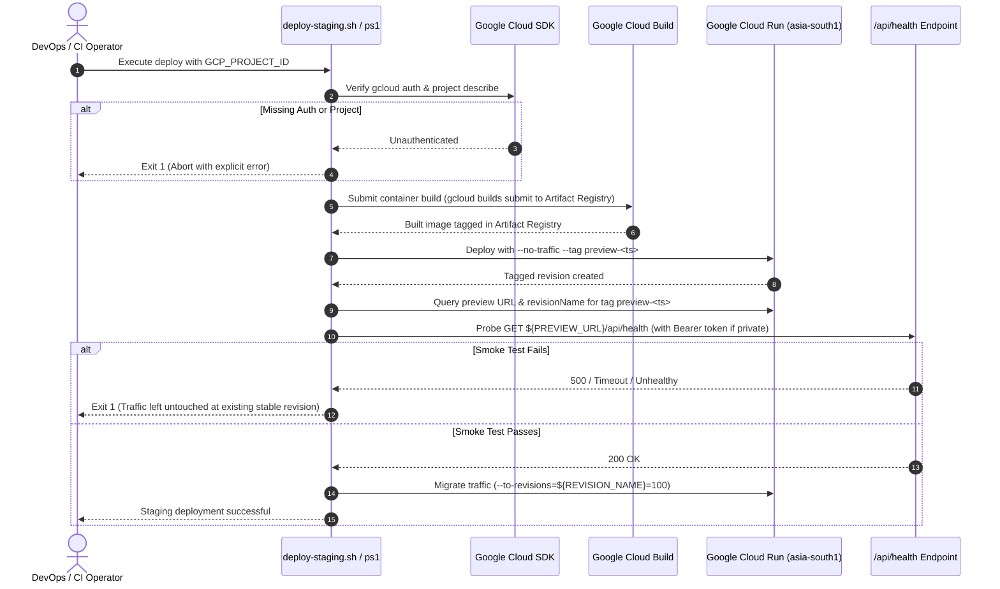

# Cloud Run Deployment and Staging Architecture (AE-231 / PR #355)

> [!NOTE]
> **Deployment Tooling Status: Draft Reference Template**  
> Per mentor review guidance on PR #355, deployment scripts and manifests in `deploy/` are reference templates and will not be automated or executed in production pipelines until deployment processes, project ownership, and IAM boundaries are agreed upon.

---

## 1. Executive Summary & Review Feedback Corrections

The Cloud Run deployment pipeline specifies how container images are deployed to Google Cloud Run in the `asia-south1` region. Based on architectural review feedback, the following critical safety corrections are codified:

| Dimension | Previous Defect | Corrected Architectural Standard |
| :--- | :--- | :--- |
| **GCP Project ID** | Hardcoded made-up project name (`iiit-hyd-assignment-eval`) | **Strictly required via `GCP_PROJECT_ID` environment variable**; scripts abort with exit code 1 if omitted. Manifest uses `${GCP_PROJECT_ID}` placeholder. |
| **Container Registry** | Deprecated `gcr.io` target | **Google Cloud Artifact Registry:** Images target `${REGION}-docker.pkg.dev/${PROJECT_ID}/assignment-evaluator/app:staging-latest`. Build requires Dockerfile from #353. |
| **Reserved PORT Env** | Manifest set `PORT=3000` | **PORT omitted from manifest:** Cloud Run reserves `PORT` for container ingress routing and prohibits custom specification. |
| **Traffic Migration** | 100% traffic immediately routed or `--to-latest` | **Exact Revision Cutover:** Looks up preview URL specifically by tag, runs smoke test, and shifts traffic to that exact verified revision (`--to-revisions=${REVISION_NAME}=100`). |
| **Private Service Auth** | Unauthenticated curl failed on private services | **Identity Token Injection:** Script captures `gcloud auth print-identity-token` and passes `Authorization: Bearer <token>` header for private endpoint smoke tests. |
| **Authentication Failures** | Exited `0` when `gcloud` was unauthenticated | **Exits `1` on auth/access failure:** Prevents false-positive build successes in CI/CD pipelines. |
| **IAM Policy Grants** | Granted `allUsers` invoker on every deployment | **Administrative One-Time IAM Setup:** Public invoker permissions are not reapplied on every deployment. |

---

## 2. Safe Deployment Workflow



---

## 3. Secret Management Integration

All sensitive credentials must be sourced from **GCP Secret Manager** rather than hardcoded or checked into version control:

| Environment Variable | Secret Manager Secret Name | Purpose |
| :--- | :--- | :--- |
| `MONGODB_URI` | `evaluator-mongodb-uri:latest` | Database connection string with replica set credentials |
| `NEXTAUTH_SECRET` | `evaluator-nextauth-secret:latest` | Session token signing and verification key (32+ chars) |
| `NEXTAUTH_URL` | `evaluator-nextauth-url:latest` | Canonical deployment URL for session cookies and redirects |
| `ORIGINAL_STORAGE_HMAC_SECRET` | `evaluator-original-hmac-secret:latest` | SHA-256 HMAC secret for immutable scan verification |

---

## 4. Operational Commands (Manual Reference)

```bash
# 1. Set required project environment variable
export GCP_PROJECT_ID="your-real-gcp-project-id"
export GCP_REGION="asia-south1"

# 2. Build and submit container image to Artifact Registry (requires Dockerfile from #353)
gcloud builds submit \
    --project="${GCP_PROJECT_ID}" \
    --tag="${GCP_REGION}-docker.pkg.dev/${GCP_PROJECT_ID}/assignment-evaluator/app:staging-latest" .

# 3. Deploy preview revision with no traffic
TAG_NAME="preview-$(date +%s)"
gcloud run deploy assignment-evaluator-staging \
    --project="${GCP_PROJECT_ID}" \
    --region="${GCP_REGION}" \
    --image="${GCP_REGION}-docker.pkg.dev/${GCP_PROJECT_ID}/assignment-evaluator/app:staging-latest" \
    --no-traffic \
    --tag="${TAG_NAME}"

# 4. Resolve exact preview URL and revision name for the deployed tag
PREVIEW_URL=$(gcloud run services describe assignment-evaluator-staging \
    --project="${GCP_PROJECT_ID}" \
    --region="${GCP_REGION}" \
    --format="value(status.traffic.filter(tag=${TAG_NAME}).url)")

REVISION_NAME=$(gcloud run services describe assignment-evaluator-staging \
    --project="${GCP_PROJECT_ID}" \
    --region="${GCP_REGION}" \
    --format="value(status.traffic.filter(tag=${TAG_NAME}).revisionName)")

# 5. Smoke test the preview URL (with identity token in case service is private)
ID_TOKEN=$(gcloud auth print-identity-token 2>/dev/null || echo "")
curl -sf -H "Authorization: Bearer ${ID_TOKEN}" "${PREVIEW_URL}/api/health"

# 6. Migrate traffic to the verified revision
gcloud run services update-traffic assignment-evaluator-staging \
    --project="${GCP_PROJECT_ID}" \
    --region="${GCP_REGION}" \
    --to-revisions="${REVISION_NAME}=100"
```
