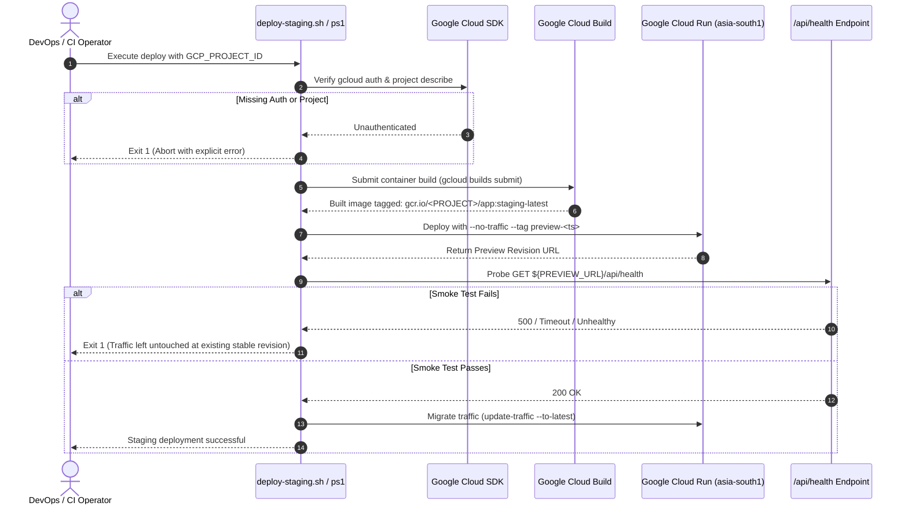

# Cloud Run Deployment and Staging Architecture (AE-231 / PR #355)

> [!NOTE]
> **Deployment Tooling Status: Draft Reference Template**  
> Per mentor review guidance on PR #355, deployment scripts and manifests in `deploy/` are reference templates and will not be automated or executed in production pipelines until deployment processes and IAM boundaries are agreed upon.

---

## 1. Executive Summary & Review Feedback Corrections

The Cloud Run deployment pipeline specifies how container images are deployed to Google Cloud Run in the `asia-south1` region. Based on architectural review feedback, the following critical safety corrections are codified:

| Dimension | Previous Defect | Corrected Architectural Standard |
| :--- | :--- | :--- |
| **GCP Project ID** | Hardcoded made-up project name (`iiit-hyd-assignment-eval`) | **Strictly required via `GCP_PROJECT_ID` environment variable**; scripts abort with exit code 1 if omitted. |
| **Traffic Migration** | 100% traffic immediately routed to new revision | **`--no-traffic` Preview Revision:** Revisions deploy with 0% traffic and a tagged preview URL. |
| **Health Verification** | No verification before cutover | **Automated Smoke Test:** Probes `${PREVIEW_URL}/api/health`; only shifts traffic if HTTP 200 is verified. |
| **Authentication Failures** | Exited `0` when `gcloud` was unauthenticated | **Exits `1` on auth/access failure:** Prevents false-positive build successes in CI/CD pipelines. |
| **IAM Policy Grants** | Granted `allUsers` invoker on every deployment | **Administrative One-Time IAM Setup:** Public invoker permissions are not reapplied on every deployment. |
| **Knative Spec Overwrite** | `services replace` would drop unlisted secrets/variables | **Incremental Deployment (`gcloud run deploy`):** Updates image and flags without wiping existing configuration. |

---

## 2. Safe Deployment Workflow



---

## 3. Secret Management Integration

All sensitive credentials must be sourced from **GCP Secret Manager** rather than hardcoded or checked into version control:

| Environment Variable | Secret Manager Secret Name | Purpose |
| :--- | :--- | :--- |
| `MONGODB_URI` | `evaluator-mongodb-uri:latest` | Database connection string with replica set credentials |
| `NEXTAUTH_SECRET` | `evaluator-nextauth-secret:latest` | Session token signing and verification key (32+ chars) |
| `NEXTAUTH_URL` | `evaluator-nextauth-url:latest` | Canonical deployment URL for session cookies and redirects |
| `ORIGINAL_STORAGE_HMAC_SECRET` | `evaluator-original-hmac-secret:latest` | SHA-256 HMAC secret for immutable scan verification |

---

## 4. Operational Commands (Manual Reference)

```bash
# 1. Set required project environment variable
export GCP_PROJECT_ID="your-real-gcp-project-id"
export GCP_REGION="asia-south1"

# 2. Deploy preview revision with no traffic
gcloud run deploy assignment-evaluator-staging \
    --project="${GCP_PROJECT_ID}" \
    --region="${GCP_REGION}" \
    --image="gcr.io/${GCP_PROJECT_ID}/assignment-evaluator:staging-latest" \
    --no-traffic \
    --tag="preview"

# 3. Smoke test the preview URL
curl -f https://preview---assignment-evaluator-staging-xxxx.asia-south1.run.app/api/health

# 4. Migrate traffic after verification
gcloud run services update-traffic assignment-evaluator-staging \
    --project="${GCP_PROJECT_ID}" \
    --region="${GCP_REGION}" \
    --to-latest
```
