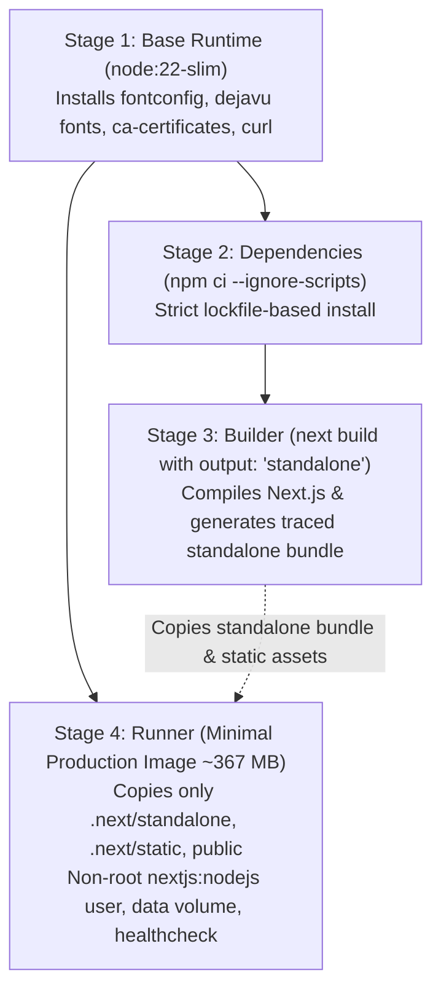

# Production Containerization & Docker Compose Architecture

**Document:** `docs/DOCKER.md`  
**Reference:** Week 12 · Day 3 — Deployment and Scaling (AE-230 / Issue #352 / PR #353)  
**Status:** Canonical Reference

---

> [!WARNING]
> **Critical Cloud Run Deployment Warning (Do Not Merge Unverified)**  
> Merging a root `Dockerfile` alters Google Cloud Run build behavior: `gcloud run deploy --source .` automatically switches from Google Cloud Buildpacks to building the root `Dockerfile`.  
> **Operational Rule:** Keep this PR as a draft and do not merge to `main` until this container image has been fully tested as a `--no-traffic` preview revision.

---

## 1. Executive Summary

This document specifies the production containerization architecture for the Exam Evaluation Platform, providing:
1. **Next.js Standalone Multi-Stage Build (`Dockerfile`):** Minimizes image size from ~1.2 GB to ~367 MB using Next.js `output: 'standalone'`, copying only traced production modules.
2. **Reproducible Dependency Hygiene:** Strictly enforces `npm ci --ignore-scripts` without fallback to `npm install`, preventing silent lockfile drift.
3. **MongoDB Replica Set Orchestration (`docker-compose.yml`):** Automatically initializes a single-node replica set (`rs0`) required for multi-document Mongoose transactions.
4. **Network & Credential Isolation:** Removes unauthenticated public MongoDB host port exposure, restricting database traffic strictly to the internal Docker bridge network.

---

## 2. Multi-Stage Dockerfile Architecture

The production `Dockerfile` uses a 4-stage build pipeline based on `node:22-slim`:



### 2.1 Next.js Standalone Optimization
Without `output: 'standalone'`, a Next.js container must copy the entire `node_modules` tree, resulting in an unwieldy **1.2 GB** image.  
With `output: 'standalone'` enabled in `next.config.ts`, Next.js performs static module tracing and outputs a self-contained Node.js server to `.next/standalone/server.js`, including only packages actively imported by production routes.

The final runner stage copies only:
- `/app/public`
- `/app/.next/standalone`
- `/app/.next/static`

**Resulting Image Size:** ~367 MB (a ~70% reduction vs full node_modules).

### 2.2 Security Controls
- **Unprivileged Execution:** Runs strictly under `USER nextjs` (UID 1001 / GID 1001).
- **No Build Scripts in Deps:** Dependencies are installed with `--ignore-scripts` to mitigate supply-chain preinstall script execution.
- **Deterministic Builds:** No `|| npm install` fallback; if `package-lock.json` drifts or is out of sync, the Docker build fails fast.
- **Canvas Rendering Support:** `fontconfig` and `fonts-dejavu-core` are installed in the base image, ensuring `@napi-rs/canvas` renders test and annotation glyphs consistently across headless environments.

---

## 3. Docker Compose Orchestration & Replica Set Requirement

### 3.1 MongoDB Replica Set (`rs0`)
The application requires MongoDB transactions for atomic grade finalization, batch script allocation, and ingestion locking. Standalone MongoDB instances reject transactions with:
```
MongoServerError: Transaction numbers are only allowed on a replica set member or mongos
```

`docker-compose.yml` resolves this by:
1. Passing `--replSet rs0 --bind_ip_all` to `mongod`.
2. Running an automated replica set healthcheck that initiates `rs0` on first boot:
```yaml
healthcheck:
  test: >
    mongosh --quiet --eval "
      try {
        rs.status().ok
      } catch (e) {
        rs.initiate({
          _id: 'rs0',
          members: [{ _id: 0, host: 'mongodb:27017' }]
        }).ok || rs.status().ok
      }
    "
```
3. Connecting the application via:
```
MONGODB_URI=mongodb://mongodb:27017/assignment_evaluator?replicaSet=rs0
```
*(Note: `directConnection=true` is deliberately omitted so the MongoDB Node.js driver discovers the `rs0` replica set topology rather than reporting "Single", allowing `validateMongoTopology` to succeed in production mode).*

### 3.2 Network Isolation & Secrets
- **No Host Port Exposure:** Port `27017` is removed from host port mappings (`ports:`). MongoDB is accessible solely to containers joined to `assignment_evaluator_network`.
- **Enforced Secrets:** Critical secrets (`NEXTAUTH_SECRET`, `ORIGINAL_STORAGE_HMAC_SECRET`) are strictly enforced using `${VAR:?error}` variable expansion in `docker-compose.yml`. Compose fails fast if these are unset, preventing default or hard-coded secrets. A template is provided in `.env.compose.example`.

---

## 4. Operational Commands

```bash
# 1. Copy compose environment template
cp .env.compose.example .env

# 2. Build and launch services in background
docker compose up -d --build

# 3. Check health status of app and MongoDB replica set
docker compose ps

# 4. View application logs
docker compose logs -f app

# 5. Verify HTTP health check
curl -f http://localhost:3000/api/health

# 6. Stop containers (preserves volume data)
docker compose down
```
