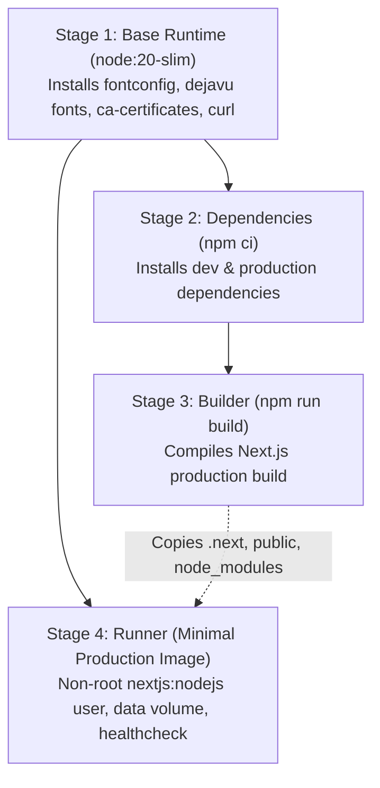

# Production Containerization & Docker Compose Guide

**Document:** `docs/DOCKER.md`  
**Reference:** Week 12 · Day 3 — Deployment and Scaling (AE-230 / Issue #352)  
**Status:** Canonical Reference

---

## 1. Executive Summary

This document specifies the containerization architecture for the Exam Evaluation Platform, providing multi-stage build definitions (`Dockerfile`), image hygiene controls (`.dockerignore`), and orchestrated local/production deployments (`docker-compose.yml`) with MongoDB, persistent volume mounts, and automated health checks.

---

## 2. Multi-Stage Docker Build Architecture

The production `Dockerfile` uses a 4-stage build pipeline on top of `node:20-slim`:



### 2.1 Security & Optimization Highlights
1. **Unprivileged Runtime Execution:**
   - The container creates a dedicated system group `nodejs` (GID 1001) and system user `nextjs` (UID 1001).
   - The application executes strictly under `USER nextjs`, eliminating root privilege escalation risks.
2. **System Font Support for Canvas Rendering:**
   - Packages `fontconfig` and `fonts-dejavu-core` are installed in the base image, ensuring `@napi-rs/canvas` reliably renders test, deskew, and annotation text inside headless Linux containers.
3. **Layer Caching:**
   - Package manifests (`package.json`, `package-lock.json`) are copied independently before application source code, maximizing Docker layer cache reusability.
4. **Image Hygiene (`.dockerignore`):**
   - Development caches (`node_modules`, `.next`, `coverage`), secrets (`.env*`, `*.pem`), and repository metadata (`.git`) are excluded from image context.

---

## 3. Docker Compose Orchestration

The platform provides a complete, turnkey Docker Compose deployment in `docker-compose.yml`:

| Service | Image / Build | Ports | Volumes | Health Check |
| :--- | :--- | :---: | :--- | :--- |
| **`app`** | Multi-stage build (`Dockerfile`) | `3000:3000` | `app_data:/app/data` | `curl -f http://localhost:3000/api/health` |
| **`mongodb`** | `mongo:7.0` | `27017:27017` | `mongo_data:/data/db` | `mongosh --eval "db.adminCommand('ping')"` |

### 3.1 Persistent Volumes
- **`mongo_data` (`assignment_evaluator_mongo_data`):** Preserves MongoDB collections (courses, exams, answer scripts, grades, audit logs) across container restarts.
- **`app_data` (`assignment_evaluator_app_data`):** Preserves immutable original scans (`/app/data/originals`) and derived enhanced pages (`/app/data/derived`).

---

## 4. Operational Commands & Deployment

### 4.1 Building and Running
```bash
# Build images and start all services in detached background mode
docker compose up -d --build

# View real-time container logs
docker compose logs -f app

# Inspect container health statuses
docker compose ps
```

### 4.2 Verifying Container Health
```bash
# Verify MongoDB container health
docker compose exec mongodb mongosh --eval "db.adminCommand('ping')"

# Verify Application HTTP health check
curl -f http://localhost:3000/api/health
```

### 4.3 Stopping and Cleanup
```bash
# Stop containers (preserves persistent volumes)
docker compose down

# Stop containers and wipe volumes (destructive reset)
docker compose down -v
```
