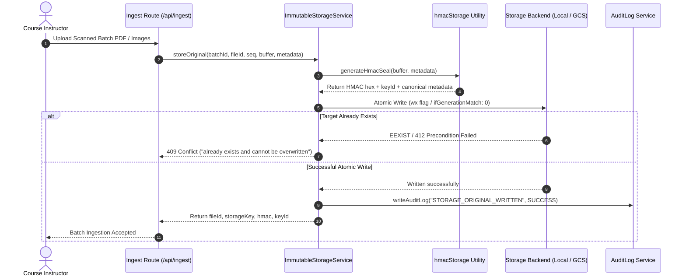

# Immutability and WORM Enforcement Architecture

**Document:** `docs/IMMUTABILITY_WORM.md`  
**Reference:** Week 12 · Day 2 — Security and Compliance (AE-227 / Issue #346)  
**Status:** Canonical Reference

---

## 1. Executive Summary

In academic examination grading, scan batches of handwritten answer sheets and published final evaluations constitute legal records of student performance. Any modification, silent truncation, or undetected tampering of original scanned scripts undermines academic integrity.

This document specifies the **Write-Once-Read-Many (WORM)** architecture, cryptographic HMAC tamper-detection mechanism, and metadata-binding protocols implemented by the platform. Crucially, it delineates the exact boundary between **application-level software guarantees** and **infrastructure-level hardware retention locks**.

---

## 2. Realistic Enforcement Boundaries: Software vs. Infrastructure WORM

> [!IMPORTANT]
> **No Unsubstantiated Infrastructure Claims**  
> Software alone cannot prevent a privileged root administrator or storage bucket owner from deleting an entire disk partition or deleting an unlocked cloud bucket. True infrastructure-level WORM requires cloud compliance retention locks.

| Dimension | Application-Level WORM (Current System) | Infrastructure-Level WORM (Cloud Compliance) |
| :--- | :--- | :--- |
| **Enforcement Mechanism** | `ImmutableStorageService` using atomic POSIX `wx` flags & GCS `ifGenerationMatch: 0` | GCS Bucket Lock / AWS S3 Object Lock (Compliance Mode) |
| **Overwrite Protection** | Throws HTTP `409 Conflict` if target file or object exists | Cloud storage API rejects overwrite regardless of credentials |
| **Deletion Protection** | Application API provides no delete route for originals | Cloud rejects deletion until retention period expires (even by root/owner) |
| **Tamper Detection** | Cryptographic HMAC-SHA256 seal verified on every read | Storage backend immutability + client-side integrity validation |
| **Privileged Bypass Risk** | System administrator with direct filesystem/GCS shell access | Cannot be bypassed or unlocked even by cloud project owners |
| **Current Platform Status** | **Fully Enforced in Code & Verified in CI** | **Architecture Config Option (Planned GCP Compliance Lock)** |

---

## 3. Storage Pipeline & Immutability Workflow

---

## 4. Cryptographic HMAC Tamper Detection & Metadata Binding

### 4.1 Canonical Metadata Binding Protocol
To prevent "cut-and-paste" attacks where a valid page from Exam A is transplanted into Exam B without modifying the file bytes, the cryptographic HMAC seal covers **both the raw content bytes and canonical binding metadata**.

The canonical metadata serialization produces a deterministic byte stream:
$$\text{CanonicalMeta} = \texttt{"batchId="} \parallel \text{batchId} \parallel \texttt{"\&seq="} \parallel \text{seq} \parallel \texttt{"\&uploader="} \parallel \text{uploader} \parallel \texttt{"\&ts="} \parallel \text{timestamp}$$

### 4.2 Delimited HMAC Computation
The HMAC-SHA256 digest is generated over:
$$\text{HMAC} = \operatorname{HMAC-SHA256}\Big(\text{Secret}_{K_{\text{id}}},\; \text{ContentBytes} \parallel \texttt{"\textbackslash x00--METADATA\_BINDING--\textbackslash x00"} \parallel \text{CanonicalMeta}\Big)$$

The null-byte delimiter (`\x00--METADATA_BINDING--\x00`) strictly separates raw file content from the metadata segment, eliminating extension attacks or ambiguity in the input stream.

### 4.3 Key Rotation & Isolation
- **Active Key:** Configured via `ORIGINAL_STORAGE_KEY_ID` (default `v1`) and `ORIGINAL_STORAGE_HMAC_SECRET`.
- **Historical Keys:** Looked up via `ORIGINAL_STORAGE_HMAC_SECRET_<KEYID>`.
- **Strict Key Isolation:** The verifier **never** falls back to the active key if a historical key secret is missing. An unavailable key yields an explicit operational error, preventing forged validations.
- **Timing-Attack Resistance:** HMAC comparisons are evaluated using constant-time byte comparisons (`crypto.timingSafeEqual`) to prevent timing side-channel attacks.

---

## 5. Tamper Detection Scenarios

| Tampering Attempt | Detection Mechanism | Result |
| :--- | :--- | :--- |
| **Byte Flip in PDF/Scan** | HMAC mismatch on read | `500 Original file integrity verification failed: HMAC signature verification failed (tamper detected)` |
| **Re-upload Overwrite** | POSIX `flag: 'wx'` / GCS `ifGenerationMatch: 0` | `409 Original file already exists and cannot be overwritten` |
| **Metadata Forgery (Changed Uploader)** | Delimited metadata canonicalization mismatch | Verification fails; tamper recorded in audit log |
| **Sequence Number Shift** | Delimited metadata canonicalization mismatch | Verification fails; tamper recorded in audit log |
| **Transplanted Batch ID** | Binding metadata mismatch with Batch document | Verification fails; tamper recorded in audit log |
| **Key Confusion / Downgrade** | Exact `keyId` lookup without fallback | Throws missing key error; prevents unauthorized validation |

---

## 6. Audit Trail & Verification Logs

Every storage operation generates a tamper-evident audit log:
- **`STORAGE_ORIGINAL_WRITTEN` (SUCCESS):** Logs user, `batchId`, `fileId`, `storageKey`, `size`, and `keyId`.
- **`STORAGE_ORIGINAL_WRITTEN` (FAILURE):** Logs failed write attempts, duplicate key conflicts, or disk errors.
- **`INTEGRITY_MISMATCH` / Authorization Failure:** Logs any failed verification attempt, recording the caller identity and mismatch details.
