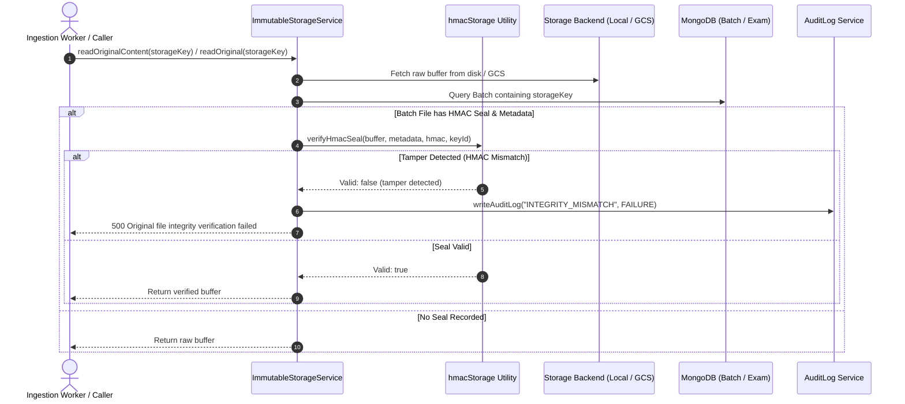

# Immutability and WORM Enforcement Architecture & Gap Analysis

**Document:** `docs/IMMUTABILITY_WORM.md`  
**Reference:** Week 12 · Day 2 — Security and Compliance (AE-227 / Issue #346 / PR #347)  
**Status:** Canonical Reference

---

## 1. Executive Summary

In academic examination grading, scan batches of handwritten answer sheets and published final evaluations constitute legal records of student performance. Any modification, silent truncation, or undetected tampering of original scanned scripts or published grades undermines academic integrity.

This document specifies the **Write-Once-Read-Many (WORM)** architecture, Mongoose model-level hooks, read-path cryptographic HMAC tamper-detection mechanism, and metadata-binding protocols implemented by the platform. It provides an honest **Gap Analysis** delineating the exact boundary between **application-level software guarantees** and **infrastructure-level hardware retention locks**.

---

## 2. Realistic Enforcement Boundaries: Software vs. Infrastructure WORM (Gap Analysis)

> [!IMPORTANT]
> **No Unsubstantiated Infrastructure Claims**  
> Software-level controls (Mongoose model hooks, POSIX `wx` flags, HMAC verification) protect against application bugs, rogue API calls, and accidental data deletion. However, software alone **cannot** prevent a privileged root system administrator, compromised database superuser, or raw disk operator from wiping or tampering with data directly at the hardware layer. True immutable WORM compliance requires cloud compliance retention locks.

| Dimension | Application-Level WORM (Enforced in Code) | Infrastructure-Level WORM (Cloud Compliance) |
| :--- | :--- | :--- |
| **Enforcement Mechanism** | `ImmutableStorageService` (POSIX `wx` / GCS `ifGenerationMatch: 0`) + Central Repositories (`ExamRepository`, `BatchRepository`) + Mongoose Schema Hooks (`pre('save')`, `pre('bulkWrite')`, query hooks) | GCS Bucket Lock / AWS S3 Object Lock (Compliance Mode) |
| **Overwrite Protection** | Throws HTTP `409 Conflict` if target file or object exists | Cloud storage API rejects overwrite regardless of credentials |
| **Deletion Protection** | Pre-delete hooks and repository/service guards block both hard deletion (`deleteOne`, `deleteMany`, `findOneAndDelete`, `bulkWrite`) and soft deletion (`isActive: false` via API, `save()`, or update queries) for sealed `Batch` and published `Exam` records | Cloud rejects object/bucket deletion until retention period expires (even by root/owner) |
| **Mutation Protection** | Pre-update, `save()`, `replaceOne`, `findOneAndReplace`, and `bulkWrite` hooks reject modification of sealed files in `Batch` ($unset, $pop, $pull, dotted paths like `files.0.storageKey`) and core parameters/isActive on published `Exam` | Underlying cloud objects cannot be modified or replaced |
| **Tamper Detection on Read** | Cryptographic HMAC-SHA256 seal verified on **every read** (`readOriginalContent`, `readOriginal`) with fail-closed enforcement on lookup failures | Storage backend immutability + client-side integrity validation |
| **Audit on Tampering** | Emits `INTEGRITY_MISMATCH` audit event with caller and file details | Cloud Audit Logs / S3 Server Access Logs record unauthorized API attempts |
| **Privileged Bypass Risk (Gap)** | **Vulnerable** to direct MongoDB shell commands or direct OS filesystem manipulation | **Immune**; cloud compliance locks cannot be bypassed or shortened even by project owners |
| **Current Platform Status** | **Enforced in Code & Verified in CI (Full mutation & soft-deletion guards; fail-closed reader; no test-env bypasses)** | **Architecture Config Option (Requires Cloud Bucket Retention Policy)** |

---

## 3. Model-Level & Repository WORM Immutability Hooks

To prevent application-level tampering or accidental deletion through admin interfaces, direct document updates, or scripts, the platform implements comprehensive pre-execution hooks in Mongoose and validation in central repositories:

### 3.1 Batch Model Hooks (`src/models/Batch.ts`)
1. **Deletion Guard (`deleteOne`, `deleteMany`, `findOneAndDelete`, `bulkWrite`):**
   - Inspects target batches. If any batch contains sealed files (records with an `hmac` seal), deletion is blocked with:
     `Cannot delete batch "<batchId>" containing sealed original files (WORM immutability enforcement)`
   - No `NODE_ENV === 'test'` bypass exists; automated test teardown uses explicit driver-level collection clearing or sanctioned bypass options.
2. **File Mutation Guard (`updateOne`, `updateMany`, `findOneAndUpdate`, `replaceOne`, `findOneAndReplace`, `bulkWrite`, `save`):**
   - Blocks any mutation attempting to `$set`, `$pull`, `$push`, `$pop`, or `$unset` the `files` array of a sealed batch.
   - Detects and blocks dotted-path mutations such as `files.0.storageKey` or index-based property overrides.
   - Enforces `save()` document middleware preventing in-memory modification of sealed files.

### 3.2 Exam Model Hooks (`src/models/Exam.ts`)
1. **Deletion Guard (`deleteOne`, `deleteMany`, `findOneAndDelete`, `bulkWrite`):**
   - If an exam has status `PUBLISHED`, deletion is rejected with:
     `Cannot delete published exam "<title>" (WORM immutability enforcement)`
2. **Soft Deletion & Core Parameter Guard (`updateOne`, `updateMany`, `findOneAndUpdate`, `replaceOne`, `findOneAndReplace`, `bulkWrite`, `save`):**
   - For published exams, alterations to `course` (preventing tenancy kidnapping), `totalMarks` (preventing grade corruption), or `isActive: false` (preventing soft deletion) are rejected with:
     `Cannot alter course/totalMarks/isActive of published exam "<title>" (WORM immutability enforcement)`
   - Document-level `pre('save')` hook blocks property reassignments and status/activity tampering.
3. **Repository & Service Layer Enforcement (`ExamRepository`, `ExamService`):**
   - `ExamRepository.deleteExam` and `ExamService.deleteExam` check publication status and throw HTTP `400` WORM error before performing soft-deletion.

---

## 4. Storage Pipeline & Read-Path Verification

---

## 5. Cryptographic HMAC Tamper Detection & Metadata Binding

### 5.1 Canonical Metadata Binding Protocol
To prevent "cut-and-paste" attacks where a valid page from Exam A is transplanted into Exam B without modifying the file bytes, the cryptographic HMAC seal covers **both raw content bytes and canonical binding metadata**:
$$\text{CanonicalMeta} = \texttt{"batchId="} \parallel \text{batchId} \parallel \texttt{"\&seq="} \parallel \text{seq} \parallel \texttt{"\&uploader="} \parallel \text{uploader} \parallel \texttt{"\&ts="} \parallel \text{timestamp}$$

### 5.2 Delimited HMAC Computation
$$\text{HMAC} = \operatorname{HMAC-SHA256}\Big(\text{Secret}_{K_{\text{id}}},\; \text{ContentBytes} \parallel \texttt{"\textbackslash x00--METADATA\_BINDING--\textbackslash x00"} \parallel \text{CanonicalMeta}\Big)$$

The null-byte delimiter (`\x00--METADATA_BINDING--\x00`) strictly separates raw file content from the metadata segment, eliminating ambiguity.

### 5.3 Key Rotation & Isolation
- **Active Key:** Configured via `ORIGINAL_STORAGE_KEY_ID` (default `v1`) and `ORIGINAL_STORAGE_HMAC_SECRET`.
- **Historical Keys:** Looked up via `ORIGINAL_STORAGE_HMAC_SECRET_<KEYID>`.
- **Strict Key Isolation:** The verifier **never** falls back to the active key if a historical key secret is missing. An unavailable key yields an explicit operational error.
- **Timing-Attack Resistance:** HMAC comparisons are evaluated using constant-time byte comparisons (`crypto.timingSafeEqual`).

---

## 6. Audit Trail & Verification Events

Every storage operation and verification failure generates a tamper-evident audit log:
- **`STORAGE_ORIGINAL_WRITTEN` (SUCCESS):** Logs user, `batchId`, `fileId`, `storageKey`, `size`, and `keyId`.
- **`STORAGE_ORIGINAL_WRITTEN` (FAILURE):** Logs failed write attempts, duplicate key conflicts, or disk errors.
- **`INTEGRITY_MISMATCH` (FAILURE):** Logged whenever `readOriginalContent` or `readOriginal` detects byte-level corruption or metadata mismatch on storage assets, recording the `storageKey`, `batchId`, `fileId`, and specific failure reason.
