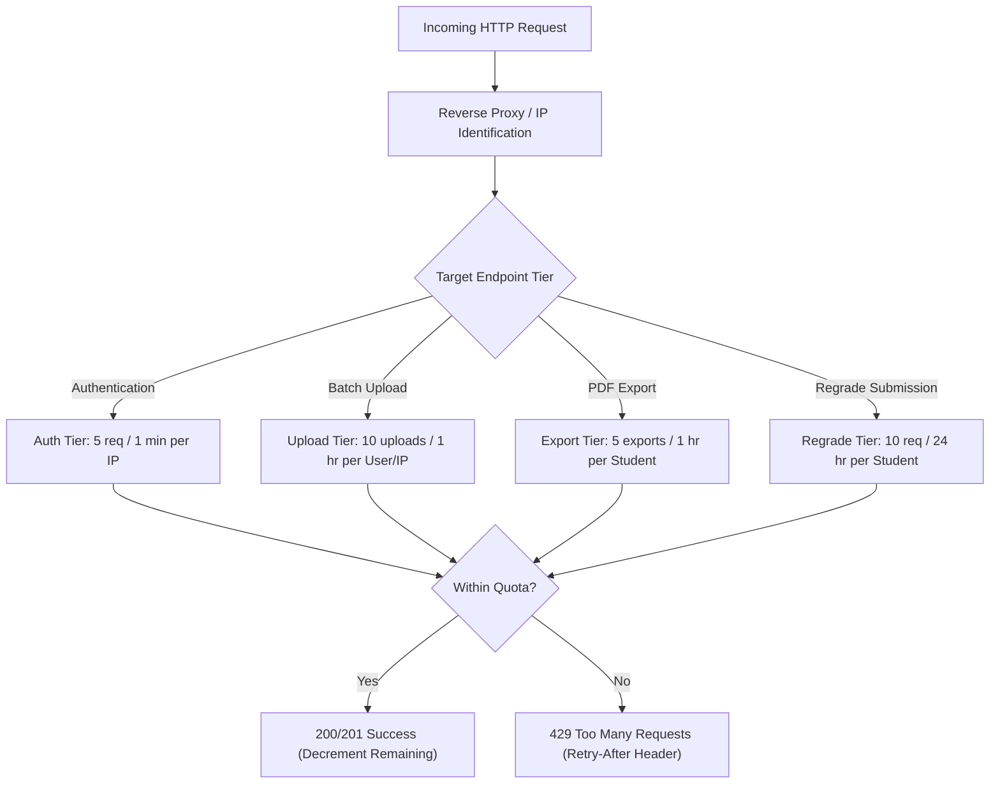

# Rate Limiting & Input Validation Architecture

**Document:** `docs/RATE_LIMITING_VALIDATION.md`  
**Reference:** Week 12 · Day 2 — Security and Compliance (AE-229 / Issue #350)  
**Status:** Canonical Reference

---

## 1. Executive Summary

This document specifies the platform's multi-tiered rate limiting architecture, payload size controls, magic byte file validation rules, and schema validation defenses. These mechanisms protect the platform from denial-of-service (DoS) attacks, brute-force credential stuffing, malicious file uploads, and resource exhaustion.

---

## 2. Multi-Tiered Rate Limiting Policies

The platform enforces sliding-window rate limiting across sensitive operations via `src/lib/rateLimit.ts`:



### 2.1 Configuration Tiers & Thresholds

| Tier | Window | Max Quota | Key Namespace | Target Attack / Risk Mitigated |
| :--- | :---: | :---: | :--- | :--- |
| **`AUTH`** | 1 minute | 5 requests | `auth:ip:<clientIp>` | Brute-force credential stuffing, password reset spamming, registration flooding |
| **`UPLOAD`** | 1 hour | 10 uploads | `upload:user:<userId>` | Storage backend flooding, OCR worker overload, disk exhaustion |
| **`STUDENT_EXPORT`** | 1 hour | 5 exports | `export:user:<studentId>` | Canvas rendering CPU exhaustion, memory buffer starvation |
| **`REGRADE_REQUEST`** | 24 hours | 10 requests | `regrade:user:<studentId>` | Teaching assistant evaluation queue spamming |

### 2.2 Standard HTTP 429 Response & Headers
When a client exceeds their quota, the platform returns `HTTP 429 Too Many Requests` with RFC-compliant headers:
```http
HTTP/1.1 429 Too Many Requests
Content-Type: application/json
Retry-After: 48
X-RateLimit-Limit: 5
X-RateLimit-Remaining: 0
X-RateLimit-Reset: 1700000060
Cache-Control: no-store, private

{
  "success": false,
  "message": "Too many requests. Please try again later.",
  "data": {
    "retryAfterSeconds": 48
  }
}
```

---

## 3. Strict Input & File Payload Validation

### 3.1 Magic Byte File Validation (Content Sniffing Protection)
Rather than relying on client-supplied `Content-Type` headers or file extensions (which can be easily spoofed), `src/utils/fileValidation.ts` inspects initial byte signatures:

| File Format | Header / Magic Bytes | Byte Inspection Rule |
| :--- | :--- | :--- |
| **PDF** | `%PDF-` (`0x25 0x50 0x44 0x46`) | Scanned within first 1,024 bytes of buffer |
| **JPEG** | `0xFF 0xD8 0xFF` | First 3 bytes of buffer |
| **PNG** | `0x89 0x50 0x4E 0x47 0x0D 0x0A 0x1A 0x0A` | First 8 bytes of buffer |
| **WebP** | `RIFF` (`0..3`) + `WEBP` (`8..11`) | Byte positions 0–3 and 8–11 |
| **TIFF** | `0x49 0x49 0x2A 0x00` (LE) or `0x4D 0x4D 0x00 0x2A` (BE) | First 4 bytes of buffer |

Any file whose magic bytes do not match an allowed format is immediately rejected with `400 Bad Request`, preventing executable or script injection.

### 3.2 Resource & Batch Bounds
To prevent memory exhaustion during PDF parsing and image manipulation:
- **`MAX_SINGLE_FILE_SIZE`:** 50 MB (`52,428,800` bytes). Rejects oversized files with `413 Payload Too Large`.
- **`MAX_FILES_PER_BATCH`:** 20 files per upload batch.
- **`MAX_TOTAL_REQUEST_SIZE`:** 200 MB (`209,715,200` bytes).
- **`MAX_PDF_PAGE_COUNT`:** 200 pages per PDF document.

### 3.3 Identifier & Parameter Sanitization
1. **MongoDB ObjectId Format:**
   - All entity parameters (`examId`, `courseId`, `scriptId`, `userId`) are strictly validated using 24-character hexadecimal regex (`/^[0-9a-fA-F]{24}$/`) before query execution.
   - Non-hex strings, object injection payloads (`{"$gt": ""}`), or SQL injection fragments are rejected with `400 Invalid Identifier Format`.
2. **Schema-Level Validation (Zod):**
   - User Registration: Name min 3 chars, valid email, password min 8 chars, role constrained strictly to `'STUDENT'`.
   - Course Creation: Code trimmed and uppercase, title min 3 max 100 chars.
   - Regrade Submission: Reason string trimmed min 10 max 2,000 chars, positive question number integer.

---

## 4. Abuse Prevention Matrix

| Attack Vector | Defense Mechanism | Response |
| :--- | :--- | :---: |
| **Credential Stuffing / Password Guessing** | 5 attempts / min per IP on `/api/auth/*` | `429 Too Many Requests` |
| **Malicious Executable Disguised as PDF** | Magic byte inspection (`%PDF-`) | `400 Unsupported file format` |
| **Zip Bomb / 500MB Scan Payload** | `MAX_SINGLE_FILE_SIZE` (50MB) check | `413 Payload Too Large` |
| **10,000 Page PDF Denial of Service** | `MAX_PDF_PAGE_COUNT` (200 pages) check | `400 Page count exceeds limit` |
| **Concurrent PDF Export Memory Exhaustion** | 1 concurrent export semaphore + 5/hr rate limit | `429 / 503 Capacity reached` |
| **NoSQL Operator Injection (`$where`, `$gt`)** | Zod scalar parsing & 24-char ObjectId validation | `400 Validation failed` |
| **Regrade Queue Flooding** | 10 requests / 24 hr per student | `429 Too Many Requests` |
