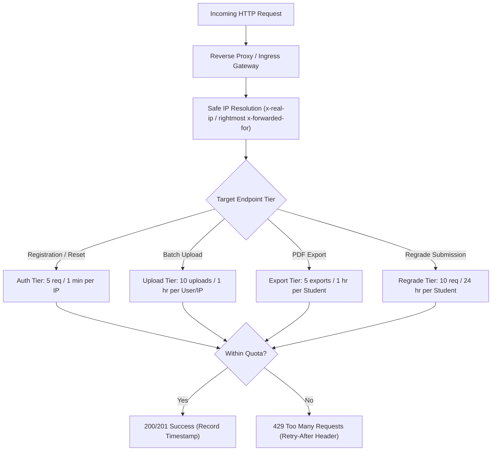

# Rate Limiting & Input Validation Architecture

**Document:** `docs/RATE_LIMITING_VALIDATION.md`  
**Reference:** Week 12 · Day 2 — Security and Compliance (AE-229 / Issue #350 / PR #351)  
**Status:** Canonical Reference

---

## 1. Executive Summary

This document specifies the platform's sliding-window rate limiting engine, client IP resolution model, memory management bounds, input validation schemas, and magic byte file inspection rules. It provides an honest **Gap Analysis** contrasting node-local in-memory sliding windows with distributed cloud rate limiting (Cloud Armor / Redis).

---

## 2. Multi-Tiered Rate Limiting Policies

The platform enforces sliding-window rate limiting across sensitive operations via `src/lib/rateLimit.ts`:



### 2.1 Configuration Tiers & Thresholds

| Tier | Window | Max Quota | Key Namespace | Target Attack / Risk Mitigated |
| :--- | :---: | :---: | :--- | :--- |
| **`AUTH`** | 1 minute | 5 requests | `auth:register:ip:<ip>`, `auth:reset:ip:<ip>` | Brute-force credential stuffing, registration flooding, password reset spamming |
| **`UPLOAD`** | 1 hour | 10 uploads | `upload:user:<userId>` | Storage backend flooding, OCR worker overload, disk exhaustion |
| **`STUDENT_EXPORT`** | 1 hour | 5 exports | `export:user:<studentId>` | Canvas rendering CPU exhaustion, memory buffer starvation |
| **`REGRADE_REQUEST`** | 24 hours | 10 requests | `regrade:user:<studentId>` | Teaching assistant evaluation queue spamming |

---

## 3. Architecture & Gap Analysis: In-Memory vs. Distributed Cloud Limiting

### 3.1 Node-Local In-Memory Scope
- **Mechanism:** In-process sliding-window bucket store (`Map<string, number[]>`) in `src/lib/rateLimit.ts`.
- **Application Endpoints:** Enforced directly in route handlers:
  - `POST /api/auth/register` (5 attempts / 60s per IP)
  - `POST /api/auth/reset` (5 attempts / 60s per IP)
- **Single-Instance Guarantee:** On a single server instance or local container, bursts exceeding the threshold are immediately rejected with `429 Too Many Requests`.

### 3.2 Horizontal Scaling Limitation (Cloud Run Multi-Instance)
> [!IMPORTANT]
> **Cloud Run Multi-Instance Gap Analysis**  
> In serverless environments like Google Cloud Run, requests are distributed across multiple ephemeral container instances. An in-memory store in Container A cannot observe requests hitting Container B. A distributed attacker whose requests round-robin across 5 instances could theoretically make up to $5 \times 5 = 25$ attempts before individual containers saturate.

### 3.3 Target Cloud Architecture
For true cluster-wide rate limiting across horizontal Cloud Run instances:
1. **Google Cloud Armor (Recommended at Ingress):**
   - Configured on Google Cloud HTTP(S) Load Balancer.
   - Throttles malicious IP ranges and credential stuffing before traffic ever reaches Cloud Run containers, saving compute resources.
2. **Centralized Redis Store (Memorystore):**
   - Cloud Run instances connect via Serverless VPC Access to a managed Redis instance.
   - Atomic Redis commands (`ZADD`, `ZREMRANGEBYSCORE`, `ZCARD`) provide cluster-synchronized sliding windows.
3. **MongoDB Token Bucket (Low Traffic Alternative):**
   - Atomic `$inc` and TTL index document updates directly in MongoDB collections.

---

## 4. Safe Client IP Resolution & Memory Management

### 4.1 Client-Controlled `X-Forwarded-For` Vulnerability Defense
- **The Vulnerability:** An attacker can craft requests with `X-Forwarded-For: 1.1.1.1`. If an application blindly reads `x-forwarded-for.split(',')[0]`, the attacker can rotate the header value on every request to bypass rate limiting completely.
- **The Defense:** `getClientIdentifier` in `src/lib/rateLimit.ts`:
  1. Checks `x-real-ip` first (set directly by the authoritative edge reverse-proxy).
  2. If using `x-forwarded-for`, reads the **rightmost** (last) entry appended by the trusted ingress reverse proxy (`parts[parts.length - 1]`), ensuring client-injected headers cannot bypass quota tracking.
  3. Falls back to user identifier (`user:<userId>`) for authenticated student/instructor routes.

### 4.2 Memory Leak Prevention & Eviction Bounds
- **Bounded Capacity:** Capped at `MAX_RATE_LIMIT_ENTRIES = 10,000` entries.
- **Active Timestamp Pruning:** Expired timestamps older than the sliding window are pruned on every check.
- **Store Size Recovery:** When the store reaches capacity, `pruneRateLimitStore()` executes a sweep, deleting inactive buckets where all timestamps have lapsed.

---

## 5. Standard HTTP 429 Response & Headers

When quota is exceeded, the server returns `HTTP 429 Too Many Requests` with standard RFC headers:
```http
HTTP/1.1 429 Too Many Requests
Content-Type: application/json
Retry-After: 48
X-RateLimit-Limit: 5
X-RateLimit-Remaining: 0
X-RateLimit-Reset: 1700000060
Cache-Control: no-store, private

{
  "success": false,
  "message": "Too many registration attempts. Please try again later.",
  "data": {
    "retryAfterSeconds": 48
  }
}
```

---

## 6. Input Validation & Magic Byte Defense

1. **Magic Byte Inspection (`src/utils/fileValidation.ts`):**
   - PDF: `%PDF-` (`0x25 0x50 0x44 0x46`)
   - JPEG: `0xFF 0xD8 0xFF`
   - PNG: `0x89 0x50 0x4E 0x47 0x0D 0x0A 0x1A 0x0A`
   - WebP: `RIFF` + `WEBP`
   - TIFF: `II*\0` (LE) or `MM\0*` (BE)
2. **Batch & Resource Limits:**
   - Single file size: 50MB
   - Total batch size: 200MB
   - Files per batch: 20
   - PDF page count: 200 pages
3. **Identifier Sanitization:**
   - 24-character hexadecimal MongoDB ObjectIds strictly validated before database queries.
