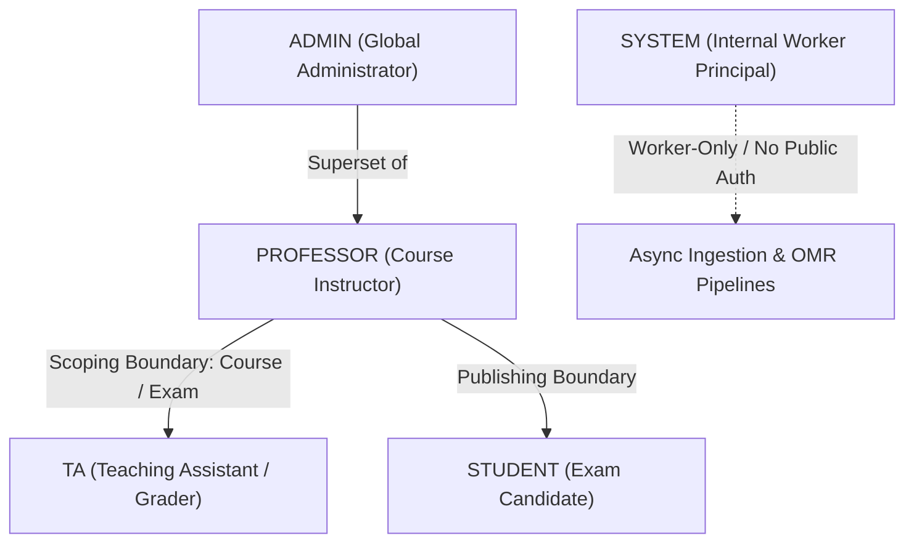

# RBAC Audit Matrix & Authorization Policy

**Document:** `docs/RBAC_AUDIT_MATRIX.md`  
**Reference:** Week 12 · Day 2 — Security and Compliance (AE-226 / Issue #344 / PR #345)  
**Status:** Canonical Reference

---

## 1. Executive Summary

This document provides a complete, code-derived audit of all 90 API routes and ~120 HTTP handlers across the Exam Evaluation Platform. It defines the canonical role hierarchy, permission assignments derived from `src/constants/permissions.ts:47-65`, endpoint-to-permission mapping, and tenancy/ownership scoping rules (`course.professor`, `exam.createdBy`, `batch.uploadedBy`, `allocation.ta`, `script.student`) to prevent privilege escalation and unauthorized cross-tenant data access.

---

## 2. Role Hierarchy & Principles of Least Privilege

The system implements four distinct user roles, plus an internal system principal for background asynchronous worker pipelines:

### Role Descriptions
1. **ADMIN:** Global system administrator. Has unrestricted administrative access (`Object.values(Permission)`), including user management (`MANAGE_USERS`), system-wide configuration, and cryptographic audit log verification (`/api/audit-logs/verify`).
2. **PROFESSOR:** Course instructor and exam owner. Governed strictly by `src/constants/permissions.ts:47-65`. Manages courses, exams, rubrics, ingestion approvals, script allocations, regrade decisions, grade publishing, and exam analytics. Bound to the courses and exams they own or coordinate (`course.professor` or `exam.createdBy`).
3. **TA:** Teaching assistant assigned to specific courses (`course.teachingAssistants`). Authorized to grade allocated scripts (`allocation.ta`), save draft marks/feedback, place canvas annotations, and flag scripts for professor review. Restricted from course creation, exam deletion, grade publication, and user administration.
4. **STUDENT:** Course enrollee and examinee. Authorized only to view courses they are enrolled in (`course.enrolledStudents`), view their own published results (`script.student`), view annotated feedback on their own scripts, and submit regrade requests within the active regrade window.
5. **SYSTEM Principal (`SYSTEM_WORKER_PRINCIPAL`):** Internal non-human principal utilized solely by asynchronous background workers (e.g. OMR processing, roster remapping). It cannot authenticate through public endpoints or obtain session cookies.

---

## 3. Canonical Permission Mapping Matrix

The system governs capabilities via discrete granular permissions defined in `src/constants/permissions.ts`:

| Permission | Description | ADMIN | PROFESSOR (`permissions.ts:47-65`) | TA (`permissions.ts:66-72`) | STUDENT (`permissions.ts:73-77`) |
| :--- | :--- | :---: | :---: | :---: | :---: |
| **`MANAGE_USERS`** | Create, update, deactivate, and import user accounts | **Yes** | No | No | No |
| **`CREATE_COURSE`** | Create new academic courses | **Yes** | **Yes** | No | No |
| **`EDIT_COURSE`** | Update course metadata, assign TAs, enroll students | **Yes** | **Yes** | No | No |
| **`DELETE_COURSE`** | Soft delete or archive courses | **Yes** | **Yes** | No | No |
| **`VIEW_COURSES`** | View courses user is associated with or enrolled in | **Yes** | **Yes** | **Yes** | **Yes** |
| **`ASSIGN_TAS`** | Assign teaching assistants to course rosters | **Yes** | **Yes** | No | No |
| **`CREATE_EXAM`** | Create exams, configure question weights and rubrics | **Yes** | **Yes** | No | No |
| **`EDIT_EXAM`** | Edit exam structure, questions, and page templates | **Yes** | **Yes** | No | No |
| **`DELETE_EXAM`** | Delete draft or unapproved exams | **Yes** | **Yes** | No | No |
| **`CREATE_RUBRIC`** | Create rubrics and scoring step criteria | **Yes** | **Yes** | No | No |
| **`EDIT_RUBRIC`** | Modify rubric criteria before grading commences | **Yes** | **Yes** | No | No |
| **`VIEW_ALL_SUBMISSIONS`** | View all student answer scripts in an exam | **Yes** | **Yes** | No | No |
| **`VIEW_ASSIGNED_SCRIPTS`** | View answer scripts assigned to the active TA | **Yes** | **Yes** | **Yes** | No |
| **`GRADE_SCRIPT`** | Enter marks, evaluate answers, submit grades | **Yes** | **Yes** | **Yes** | No |
| **`ALLOCATE_SCRIPTS`** | Allocate scripts/questions to TAs | **Yes** | **Yes** | No | No |
| **`FLAG_FOR_REVIEW`** | Flag ambiguous answer scripts for professor attention | **Yes** | **Yes** | **Yes** | No |
| **`SAVE_MARKS_FEEDBACK`** | Save draft scores and canvas annotation marks | **Yes** | **Yes** | **Yes** | No |
| **`PUBLISH_GRADES`** | Publish final exam grades to student portal | **Yes** | **Yes** | No | No |
| **`CREATE_BATCH`** | Upload raw PDF scan batches for ingestion | **Yes** | **Yes** | No | No |
| **`VIEW_BATCH`** | Inspect scan batches, page thumbnails, and split status | **Yes** | **Yes** | No | No |
| **`APPROVE_INGESTION`** | Approve segmented batches for grading | **Yes** | **Yes** | No | No |
| **`VIEW_OWN_RESULTS`** | View own published grades, question scores, feedback | **Yes** | No | No | **Yes** |
| **`REQUEST_REGRADE`** | Submit regrade request for an evaluated question | **Yes** | No | No | **Yes** |

---

## 4. Comprehensive Endpoint-to-Role Matrix (All 90 Routes)

### 4.1 Authentication & System Health (5 routes)
| Route | Method(s) | Auth Required | Allowed Roles / Code-Enforced Guard | Ownership / Tenancy Guard | Denied Status |
| :--- | :---: | :---: | :--- | :--- | :---: |
| `/api/auth/[...nextauth]` | GET, POST | No | Public (NextAuth session handler) | Credentials / Session validation | 400 / 401 |
| `/api/auth/register` | POST | No | Public registration | Self-registration forced to `STUDENT` | 400 |
| `/api/auth/reset` | POST | No | Public password reset request | Generates reset token via registered email | 400 / 404 |
| `/api/auth/reset-password` | POST | No | Public password reset confirmation | Token expiration & signature validation | 400 |
| `/api/health` | GET | No | Public health probe | Probes MongoDB connection state via `HealthService` | 503 if down |

### 4.2 User Management (3 routes)
| Route | Method(s) | Auth Required | Allowed Roles / Code-Enforced Guard | Ownership / Tenancy Guard | Denied Status |
| :--- | :---: | :---: | :--- | :--- | :---: |
| `/api/users` | GET | Yes | ADMIN, PROFESSOR | ADMIN: all users; PROFESSOR: TAs & students only | 401 / 403 |
| `/api/users` | POST | Yes | `MANAGE_USERS` (ADMIN only) | System-wide user creation | 401 / 403 |
| `/api/users/[id]` | PUT, PATCH | Yes | `MANAGE_USERS` (ADMIN only) | Self-role de-escalation prevented | 401 / 403 / 404 |
| `/api/users/import` | POST | Yes | `MANAGE_USERS` (ADMIN only) | Bulk CSV user roster provisioning | 401 / 403 |

### 4.3 Course Lifecycle & Rosters (3 routes)
| Route | Method(s) | Auth Required | Allowed Roles / Code-Enforced Guard | Ownership / Tenancy Guard | Denied Status |
| :--- | :---: | :---: | :--- | :--- | :---: |
| `/api/courses` | GET | Yes | `VIEW_COURSES` (All roles) | Scoped: ADMIN sees all; others see enrolled/associated courses | 401 |
| `/api/courses` | POST | Yes | `CREATE_COURSE` (ADMIN, PROFESSOR) | Creator automatically assigned as `course.professor` | 401 / 403 |
| `/api/courses/[id]` | GET | Yes | `VIEW_COURSES` (All roles) | Member check: `course.professor`, TA, or enrolled student | 401 / 403 / 404 |
| `/api/courses/[id]` | PUT, DELETE | Yes | `EDIT_COURSE` / `DELETE_COURSE` | ADMIN or assigned `course.professor` only | 401 / 403 / 404 |
| `/api/courses/[id]/enroll` | POST, DELETE | Yes | `EDIT_COURSE` (ADMIN, PROFESSOR) | ADMIN or assigned `course.professor` only | 401 / 403 / 404 |

### 4.4 Exam Lifecycle, Settings & Status (24 routes)
| Route | Method(s) | Auth Required | Allowed Roles / Code-Enforced Guard | Ownership / Tenancy Guard | Denied Status |
| :--- | :---: | :---: | :--- | :--- | :---: |
| `/api/exams` | GET | Yes | `VIEW_COURSES` (All roles) | Filtered by course affiliation | 401 |
| `/api/exams` | POST | Yes | `CREATE_EXAM` (ADMIN, PROFESSOR) | Must be assigned `course.professor` or ADMIN | 401 / 403 |
| `/api/exams/[id]` | GET | Yes | `VIEW_COURSES` (All roles) | Affiliated course members | 401 / 404 |
| `/api/exams/[id]` | PUT, DELETE | Yes | `EDIT_EXAM`, `DELETE_EXAM` | ADMIN or assigned `course.professor` (`canManageExam`) | 401 / 403 / 404 |
| `/api/exams/[id]/allocate` | GET, POST | Yes | `ALLOCATE_SCRIPTS` (ADMIN, PROFESSOR) | ADMIN or assigned `course.professor` | 401 / 403 / 404 |
| `/api/exams/[id]/allocate/preview` | POST | Yes | `ALLOCATE_SCRIPTS` (ADMIN, PROFESSOR) | ADMIN or assigned `course.professor` | 401 / 403 / 404 |
| `/api/exams/[id]/allocate/reassign` | PUT | Yes | `ALLOCATE_SCRIPTS` (ADMIN, PROFESSOR) | ADMIN or assigned `course.professor` | 401 / 403 / 404 |
| `/api/exams/[id]/allocate/reassign/history` | GET | Yes | `ALLOCATE_SCRIPTS` (ADMIN, PROFESSOR) | ADMIN or assigned `course.professor` | 401 / 403 / 404 |
| `/api/exams/[id]/approve-ingestion` | POST | Yes | `APPROVE_INGESTION` (ADMIN, PROFESSOR) | ADMIN or assigned `course.professor` | 401 / 403 / 404 |
| `/api/exams/[id]/blind-grading` | POST | Yes | `EDIT_EXAM` (ADMIN, PROFESSOR) | ADMIN or assigned `course.professor` | 401 / 403 / 404 |
| `/api/exams/[id]/cover-sheets` | POST | Yes | `CREATE_BATCH` (ADMIN, PROFESSOR) | ADMIN or assigned `course.professor` | 401 / 403 / 404 |
| `/api/exams/[id]/enroll` | POST, PUT | Yes | `EDIT_EXAM` (ADMIN, PROFESSOR) | ADMIN or assigned `course.professor` | 401 / 403 / 404 |
| `/api/exams/[id]/export` | GET | Yes | `VIEW_ALL_SUBMISSIONS` (ADMIN, PROFESSOR) | Re-exports from analytics export; instructor/ADMIN | 401 / 403 / 404 |
| `/api/exams/[id]/ingestion-summary` | GET | Yes | `VIEW_BATCH` (ADMIN, PROFESSOR, TA) | Course staff affiliation | 401 / 403 / 404 |
| `/api/exams/[id]/progress` | GET | Yes | `VIEW_COURSES` (ADMIN, PROFESSOR, TA) | Associated course instructors & TAs | 401 / 403 / 404 |
| `/api/exams/[id]/progress/stream` | GET | Yes | `VIEW_COURSES` (ADMIN, PROFESSOR, TA) | Associated course instructors & TAs SSE stream | 401 / 403 / 404 |
| `/api/exams/[id]/publish` | GET, POST | Yes | `PUBLISH_GRADES` (ADMIN, PROFESSOR) | ADMIN or assigned `course.professor` (`canManageExam`) | 401 / 403 / 404 |
| `/api/exams/[id]/regrade-window` | GET, PUT | Yes | `EDIT_EXAM` (ADMIN, PROFESSOR) | ADMIN or assigned `course.professor` (`canManageExam`) | 401 / 403 / 404 |
| `/api/exams/[id]/revoke-ingestion` | POST | Yes | `APPROVE_INGESTION` (ADMIN, PROFESSOR) | ADMIN or assigned `course.professor` | 401 / 403 / 404 |
| `/api/exams/[id]/students` | GET | Yes | `VIEW_COURSES` (ADMIN, PROFESSOR, TA) | Associated course staff | 401 / 403 / 404 |
| `/api/exams/[id]/submissions/bulk` | GET, POST | Yes | `VIEW_ALL_SUBMISSIONS` (ADMIN, PROFESSOR) | ADMIN or assigned `course.professor` | 401 / 403 / 404 |
| `/api/exams/[id]/ta/[taId]` | GET | Yes | `VIEW_COURSES` (ADMIN, PROFESSOR, TA) | Course staff; TA restricted to own stats | 401 / 403 / 404 |
| `/api/exams/[id]/tags` | GET, POST | Yes | `EDIT_EXAM` (ADMIN, PROFESSOR, TA) | Associated exam staff | 401 / 403 / 404 |
| `/api/exams/[id]/unpublish` | POST | Yes | `PUBLISH_GRADES` (ADMIN, PROFESSOR) | ADMIN or assigned `course.professor` (`canManageExam`) | 401 / 403 / 404 |
| `/api/exams/[id]/verify-assembly` | POST | Yes | `VIEW_BATCH` (ADMIN, PROFESSOR) | ADMIN or assigned `course.professor` | 401 / 403 / 404 |
| `/api/exams/[id]/verify-integrity` | POST | Yes | `VIEW_ALL_SUBMISSIONS` (ADMIN, PROFESSOR) | Cryptographic exam hash verification | 401 / 403 / 404 |

### 4.5 Ingestion, Scanning & Batch Processing (10 routes)
| Route | Method(s) | Auth Required | Allowed Roles / Code-Enforced Guard | Ownership / Tenancy Guard | Denied Status |
| :--- | :---: | :---: | :--- | :--- | :---: |
| `/api/ingest` | GET, POST | Yes | `CREATE_BATCH`, `VIEW_BATCH` (ADMIN, PROFESSOR) | Must be assigned `course.professor` or ADMIN | 401 / 403 |
| `/api/ingest/[id]` | GET | Yes | `VIEW_BATCH` (ADMIN, PROFESSOR) | `batch.uploadedBy` or assigned course professor | 401 / 403 / 404 |
| `/api/ingest/[id]/pages/[pageId]/enhance` | PUT | Yes | `VIEW_BATCH` (ADMIN, PROFESSOR) | Batch uploader or assigned course professor | 401 / 403 / 404 |
| `/api/ingest/[id]/pages/[pageId]/image` | GET | Yes | `VIEW_BATCH` (ADMIN, PROFESSOR) | Batch uploader or assigned course professor | 401 / 403 / 404 |
| `/api/ingest/[id]/pages/[pageId]/thumbnail` | GET | Yes | `VIEW_BATCH` (ADMIN, PROFESSOR) | Batch uploader or assigned course professor | 401 / 403 / 404 |
| `/api/ingest/[id]/scripts` | GET | Yes | `VIEW_BATCH` (ADMIN, PROFESSOR) | Batch uploader or assigned course professor | 401 / 403 / 404 |
| `/api/ingest/[id]/scripts/merge` | POST | Yes | `EDIT_EXAM` (ADMIN, PROFESSOR) | Batch uploader or assigned course professor | 401 / 403 / 404 |
| `/api/ingest/[id]/scripts/remap` | POST | Yes | `EDIT_EXAM` (ADMIN, PROFESSOR) | Batch uploader or assigned course professor | 401 / 403 / 404 |
| `/api/ingest/[id]/scripts/reorder` | POST | Yes | `EDIT_EXAM` (ADMIN, PROFESSOR) | Batch uploader or assigned course professor | 401 / 403 / 404 |
| `/api/ingest/[id]/scripts/split` | POST | Yes | `EDIT_EXAM` (ADMIN, PROFESSOR) | Batch uploader or assigned course professor | 401 / 403 / 404 |

### 4.6 Rubric Configuration (2 routes)
| Route | Method(s) | Auth Required | Allowed Roles / Code-Enforced Guard | Ownership / Tenancy Guard | Denied Status |
| :--- | :---: | :---: | :--- | :--- | :---: |
| `/api/rubrics` | GET, POST | Yes | `VIEW_COURSES` / `CREATE_RUBRIC` | Exam owner, course professor, or ADMIN | 401 / 403 |
| `/api/rubrics/[id]` | GET, PUT | Yes | `VIEW_COURSES` / `EDIT_RUBRIC` | Exam owner, course professor, or ADMIN | 401 / 403 / 404 |

### 4.7 Allocations & TA Workflows (7 routes)
| Route | Method(s) | Auth Required | Allowed Roles / Code-Enforced Guard | Ownership / Tenancy Guard | Denied Status |
| :--- | :---: | :---: | :--- | :--- | :---: |
| `/api/allocations` | GET | Yes | `VIEW_ASSIGNED_SCRIPTS` (TA, PROF, ADMIN) | TA sees only own allocated scripts; Prof sees exam allocations | 401 / 403 |
| `/api/allocations/next` | GET, POST | Yes | `GRADE_SCRIPT` (TA, PROF, ADMIN) | Claims or fetches next script allocated to `user.id` | 401 / 403 / 404 |
| `/api/allocations/[id]` | DELETE | Yes | `ALLOCATE_SCRIPTS` (ADMIN, PROFESSOR) | Course professor or ADMIN only | 401 / 403 / 404 |
| `/api/allocations/[id]/claim` | POST | Yes | `GRADE_SCRIPT` (TA, PROF, ADMIN) | Assigned TA (`allocation.ta === user.id`) or instructor | 401 / 403 / 409 |
| `/api/allocations/[id]/complete` | POST | Yes | `GRADE_SCRIPT` (TA, PROF, ADMIN) | Assigned TA (`allocation.ta === user.id`) or instructor | 401 / 403 / 404 |
| `/api/allocations/[id]/release` | POST | Yes | `GRADE_SCRIPT` (TA, PROF, ADMIN) | Assigned TA or course instructor | 401 / 403 / 404 |
| `/api/allocations/[id]/reopen` | POST | Yes | `ALLOCATE_SCRIPTS` (ADMIN, PROFESSOR) | Course professor or ADMIN only | 401 / 403 / 404 |

### 4.8 Answer Scripts, Annotations & Grading (9 routes)
| Route | Method(s) | Auth Required | Allowed Roles / Code-Enforced Guard | Ownership / Tenancy Guard | Denied Status |
| :--- | :---: | :---: | :--- | :--- | :---: |
| `/api/answerscripts/[id]/identify` | POST | Yes | `EDIT_EXAM` (ADMIN, PROFESSOR) | Course instructor or ADMIN | 401 / 403 / 404 |
| `/api/scripts/[id]` | GET | Yes | `requireGradingOrAnnotationAccess` | Assigned TA, course professor, or ADMIN | 401 / 403 / 404 |
| `/api/scripts/[id]/flags` | GET, POST | Yes | `FLAG_FOR_REVIEW` (TA, PROFESSOR, ADMIN) | Assigned TA, course professor, or ADMIN | 401 / 403 / 404 |
| `/api/scripts/[id]/grades` | GET, POST | Yes | `GRADE_SCRIPT` (TA, PROFESSOR, ADMIN) | Assigned TA, course professor, or ADMIN | 401 / 403 / 404 |
| `/api/scripts/[id]/pages` | GET | Yes | `requireGradingOrAnnotationAccess` | Assigned TA, course professor, or ADMIN | 401 / 403 / 404 |
| `/api/scripts/[id]/pages/[p]/annotations` | GET, POST | Yes | `requireGradingOrAnnotationAccess` | Assigned TA, course professor, or ADMIN | 401 / 403 / 404 |
| `/api/scripts/[id]/questions/[questionNumber]/grade` | GET, POST | Yes | `GRADE_SCRIPT` (TA, PROFESSOR, ADMIN) | Assigned TA, course professor, or ADMIN | 401 / 403 / 404 |
| `/api/scripts/[id]/submit` | POST | Yes | `GRADE_SCRIPT` (TA, PROFESSOR, ADMIN) | Assigned TA, course professor, or ADMIN | 401 / 403 / 404 |

### 4.9 Student Results & Regrading Portal (7 routes)
| Route | Method(s) | Auth Required | Allowed Roles / Code-Enforced Guard | Ownership / Tenancy Guard | Denied Status |
| :--- | :---: | :---: | :--- | :--- | :---: |
| `/api/student/results` | GET | Yes | STUDENT, ADMIN | Published exams only; returns only scripts owned by `user.id` | 401 / 403 |
| `/api/student/results/[scriptId]` | GET | Yes | STUDENT, ADMIN | Must own script (`script.student === user.id`); published exam | 401 / 403 / 404 |
| `/api/student/results/[scriptId]/export` | GET | Yes | STUDENT, ADMIN | Must own script; watermarked PDF export | 401 / 403 / 404 |
| `/api/student/results/[scriptId]/pages` | GET | Yes | STUDENT, ADMIN | Must own script; returns rendered page URLs | 401 / 403 / 404 |
| `/api/student/results/[scriptId]/pages/[pageId]/annotations` | GET | Yes | STUDENT, ADMIN | Must own script; sanitized read-only annotations | 401 / 403 / 404 |
| `/api/student/results/[scriptId]/pages/[pageId]/image` | GET | Yes | STUDENT, ADMIN | Must own script; watermarked page image | 401 / 403 / 404 |
| `/api/student/regrade-requests` | GET, POST | Yes | `REQUEST_REGRADE` (STUDENT) | Must own script; active regrade window required | 401 / 403 / 400 |

### 4.10 Professor Regrade Reviews & Flags (7 routes)
| Route | Method(s) | Auth Required | Allowed Roles / Code-Enforced Guard | Ownership / Tenancy Guard | Denied Status |
| :--- | :---: | :---: | :--- | :--- | :---: |
| `/api/professor/activity` | GET | Yes | PROFESSOR, ADMIN | Scoped to professor's courses | 401 / 403 |
| `/api/professor/flags` | GET | Yes | PROFESSOR, ADMIN, assigned TA | Scoped to professor's exams/courses | 401 / 403 |
| `/api/professor/flags/analytics` | GET | Yes | PROFESSOR, ADMIN | Aggregated flag statistics for owned courses | 401 / 403 |
| `/api/professor/flags/[id]/resolve` | POST | Yes | PROFESSOR, ADMIN | Assigned course professor or ADMIN only | 401 / 403 / 404 |
| `/api/professor/regrade-requests` | GET | Yes | PROFESSOR, ADMIN, assigned TA | Instructor or assigned reviewer only | 401 / 403 |
| `/api/professor/regrade-requests/[id]` | PATCH | Yes | PROFESSOR, ADMIN, assigned TA | Instructor or assigned reviewer only | 401 / 403 / 404 |
| `/api/professor/regrade-requests/[id]/assignment` | PATCH | Yes | PROFESSOR, ADMIN | Instructor or ADMIN only | 401 / 403 / 404 |

### 4.11 Analytics, LMS & LTI Integration (7 routes)
| Route | Method(s) | Auth Required | Allowed Roles / Code-Enforced Guard | Ownership / Tenancy Guard | Denied Status |
| :--- | :---: | :---: | :--- | :--- | :---: |
| `/api/analytics/exams/[id]` | GET | Yes | `VIEW_ALL_SUBMISSIONS` (ADMIN, PROFESSOR) | Course instructor (`canManageExam`) or ADMIN | 401 / 403 / 404 |
| `/api/analytics/exams/[id]/export` | GET | Yes | `VIEW_ALL_SUBMISSIONS` (ADMIN, PROFESSOR) | Course instructor (`canManageExam`) or ADMIN | 401 / 403 / 404 |
| `/api/analytics/exams/[id]/export/lms` | GET, POST | Yes | `VIEW_ALL_SUBMISSIONS` (ADMIN, PROFESSOR) | Course instructor (`canManageExam`) or ADMIN | 401 / 403 / 404 |
| `/api/analytics/exams/[id]/graders` | GET | Yes | `VIEW_ALL_SUBMISSIONS` (ADMIN, PROFESSOR) | Course instructor (`canManageExam`) or ADMIN | 401 / 403 / 404 |
| `/api/analytics/exams/[id]/lti/passback` | GET, POST | Yes | `VIEW_ALL_SUBMISSIONS` (ADMIN, PROFESSOR) | Course instructor (`canManageExam`) or ADMIN | 401 / 403 / 404 |
| `/api/analytics/remark-tags` | GET | Yes | `VIEW_COURSES` (ADMIN, PROFESSOR, TA) | Associated course staff | 401 / 403 |

### 4.12 Audit Logs & Integrity Verification (3 routes)
| Route | Method(s) | Auth Required | Allowed Roles / Code-Enforced Guard | Ownership / Tenancy Guard | Denied Status |
| :--- | :---: | :---: | :--- | :--- | :---: |
| `/api/audit-logs` | GET | Yes | `VIEW_ALL_SUBMISSIONS` (ADMIN, PROFESSOR) | Scoped to owned exam/course; sanitized secrets | 401 / 403 |
| `/api/audit-logs/export` | GET | Yes | `VIEW_ALL_SUBMISSIONS` (ADMIN, PROFESSOR) | Scoped CSV audit download | 401 / 403 |
| `/api/audit-logs/verify` | POST | Yes | `VIEW_ALL_SUBMISSIONS` + Role `ADMIN` | System-wide cryptographic verification | 401 / 403 |

### 4.13 Notifications Center (3 routes)
| Route | Method(s) | Auth Required | Allowed Roles / Code-Enforced Guard | Ownership / Tenancy Guard | Denied Status |
| :--- | :---: | :---: | :--- | :--- | :---: |
| `/api/notifications` | GET | Yes | All authenticated users | Returns notifications addressed to `user.id` | 401 |
| `/api/notifications/[id]/read` | PATCH | Yes | All authenticated users | Recipient check: `notification.recipient === user.id` | 401 / 403 / 404 |
| `/api/notifications/read-all` | PATCH | Yes | All authenticated users | Marks all notifications for `user.id` as read | 401 |

### 4.14 Tags Management (2 routes)
| Route | Method(s) | Auth Required | Allowed Roles / Code-Enforced Guard | Ownership / Tenancy Guard | Denied Status |
| :--- | :---: | :---: | :--- | :--- | :---: |
| `/api/tags` | GET, POST | Yes | `VIEW_COURSES` / `EDIT_EXAM` | Scoped to exam/course staff | 401 / 403 |
| `/api/tags/[id]` | GET, PUT, DELETE, PATCH | Yes | `EDIT_EXAM` | Course instructor or ADMIN | 401 / 403 / 404 |

---

## 5. Security & Isolation Controls

1. **Information Leakage Prevention:**
   - Unauthenticated requests receive `401 Unauthorized` without confirming entity existence.
   - Unauthorized role requests receive `403 Forbidden`.
   - Cross-tenancy access (e.g. Professor A attempting to inspect or manage an exam in Professor B's course via `canManageExam`) returns `404 Not Found` to prevent entity enumeration.
2. **Audit Logging on Authorization Failure:**
   - Routes protected by `requirePermission` or `requireAnyPermission` emit an `AUTHORIZATION_FAILURE` event into the audit trail detailing the user ID, role, and attempted permission.
3. **Blind Grading Enforcement:**
   - During active evaluation, TA views mask student identity (`studentId`, `studentName`, `email`) and present anonymous tokens unless unmasked by the course instructor.
4. **Health Check Probes:**
   - `/api/health` probes MongoDB readiness using `mongoose.connection.readyState` via `HealthService` (returning 200 if connected, 503 if disconnected). It does not use Redis.
