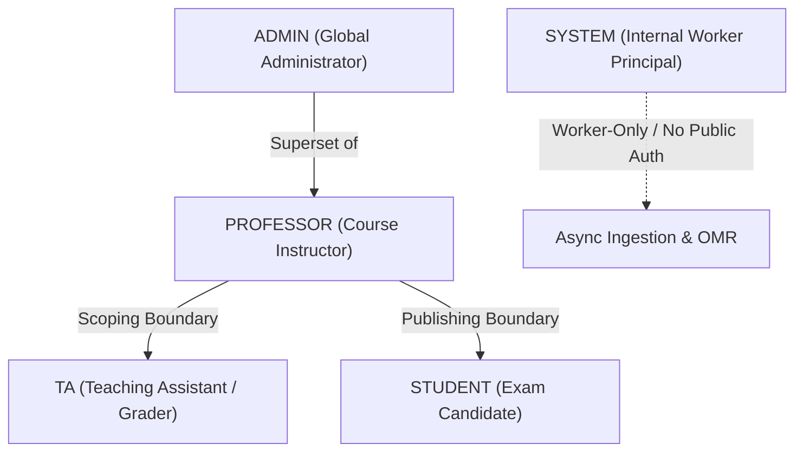

# RBAC Audit Matrix & Authorization Policy

**Document:** `docs/RBAC_AUDIT_MATRIX.md`  
**Reference:** Week 12 · Day 2 — Security and Compliance (AE-226 / Issue #344)  
**Status:** Canonical Reference

---

## 1. Executive Summary

This document provides a comprehensive audit of all API endpoints, authorization guards, and tenancy isolation policies across the Exam Evaluation Platform. It defines the canonical role hierarchy, permission assignments, endpoint-to-permission mapping, and tenancy scoping rules to prevent privilege escalation and unauthorized data access.

---

## 2. Role Hierarchy & Principles of Least Privilege

The system implements four distinct user roles, plus an internal system principal for background asynchronous worker pipelines:

### Role Descriptions
1. **ADMIN:** Global system administrator. Has unrestricted administrative access (`Object.values(Permission)`), including user management, system-wide configuration, and cryptographic audit log verification.
2. **PROFESSOR:** Course instructor and exam owner. Manages courses, exams, rubrics, ingestion approvals, script allocations, regrade decisions, grade publishing, and exam analytics. Bound to the courses and exams they own or coordinate.
3. **TA:** Teaching assistant assigned to specific courses. Authorized to grade allocated scripts, save draft marks/feedback, place canvas annotations, and flag scripts for professor review. Restricted from course creation, exam deletion, grade publication, and user administration.
4. **STUDENT:** Course enrollee and examinee. Authorized only to view their own published results, view annotated feedback on their own scripts, and submit regrade requests within the active regrade window.
5. **SYSTEM Principal (`SYSTEM_WORKER_PRINCIPAL`):** Internal non-human principal utilized solely by asynchronous background workers (e.g. OMR processing, roster remapping). It cannot authenticate through public endpoints or obtain session cookies.

---

## 3. Canonical Permission Mapping Matrix

The system governs capabilities via discrete granular permissions defined in `src/constants/permissions.ts`:

| Permission | Description | ADMIN | PROFESSOR | TA | STUDENT |
| :--- | :--- | :---: | :---: | :---: | :---: |
| **`MANAGE_USERS`** | Create, update, deactivate, and import user accounts | **Yes** | No | No | No |
| **`CREATE_COURSE`** | Create new academic courses | **Yes** | **Yes** | No | No |
| **`EDIT_COURSE`** | Update course metadata, assign TAs, enroll students | **Yes** | **Yes** | No | No |
| **`DELETE_COURSE`** | Soft delete or archive courses | **Yes** | **Yes** | No | No |
| **`VIEW_COURSES`** | View courses user is associated with or enrolled in | **Yes** | **Yes** | **Yes** | **Yes** |
| **`ASSIGN_TAS`** | Assign teaching assistants to course rosters | **Yes** | **Yes** | No | No |
| **`CREATE_EXAM`** | Create exams, configure question weights and rubrics | **Yes** | **Yes** | No | No |
| **`EDIT_EXAM`** | Edit exam structure, questions, and page templates | **Yes** | **Yes** | No | No |
| **`DELETE_EXAM`** | Delete draft or unapproved exams | **Yes** | **Yes** | No | No |
| **`CREATE_RUBRIC`** | Create rubrics and scoring step criteria | **Yes** | **Yes** | No | No |
| **`EDIT_RUBRIC`** | Modify rubric criteria before grading commences | **Yes** | **Yes** | No | No |
| **`VIEW_ALL_SUBMISSIONS`** | View all student answer scripts in an exam | **Yes** | **Yes** | No | No |
| **`VIEW_ASSIGNED_SCRIPTS`** | View answer scripts assigned to the active TA | **Yes** | **Yes** | **Yes** | No |
| **`GRADE_SCRIPT`** | Enter marks, evaluate answers, submit grades | **Yes** | **Yes** | **Yes** | No |
| **`ALLOCATE_SCRIPTS`** | Allocate scripts/questions to TAs | **Yes** | **Yes** | No | No |
| **`FLAG_FOR_REVIEW`** | Flag ambiguous answer scripts for professor attention | **Yes** | **Yes** | **Yes** | No |
| **`SAVE_MARKS_FEEDBACK`** | Save draft scores and canvas annotation marks | **Yes** | **Yes** | **Yes** | No |
| **`PUBLISH_GRADES`** | Publish final exam grades to student portal | **Yes** | **Yes** | No | No |
| **`CREATE_BATCH`** | Upload raw PDF scan batches for ingestion | **Yes** | **Yes** | No | No |
| **`VIEW_BATCH`** | Inspect scan batches, page thumbnails, and split status | **Yes** | **Yes** | No | No |
| **`APPROVE_INGESTION`** | Approve segmented batches for grading | **Yes** | **Yes** | No | No |
| **`VIEW_OWN_RESULTS`** | View own published grades, question scores, feedback | **Yes** | No | No | **Yes** |
| **`REQUEST_REGRADE`** | Submit regrade request for an evaluated question | **Yes** | No | No | **Yes** |

---

## 4. Comprehensive Endpoint-to-Role Matrix

### 4.1 Authentication & User Management
| Route | Method | Auth Required | Required Permission / Role | Scoping / Tenancy Rule | Denied Status |
| :--- | :---: | :---: | :--- | :--- | :---: |
| `/api/auth/[...nextauth]` | * | No | Public NextAuth handler | Rate-limited session endpoint | 400 / 401 |
| `/api/auth/register` | POST | No | Public (Student registration only) | Role forced to STUDENT | 400 |
| `/api/auth/reset` | POST | No | Public password reset request | Rate-limited | 400 |
| `/api/auth/reset-password` | POST | No | Public token confirmation | Token validity & expiry check | 400 |
| `/api/users` | GET | Yes | ADMIN or PROFESSOR | ADMIN: all users; PROFESSOR: students & TAs only | 401 / 403 |
| `/api/users` | POST | Yes | `MANAGE_USERS` (ADMIN only) | System-wide user provisioning | 401 / 403 |
| `/api/users/[id]` | PUT, PATCH | Yes | `MANAGE_USERS` (ADMIN only) | Cannot modify own admin role | 401 / 403 |
| `/api/users/import` | POST | Yes | `MANAGE_USERS` (ADMIN only) | Bulk CSV user roster import | 401 / 403 |

### 4.2 Course Management
| Route | Method | Auth Required | Required Permission / Role | Scoping / Tenancy Rule | Denied Status |
| :--- | :---: | :---: | :--- | :--- | :---: |
| `/api/courses` | GET | Yes | `VIEW_COURSES` (All roles) | Role-filtered: users see only associated courses | 401 |
| `/api/courses` | POST | Yes | `CREATE_COURSE` (ADMIN, PROFESSOR) | Creator automatically added as instructor | 401 / 403 |
| `/api/courses/[id]` | GET | Yes | `VIEW_COURSES` | Course membership check (instructor, TA, student) | 401 / 404 |
| `/api/courses/[id]` | PUT | Yes | `EDIT_COURSE` (ADMIN, PROFESSOR) | Course instructor or ADMIN only | 401 / 403 / 404 |
| `/api/courses/[id]` | DELETE | Yes | `DELETE_COURSE` (ADMIN, PROFESSOR) | Course instructor or ADMIN only | 401 / 403 / 404 |
| `/api/courses/[id]/enroll` | POST, DELETE | Yes | `EDIT_COURSE` (ADMIN, PROFESSOR) | Course instructor or ADMIN only | 401 / 403 / 404 |

### 4.3 Exam & Rubric Lifecycle
| Route | Method | Auth Required | Required Permission / Role | Scoping / Tenancy Rule | Denied Status |
| :--- | :---: | :---: | :--- | :--- | :---: |
| `/api/exams` | GET | Yes | `VIEW_COURSES` (All roles) | Role-filtered exam list | 401 |
| `/api/exams` | POST | Yes | `CREATE_EXAM` (ADMIN, PROFESSOR) | Instructor of parent course only | 401 / 403 |
| `/api/exams/[id]` | GET | Yes | `VIEW_COURSES` | Exam visibility check | 401 / 404 |
| `/api/exams/[id]` | PUT, DELETE | Yes | `EDIT_EXAM`, `DELETE_EXAM` | Exam owner or ADMIN | 401 / 403 / 404 |
| `/api/exams/[id]/publish` | POST | Yes | `PUBLISH_GRADES` (ADMIN, PROFESSOR) | Exam owner or ADMIN | 401 / 403 / 404 |
| `/api/exams/[id]/unpublish` | POST | Yes | `PUBLISH_GRADES` (ADMIN, PROFESSOR) | Exam owner or ADMIN | 401 / 403 / 404 |
| `/api/exams/[id]/regrade-window` | PATCH | Yes | `EDIT_EXAM` (ADMIN, PROFESSOR) | Exam owner or ADMIN | 401 / 403 / 404 |
| `/api/rubrics` | GET, POST | Yes | `VIEW_COURSES` / `CREATE_RUBRIC` | Exam owner or ADMIN | 401 / 403 |
| `/api/rubrics/[id]` | GET, PUT | Yes | `VIEW_COURSES` / `EDIT_RUBRIC` | Exam owner or ADMIN | 401 / 403 / 404 |

### 4.4 Ingestion & Batch Processing
| Route | Method | Auth Required | Required Permission / Role | Scoping / Tenancy Rule | Denied Status |
| :--- | :---: | :---: | :--- | :--- | :---: |
| `/api/ingest` | POST | Yes | `CREATE_BATCH` (ADMIN, PROFESSOR) | Course instructor or ADMIN | 401 / 403 |
| `/api/ingest/[id]` | GET | Yes | `VIEW_BATCH` (ADMIN, PROFESSOR) | Course instructor or ADMIN | 401 / 403 / 404 |
| `/api/ingest/[id]/scripts` | GET, POST | Yes | `VIEW_BATCH`, `EDIT_EXAM` | Course instructor or ADMIN | 401 / 403 / 404 |
| `/api/ingest/[id]/scripts/split` | POST | Yes | `EDIT_EXAM` (ADMIN, PROFESSOR) | Course instructor or ADMIN | 401 / 403 / 404 |
| `/api/ingest/[id]/scripts/merge` | POST | Yes | `EDIT_EXAM` (ADMIN, PROFESSOR) | Course instructor or ADMIN | 401 / 403 / 404 |
| `/api/ingest/[id]/scripts/remap` | POST | Yes | `EDIT_EXAM` (ADMIN, PROFESSOR) | Course instructor or ADMIN | 401 / 403 / 404 |
| `/api/ingest/[id]/scripts/reorder`| POST | Yes | `EDIT_EXAM` (ADMIN, PROFESSOR) | Course instructor or ADMIN | 401 / 403 / 404 |
| `/api/exams/[id]/approve-ingestion`| POST | Yes | `APPROVE_INGESTION` (ADMIN, PROF.) | Course instructor or ADMIN | 401 / 403 / 404 |

### 4.5 Allocation & Grading
| Route | Method | Auth Required | Required Permission / Role | Scoping / Tenancy Rule | Denied Status |
| :--- | :---: | :---: | :--- | :--- | :---: |
| `/api/exams/[id]/allocate` | POST | Yes | `ALLOCATE_SCRIPTS` (ADMIN, PROFESSOR) | Course instructor or ADMIN | 401 / 403 / 404 |
| `/api/allocations` | GET | Yes | `VIEW_ASSIGNED_SCRIPTS` (TA, PROF, ADMIN)| TA sees only own allocated scripts | 401 / 403 |
| `/api/allocations/[id]/claim` | POST | Yes | `GRADE_SCRIPT` (TA, PROF, ADMIN) | Claimed by assigned TA only | 401 / 403 / 409 |
| `/api/allocations/[id]/release` | POST | Yes | `GRADE_SCRIPT` or `ALLOCATE_SCRIPTS` | Assigned TA or course instructor | 401 / 403 / 404 |
| `/api/allocations/[id]/complete`| POST | Yes | `GRADE_SCRIPT` or `ALLOCATE_SCRIPTS` | Assigned TA or course instructor | 401 / 403 / 404 |
| `/api/scripts/[id]/questions/[q]/grade`| POST | Yes | `GRADE_SCRIPT` (TA, PROF, ADMIN) | Assigned TA, course instructor, or ADMIN | 401 / 403 / 404 |
| `/api/scripts/[id]/pages/[p]/annotations`| GET, POST | Yes | `requireGradingOrAnnotationAccess` | Assigned TA, course instructor, or ADMIN | 401 / 403 / 404 |

### 4.6 Student Results & Regrading
| Route | Method | Auth Required | Required Permission / Role | Scoping / Tenancy Rule | Denied Status |
| :--- | :---: | :---: | :--- | :--- | :---: |
| `/api/student/results` | GET | Yes | Authenticated STUDENT (or ADMIN) | Enforces published exam status; returns student's scripts only | 401 / 403 |
| `/api/student/results/[scriptId]` | GET | Yes | Authenticated STUDENT | Must be owner of script; exam must be published | 401 / 403 / 404 |
| `/api/student/regrade-requests` | POST | Yes | `REQUEST_REGRADE` (STUDENT) | Must own script; window must be open | 401 / 403 / 400 |
| `/api/professor/regrade-requests`| GET | Yes | PROFESSOR, ADMIN, or assigned TA | Instructor or assigned reviewer only | 401 / 403 |
| `/api/professor/regrade-requests/[id]`| PATCH | Yes | PROFESSOR, ADMIN, or assigned TA | Instructor or assigned reviewer only | 401 / 403 / 404 |

### 4.7 Analytics, Export, and Audit
| Route | Method | Auth Required | Required Permission / Role | Scoping / Tenancy Rule | Denied Status |
| :--- | :---: | :---: | :--- | :--- | :---: |
| `/api/analytics/exams/[id]` | GET | Yes | `VIEW_ALL_SUBMISSIONS` (ADMIN, PROF) | Course instructor or ADMIN | 401 / 403 / 404 |
| `/api/analytics/exams/[id]/export`| GET | Yes | `VIEW_ALL_SUBMISSIONS` (ADMIN, PROF) | Course instructor or ADMIN | 401 / 403 / 404 |
| `/api/analytics/exams/[id]/lti/passback`| POST | Yes | `VIEW_ALL_SUBMISSIONS` (ADMIN, PROF) | Course instructor or ADMIN | 401 / 403 / 404 |
| `/api/audit-logs` | GET | Yes | `VIEW_ALL_SUBMISSIONS` (ADMIN, PROF) | Scoped to exam/course; sanitized secrets | 401 / 403 |
| `/api/audit-logs/export` | GET | Yes | `VIEW_ALL_SUBMISSIONS` (ADMIN, PROF) | Scoped CSV audit download | 401 / 403 |
| `/api/audit-logs/verify` | POST | Yes | `VIEW_ALL_SUBMISSIONS` + Role `ADMIN` | System-wide cryptographic verification | 401 / 403 |
| `/api/health` | GET | No | Public health check | DB & Redis status probes | 503 if unhealthy |

---

## 5. Security & Isolation Controls

1. **Information Leakage Prevention:**
   - Unauthenticated requests receive `401 Unauthorized` without confirming entity existence.
   - Unauthorized role requests receive `403 Forbidden`.
   - Cross-tenancy or non-existent requests return consistent `404 Not Found` to prevent entity enumeration.
2. **Audit Logging on Authorization Failure:**
   - Every failed authorization check writes an `AUTHORIZATION_FAILURE` event into the tamper-evident audit log with the attempted permission, user ID, role, and client IP.
3. **Blind Grading Enforcement:**
   - During active grading, TA views mask student identity (`studentId`, `studentName`, `email`) and replace them with pseudonymized script tokens unless unmasked by the course instructor.
