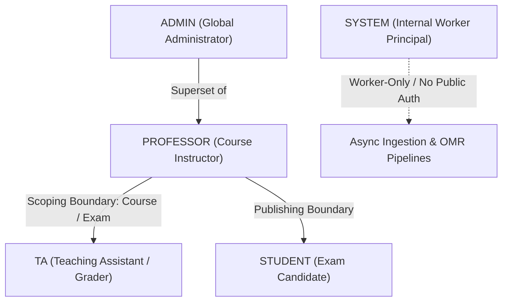

# RBAC Audit Matrix & Authorization Policy

**Document:** `docs/RBAC_AUDIT_MATRIX.md`  
**Reference:** Week 12 · Day 2 — Security and Compliance (AE-226 / PR #345)  
**Status:** Canonical Reference (Code-Derived)

---

## 1. Executive Summary

This document provides a complete, code-derived audit of all 90 API routes and their HTTP handlers across the Exam Evaluation Platform. It defines the canonical role hierarchy, permission assignments derived strictly from `src/constants/permissions.ts:47-65`, endpoint-to-permission mapping, and tenancy/ownership scoping rules (`course.professor`, `exam.createdBy`, `batch.uploadedBy`, `allocation.ta`, `script.student`) to prevent privilege escalation and unauthorized cross-tenant data access.

---

## 2. Role Hierarchy & Principles of Least Privilege

The system implements four distinct user roles, plus an internal system principal for background asynchronous worker pipelines:

### Role Descriptions
1. **ADMIN:** Global system administrator. Has unrestricted administrative access (`Object.values(Permission)`), including user management (`MANAGE_USERS`), system-wide configuration, and cryptographic audit log verification (`/api/audit-logs/verify`).
2. **PROFESSOR:** Course instructor and exam owner. Governed strictly by `src/constants/permissions.ts:47-65`. Manages courses, exams, rubrics, ingestion approvals, script allocations, regrade decisions, grade publishing, and exam analytics. Bound to the courses and exams they own or coordinate (`course.professor` or `exam.createdBy`). Professors do **not** hold grading/flagging permissions (`VIEW_ASSIGNED_SCRIPTS`, `GRADE_SCRIPT`, `FLAG_FOR_REVIEW`) directly—they manage and publish.
3. **TA:** Teaching assistant assigned to specific courses (`course.teachingAssistants`). Authorized to grade allocated scripts (`allocation.ta`), save draft marks/feedback, place canvas annotations, and flag scripts for professor review. Restricted from course creation, exam deletion, grade publication, and user administration.
4. **STUDENT:** Course enrollee and examinee. Authorized only to view courses they are enrolled in (`course.enrolledStudents`), view their own published results (`script.student`), view annotated feedback on their own scripts, and submit regrade requests within the active regrade window.
5. **SYSTEM Principal (`SYSTEM_WORKER_PRINCIPAL`):** Internal non-human principal utilized solely by asynchronous background workers (e.g. OMR processing, roster remapping). It cannot authenticate through public endpoints or obtain session cookies.

---

## 3. Canonical Permission Mapping Matrix

The system governs capabilities via discrete granular permissions defined in `src/constants/permissions.ts`:

| Permission | Description | ADMIN | PROFESSOR (`permissions.ts:47-65`) | TA (`permissions.ts:66-72`) | STUDENT (`permissions.ts:73-77`) |
| :--- | :--- | :---: | :---: | :---: | :---: |
| **`MANAGE_USERS`** | Create, update, deactivate, and import user accounts | **Yes** | No | No | No |
| **`CREATE_COURSE`** | Create new academic courses | **Yes** | **Yes** | No | No |
| **`EDIT_COURSE`** | Update course metadata, assign TAs, enroll students | **Yes** | **Yes** | No | No |
| **`DELETE_COURSE`** | Soft delete or archive courses | **Yes** | **Yes** | No | No |
| **`VIEW_COURSES`** | View courses user is associated with or enrolled in | **Yes** | **Yes** | **Yes** | **Yes** |
| **`ASSIGN_TAS`** | Assign teaching assistants to course rosters | **Yes** | **Yes** | No | No |
| **`CREATE_EXAM`** | Create exams, configure question weights and rubrics | **Yes** | **Yes** | No | No |
| **`EDIT_EXAM`** | Edit exam structure, questions, and page templates | **Yes** | **Yes** | No | No |
| **`DELETE_EXAM`** | Delete draft or unapproved exams | **Yes** | **Yes** | No | No |
| **`CREATE_RUBRIC`** | Create rubrics and scoring step criteria | **Yes** | **Yes** | No | No |
| **`EDIT_RUBRIC`** | Modify rubric criteria before grading commences | **Yes** | **Yes** | No | No |
| **`VIEW_ALL_SUBMISSIONS`** | View all student answer scripts in an exam | **Yes** | **Yes** | No | No |
| **`VIEW_ASSIGNED_SCRIPTS`** | View answer scripts assigned to the active TA | **Yes** | No | **Yes** | No |
| **`GRADE_SCRIPT`** | Enter marks, evaluate answers, submit grades | **Yes** | No | **Yes** | No |
| **`ALLOCATE_SCRIPTS`** | Allocate scripts/questions to TAs | **Yes** | **Yes** | No | No |
| **`FLAG_FOR_REVIEW`** | Flag ambiguous answer scripts for professor attention | **Yes** | No | **Yes** | No |
| **`SAVE_MARKS_FEEDBACK`** | Save draft scores and canvas annotation marks | **Yes** | **Yes** | **Yes** | No |
| **`PUBLISH_GRADES`** | Publish final exam grades to student portal | **Yes** | **Yes** | No | No |
| **`CREATE_BATCH`** | Upload raw PDF scan batches for ingestion | **Yes** | **Yes** | No | No |
| **`VIEW_BATCH`** | Inspect scan batches, page thumbnails, and split status | **Yes** | **Yes** | No | No |
| **`APPROVE_INGESTION`** | Approve segmented batches for grading | **Yes** | **Yes** | No | No |
| **`VIEW_OWN_RESULTS`** | View own published grades, question scores, feedback | **Yes** | No | No | **Yes** |
| **`REQUEST_REGRADE`** | Submit regrade request for an evaluated question | **Yes** | No | No | **Yes** |

---

## 4. Comprehensive Endpoint-to-Role Matrix (All 90 Routes)

### 4.1 Authentication & System Health (5 routes)
| Route | Method(s) | Auth Required | Allowed Roles / Code-Enforced Guard | Ownership / Tenancy Guard | Denied Status |
| :--- | :---: | :---: | :--- | :--- | :---: |
| `/api/auth/[...nextauth]` | GET, POST | No | Public (NextAuth authentication & session handler) | Credentials / Session validation | 400 / 401 |
| `/api/auth/register` | POST | No | Public registration | Self-registration forced to `STUDENT` | 400 |
| `/api/auth/reset` | POST | No | Public password reset request | Generates reset token via registered email | 400 / 404 |
| `/api/auth/reset-password` | POST | No | Public password reset confirmation | Token expiration & signature validation | 400 |
| `/api/health` | GET | No | Public health probe | Probes MongoDB connection state (1 connected, 503 if disconnected) | 503 if down |

### 4.2 User Management (3 routes)
| Route | Method(s) | Auth Required | Allowed Roles / Code-Enforced Guard | Ownership / Tenancy Guard | Denied Status |
| :--- | :---: | :---: | :--- | :--- | :---: |
| `/api/users` | GET, POST | Yes | GET: ADMIN, PROFESSOR; POST: `MANAGE_USERS` (ADMIN only) | ADMIN: all users; PROFESSOR: TAs & students only; POST: system-wide | 401 / 403 |
| `/api/users/[id]` | PUT, PATCH | Yes | `MANAGE_USERS` (ADMIN only) | Self-role de-escalation prevented | 401 / 403 / 404 |
| `/api/users/import` | POST | Yes | `MANAGE_USERS` (ADMIN only) | Bulk CSV user roster provisioning | 401 / 403 |

### 4.3 Course Lifecycle & Rosters (3 routes)
| Route | Method(s) | Auth Required | Allowed Roles / Code-Enforced Guard | Ownership / Tenancy Guard | Denied Status |
| :--- | :---: | :---: | :--- | :--- | :---: |
| `/api/courses` | GET, POST | Yes | GET: `VIEW_COURSES` (All roles); POST: `CREATE_COURSE` (ADMIN, PROFESSOR) | GET: scoped to associated/enrolled courses; POST: `course.professor` | 401 / 403 |
| `/api/courses/[id]` | GET, PUT, DELETE | Yes | GET: `VIEW_COURSES` (All roles); PUT/DELETE: `EDIT_COURSE` / `DELETE_COURSE` (ADMIN, PROFESSOR) | GET: course members; PUT/DELETE: ADMIN or assigned `course.professor` | 401 / 403 / 404 |
| `/api/courses/[id]/enroll` | POST, DELETE | Yes | `EDIT_COURSE` (ADMIN, PROFESSOR) | ADMIN or assigned `course.professor` only | 401 / 403 / 404 |

### 4.4 Exam Creation, Management & Allocation (31 routes)
| Route | Method(s) | Auth Required | Allowed Roles / Code-Enforced Guard | Ownership / Tenancy Guard | Denied Status |
| :--- | :---: | :---: | :--- | :--- | :---: |
| `/api/allocations` | GET | Yes | `VIEW_ASSIGNED_SCRIPTS` (TA, ADMIN only — PROFESSOR denied) | TA sees only scripts where `allocation.ta === user.id`; ADMIN sees all | 401 / 403 |
| `/api/allocations/[id]` | DELETE | Yes | `ALLOCATE_SCRIPTS` (ADMIN, PROFESSOR) | Course professor or ADMIN only | 401 / 403 / 404 |
| `/api/allocations/[id]/claim` | POST | Yes | `GRADE_SCRIPT` (TA, ADMIN) | Assigned TA (`allocation.ta === user.id`) or ADMIN | 401 / 403 / 409 |
| `/api/allocations/[id]/complete` | POST | Yes | `GRADE_SCRIPT` or `ALLOCATE_SCRIPTS` (TA, PROFESSOR, ADMIN) | Assigned TA (`allocation.ta === user.id`) or course instructor/ADMIN | 401 / 403 / 404 |
| `/api/allocations/[id]/release` | POST | Yes | `GRADE_SCRIPT` or `ALLOCATE_SCRIPTS` (TA, PROFESSOR, ADMIN) | Assigned TA (`allocation.ta === user.id`) or course instructor/ADMIN | 401 / 403 / 404 |
| `/api/allocations/[id]/reopen` | POST | Yes | `ALLOCATE_SCRIPTS` (ADMIN, PROFESSOR) | Course professor or ADMIN only | 401 / 403 / 404 |
| `/api/allocations/next` | GET | Yes | `VIEW_ASSIGNED_SCRIPTS` (TA, ADMIN only — PROFESSOR denied) | Fetches next script allocated to caller (`allocation.ta === user.id`) | 401 / 403 / 404 |
| `/api/exams` | GET, POST | Yes | GET: `VIEW_COURSES` (All roles); POST: `CREATE_EXAM` (ADMIN, PROFESSOR) | GET: associated courses; POST: `createdBy` set to caller, must own course | 401 / 403 |
| `/api/exams/[id]` | GET, PUT, DELETE, PATCH | Yes | GET: `VIEW_COURSES` (All roles); PUT/DELETE: `EDIT_EXAM`, `DELETE_EXAM` (ADMIN, PROFESSOR) | GET: affiliated course members; PUT/DELETE: ADMIN or assigned `course.professor` | 401 / 403 / 404 |
| `/api/exams/[id]/allocate` | GET, POST | Yes | `ALLOCATE_SCRIPTS` (ADMIN, PROFESSOR) | ADMIN or assigned `course.professor` only | 401 / 403 / 404 |
| `/api/exams/[id]/allocate/preview` | POST | Yes | `ALLOCATE_SCRIPTS` (ADMIN, PROFESSOR) | ADMIN or assigned `course.professor` only | 401 / 403 / 404 |
| `/api/exams/[id]/allocate/reassign` | PUT | Yes | `ALLOCATE_SCRIPTS` (ADMIN, PROFESSOR) | ADMIN or assigned `course.professor` only | 401 / 403 / 404 |
| `/api/exams/[id]/allocate/reassign/history` | GET | Yes | `ALLOCATE_SCRIPTS` (ADMIN, PROFESSOR) | ADMIN or assigned `course.professor` only | 401 / 403 / 404 |
| `/api/exams/[id]/approve-ingestion` | POST | Yes | `APPROVE_INGESTION` (ADMIN, PROFESSOR) | ADMIN or assigned `course.professor` only | 401 / 403 / 404 |
| `/api/exams/[id]/blind-grading` | POST | Yes | `ALLOCATE_SCRIPTS` (ADMIN, PROFESSOR) | ADMIN or assigned `course.professor` only | 401 / 403 / 404 |
| `/api/exams/[id]/cover-sheets` | POST | Yes | `EDIT_EXAM` (ADMIN, PROFESSOR) | ADMIN or assigned `course.professor` only | 401 / 403 / 404 |
| `/api/exams/[id]/enroll` | POST, PUT | Yes | `EDIT_EXAM` (ADMIN, PROFESSOR) | ADMIN or assigned `course.professor` only | 401 / 403 / 404 |
| `/api/exams/[id]/export` | GET | Yes | `VIEW_ALL_SUBMISSIONS` (ADMIN, PROFESSOR) | Course professor or ADMIN only (re-exports analytics/exams/[id]/export) | 401 / 403 / 404 |
| `/api/exams/[id]/ingestion-summary` | GET | Yes | `APPROVE_INGESTION` or `VIEW_BATCH` (ADMIN, PROFESSOR, TA) | Associated course staff | 401 / 403 / 404 |
| `/api/exams/[id]/progress` | GET | Yes | `ALLOCATE_SCRIPTS` (ADMIN, PROFESSOR) | ADMIN or assigned `course.professor` only | 401 / 403 / 404 |
| `/api/exams/[id]/progress/stream` | GET | Yes | `ALLOCATE_SCRIPTS` (ADMIN, PROFESSOR) | ADMIN or assigned `course.professor` only | 401 / 403 / 404 |
| `/api/exams/[id]/publish` | GET, POST | Yes | `PUBLISH_GRADES` (ADMIN, PROFESSOR) | ADMIN or assigned `course.professor` only | 401 / 403 / 404 |
| `/api/exams/[id]/regrade-window` | GET, PUT | Yes | GET: `VIEW_COURSES` (All roles); PUT: `EDIT_EXAM` (ADMIN, PROFESSOR) | GET: course members; PUT: ADMIN or assigned `course.professor` | 401 / 403 / 404 |
| `/api/exams/[id]/revoke-ingestion` | POST | Yes | `APPROVE_INGESTION` (ADMIN, PROFESSOR) | ADMIN or assigned `course.professor` only | 401 / 403 / 404 |
| `/api/exams/[id]/students` | GET | Yes | `EDIT_EXAM` (ADMIN, PROFESSOR) | ADMIN or assigned `course.professor` only | 401 / 403 / 404 |
| `/api/exams/[id]/submissions/bulk` | POST | Yes | `requireGradingOrAnnotationAccess` (TA, PROFESSOR, ADMIN) | Exam staff; TAs restricted to assigned scripts | 401 / 403 / 404 |
| `/api/exams/[id]/ta/[taId]` | GET | Yes | `ALLOCATE_SCRIPTS` (ADMIN, PROFESSOR) | ADMIN or assigned `course.professor` only | 401 / 403 / 404 |
| `/api/exams/[id]/tags` | GET, POST | Yes | `requireGradingOrAnnotationAccess` (TA, PROFESSOR, ADMIN) | Associated exam course staff | 401 / 403 / 404 |
| `/api/exams/[id]/unpublish` | POST | Yes | `PUBLISH_GRADES` (ADMIN, PROFESSOR) | ADMIN or assigned `course.professor` only | 401 / 403 / 404 |
| `/api/exams/[id]/verify-assembly` | POST | Yes | `APPROVE_INGESTION` (ADMIN, PROFESSOR) | ADMIN or assigned `course.professor` only | 401 / 403 / 404 |
| `/api/exams/[id]/verify-integrity` | POST | Yes | `APPROVE_INGESTION` (ADMIN, PROFESSOR) | ADMIN or assigned `course.professor` only | 401 / 403 / 404 |

### 4.5 Batch Scanning & Ingestion Pipelines (10 routes)
| Route | Method(s) | Auth Required | Allowed Roles / Code-Enforced Guard | Ownership / Tenancy Guard | Denied Status |
| :--- | :---: | :---: | :--- | :--- | :---: |
| `/api/ingest` | GET, POST | Yes | GET: `VIEW_BATCH`; POST: `CREATE_BATCH` (ADMIN, PROFESSOR) | ADMIN or uploader (`batch.uploadedBy`) | 401 / 403 |
| `/api/ingest/[id]` | GET | Yes | `VIEW_BATCH` (ADMIN, PROFESSOR) | `batch.uploadedBy` or assigned `course.professor` | 401 / 403 / 404 |
| `/api/ingest/[id]/pages/[pageId]/enhance` | PUT | Yes | `CREATE_BATCH` (ADMIN, PROFESSOR) | Uploader (`batch.uploadedBy`) or ADMIN | 401 / 403 / 404 |
| `/api/ingest/[id]/pages/[pageId]/image` | GET | Yes | `requireGradingOrAnnotationAccess` + `canManageExam` (ADMIN, PROFESSOR, assigned TA) | `batch.uploadedBy` or course professor / assigned TA | 401 / 403 / 404 |
| `/api/ingest/[id]/pages/[pageId]/thumbnail` | GET | Yes | `requireGradingOrAnnotationAccess` + `canManageExam` (ADMIN, PROFESSOR, assigned TA) | `batch.uploadedBy` or course professor / assigned TA | 401 / 403 / 404 |
| `/api/ingest/[id]/scripts` | GET | Yes | `EDIT_EXAM` (ADMIN, PROFESSOR) | `batch.uploadedBy` or course professor | 401 / 403 / 404 |
| `/api/ingest/[id]/scripts/merge` | POST | Yes | `EDIT_EXAM` (ADMIN, PROFESSOR) | `batch.uploadedBy` or course professor | 401 / 403 / 404 |
| `/api/ingest/[id]/scripts/remap` | POST | Yes | `EDIT_EXAM` (ADMIN, PROFESSOR) | `batch.uploadedBy` or course professor | 401 / 403 / 404 |
| `/api/ingest/[id]/scripts/reorder` | POST | Yes | `EDIT_EXAM` (ADMIN, PROFESSOR) | `batch.uploadedBy` or course professor | 401 / 403 / 404 |
| `/api/ingest/[id]/scripts/split` | POST | Yes | `EDIT_EXAM` (ADMIN, PROFESSOR) | `batch.uploadedBy` or course professor | 401 / 403 / 404 |

### 4.6 Rubrics (2 routes)
| Route | Method(s) | Auth Required | Allowed Roles / Code-Enforced Guard | Ownership / Tenancy Guard | Denied Status |
| :--- | :---: | :---: | :--- | :--- | :---: |
| `/api/rubrics` | GET, POST | Yes | GET: `VIEW_COURSES` (All roles); POST: `CREATE_RUBRIC` (ADMIN, PROFESSOR) | POST: `createdBy` set to caller, must be course professor or ADMIN | 401 / 403 |
| `/api/rubrics/[id]` | GET, PUT | Yes | GET: `VIEW_COURSES` (All roles); PUT: `EDIT_RUBRIC` (ADMIN, PROFESSOR) | PUT: Course professor or ADMIN only | 401 / 403 / 404 |

### 4.7 Answer Scripts, Grading & Annotations (8 routes)
| Route | Method(s) | Auth Required | Allowed Roles / Code-Enforced Guard | Ownership / Tenancy Guard | Denied Status |
| :--- | :---: | :---: | :--- | :--- | :---: |
| `/api/answerscripts/[id]/identify` | POST | Yes | `EDIT_EXAM` (ADMIN, PROFESSOR) | Course professor or ADMIN only | 401 / 403 / 404 |
| `/api/scripts/[id]` | GET | Yes | `requireGradingOrAnnotationAccess` (TA, PROFESSOR, ADMIN) | Assigned TA (`allocation.ta === user.id`), course professor, or ADMIN | 401 / 403 / 404 |
| `/api/scripts/[id]/flags` | GET, POST | Yes | `FLAG_FOR_REVIEW` (TA, ADMIN only — PROFESSOR lacks flag permission; uses resolve) | Assigned TA (`allocation.ta === user.id`) or ADMIN | 401 / 403 / 404 |
| `/api/scripts/[id]/grades` | GET, POST, PUT | Yes | `requireGradingOrAnnotationAccess` (TA, PROFESSOR, ADMIN) | Assigned TA (`allocation.ta === user.id`), course professor, or ADMIN | 401 / 403 / 404 |
| `/api/scripts/[id]/pages` | GET | Yes | `requireGradingOrAnnotationAccess` (TA, PROFESSOR, ADMIN) | Assigned TA (`allocation.ta === user.id`), course professor, or ADMIN | 401 / 403 / 404 |
| `/api/scripts/[id]/pages/[p]/annotations` | GET, PUT | Yes | `requireGradingOrAnnotationAccess` (TA, PROFESSOR, ADMIN) | Assigned TA (`allocation.ta === user.id`), course professor, or ADMIN | 401 / 403 / 404 |
| `/api/scripts/[id]/questions/[questionNumber]/grade` | POST, PUT | Yes | `requireGradingOrAnnotationAccess` (TA, PROFESSOR, ADMIN) | Assigned TA (`allocation.ta === user.id`), course professor, or ADMIN | 401 / 403 / 404 |
| `/api/scripts/[id]/submit` | POST | Yes | `requireGradingOrAnnotationAccess` (TA, PROFESSOR, ADMIN) | Assigned TA (`allocation.ta === user.id`), course professor, or ADMIN | 401 / 403 / 404 |

### 4.8 Student Portal (7 routes)
| Route | Method(s) | Auth Required | Allowed Roles / Code-Enforced Guard | Ownership / Tenancy Guard | Denied Status |
| :--- | :---: | :---: | :--- | :--- | :---: |
| `/api/student/regrade-requests` | GET, POST | Yes | `REQUEST_REGRADE` (STUDENT only) | Must own script (`script.student === user.id`); active regrade window | 401 / 403 / 404 |
| `/api/student/results` | GET | Yes | STUDENT, ADMIN | Published exams only; strictly scoped to caller (`script.student === user.id`) | 401 / 403 |
| `/api/student/results/[scriptId]` | GET | Yes | STUDENT, ADMIN | Must own script (`script.student === user.id`) in published exam | 401 / 403 / 404 |
| `/api/student/results/[scriptId]/export` | GET | Yes | STUDENT, ADMIN | Must own script (`script.student === user.id`); dynamic watermark applied | 401 / 403 / 404 |
| `/api/student/results/[scriptId]/pages` | GET | Yes | STUDENT, ADMIN | Must own script (`script.student === user.id`) in published exam | 401 / 403 / 404 |
| `/api/student/results/[scriptId]/pages/[pageId]/annotations` | GET | Yes | STUDENT, ADMIN | Must own script (`script.student === user.id`) in published exam | 401 / 403 / 404 |
| `/api/student/results/[scriptId]/pages/[pageId]/image` | GET | Yes | STUDENT, ADMIN | Must own script (`script.student === user.id`); watermarked | 401 / 403 / 404 |

### 4.9 Professor Oversight & Regrade Queue (7 routes)
| Route | Method(s) | Auth Required | Allowed Roles / Code-Enforced Guard | Ownership / Tenancy Guard | Denied Status |
| :--- | :---: | :---: | :--- | :--- | :---: |
| `/api/professor/activity` | GET | Yes | `ALLOCATE_SCRIPTS` (ADMIN, PROFESSOR) | Scoped to caller professor courses | 401 / 403 |
| `/api/professor/flags` | GET | Yes | PROFESSOR, ADMIN, assigned TA | Scoped to caller exams/allocations | 401 / 403 |
| `/api/professor/flags/[id]/resolve` | POST | Yes | PROFESSOR, ADMIN | Assigned course professor or ADMIN only | 401 / 403 / 404 |
| `/api/professor/flags/analytics` | GET | Yes | PROFESSOR, ADMIN | Aggregated flag statistics for owned courses | 401 / 403 |
| `/api/professor/regrade-requests` | GET | Yes | PROFESSOR, ADMIN, assigned TA | Instructor or assigned TA for the subject question | 401 / 403 |
| `/api/professor/regrade-requests/[id]` | PATCH | Yes | `canManageExam` (PROFESSOR, ADMIN, assigned TA) | Instructor or assigned TA for the subject question | 401 / 403 / 404 |
| `/api/professor/regrade-requests/[id]/assignment` | PATCH | Yes | `VIEW_ALL_SUBMISSIONS` + `canManageExam` (ADMIN, PROFESSOR) | Course professor or ADMIN only | 401 / 403 / 404 |

### 4.10 Analytics & LMS Export (6 routes)
| Route | Method(s) | Auth Required | Allowed Roles / Code-Enforced Guard | Ownership / Tenancy Guard | Denied Status |
| :--- | :---: | :---: | :--- | :--- | :---: |
| `/api/analytics/exams/[id]` | GET | Yes | `VIEW_ALL_SUBMISSIONS` + `canManageExam` (ADMIN, PROFESSOR) | Course professor (`course.professor`) or ADMIN only | 401 / 403 / 404 |
| `/api/analytics/exams/[id]/export` | GET | Yes | `VIEW_ALL_SUBMISSIONS` + `canManageExam` (ADMIN, PROFESSOR) | Course professor (`course.professor`) or ADMIN only | 401 / 403 / 404 |
| `/api/analytics/exams/[id]/export/lms` | GET, POST | Yes | `VIEW_ALL_SUBMISSIONS` + `canManageExam` (ADMIN, PROFESSOR) | Course professor (`course.professor`) or ADMIN only | 401 / 403 / 404 |
| `/api/analytics/exams/[id]/graders` | GET | Yes | `VIEW_ALL_SUBMISSIONS` + `canManageExam` (ADMIN, PROFESSOR) | Course professor (`course.professor`) or ADMIN only | 401 / 403 / 404 |
| `/api/analytics/exams/[id]/lti/passback` | GET, POST | Yes | `VIEW_ALL_SUBMISSIONS` + `canManageExam` (ADMIN, PROFESSOR) | Course professor (`course.professor`) or ADMIN only | 401 / 403 / 404 |
| `/api/analytics/remark-tags` | GET | Yes | PROFESSOR only (`userRole === UserRole.PROFESSOR`) | Scoped exclusively to caller professor exams (`professorId: user.id`) | 401 / 403 |

### 4.11 Cryptographic Audit Logs (3 routes)
| Route | Method(s) | Auth Required | Allowed Roles / Code-Enforced Guard | Ownership / Tenancy Guard | Denied Status |
| :--- | :---: | :---: | :--- | :--- | :---: |
| `/api/audit-logs` | GET | Yes | `VIEW_ALL_SUBMISSIONS` + `canManageExam` (ADMIN, PROFESSOR) | Scoped to owned exam/course; ADMIN sees all | 401 / 403 / 404 |
| `/api/audit-logs/export` | GET | Yes | `VIEW_ALL_SUBMISSIONS` + `canManageExam` (ADMIN, PROFESSOR) | Scoped CSV audit trail for owned exam/course | 401 / 403 / 404 |
| `/api/audit-logs/verify` | POST | Yes | `VIEW_ALL_SUBMISSIONS` + Role `ADMIN` only | System-wide cryptographic ledger validation | 401 / 403 |

### 4.12 Notifications (3 routes)
| Route | Method(s) | Auth Required | Allowed Roles / Code-Enforced Guard | Ownership / Tenancy Guard | Denied Status |
| :--- | :---: | :---: | :--- | :--- | :---: |
| `/api/notifications` | GET | Yes | All authenticated users | Returns notifications addressed to `user.id` | 401 |
| `/api/notifications/[id]/read` | PATCH | Yes | All authenticated users | Recipient check: `notification.recipient === user.id` | 401 / 404 |
| `/api/notifications/read-all` | PATCH | Yes | All authenticated users | Marks all notifications for `user.id` | 401 |

### 4.13 Tags & Annotations (2 routes)
| Route | Method(s) | Auth Required | Allowed Roles / Code-Enforced Guard | Ownership / Tenancy Guard | Denied Status |
| :--- | :---: | :---: | :--- | :--- | :---: |
| `/api/tags` | GET, POST | Yes | `requireGradingOrAnnotationAccess` (TA, PROFESSOR, ADMIN) | Scoped to associated course/exam staff | 401 / 403 |
| `/api/tags/[id]` | GET, PUT, DELETE, PATCH | Yes | `requireGradingOrAnnotationAccess` (TA, PROFESSOR, ADMIN) | Scoped to associated course/exam staff | 401 / 403 / 404 |

---

## 5. Tenancy & Isolation Enforcement Model

The platform enforces multi-tenant boundary checks across all data-access layers:
1. **Course Scoping:** Non-admin users are restricted to courses where their ID appears in `professor`, `teachingAssistants`, or `enrolledStudents`.
2. **Exam Isolation (`canManageExam`):** Mutating or accessing exam administrative functions requires caller to be `ADMIN` or the designated professor of the course (`courseProfId === user.id`). Inactive exams or exams belonging to other professors return `404 Not Found` to prevent metadata leakage.
3. **Batch Uploader Scoping (`BatchRepository`):** Ingestion scan batches are bound to `batch.uploadedBy`. Professors can only view and mutate batches they personally uploaded.
4. **Grader Allocation Scoping:** TAs can only retrieve, inspect, and evaluate answer scripts where an active `Allocation` binds the script/question directly to their `user.id` (`allocation.ta === user.id`).
5. **Student Result Scoping:** Students can strictly access scripts where `script.student === user.id` in published exams (`exam.status === ExamStatus.PUBLISHED`). Watermarked exports embed user identity metadata.

---

## 6. Audit Logging & Non-Repudiation

Every authorization failure triggers a structured immutable audit entry via `writeAuditLog`:
- **Action:** `AUTHORIZATION_FAILURE`
- **Outcome:** `FAILURE`
- **Details:** Attempted permission/role, caller user ID, IP address, and timestamp.

Cryptographic ledger verification (`POST /api/audit-logs/verify`) recalculates the SHA-256 hash chain and is strictly restricted to `ADMIN` accounts.