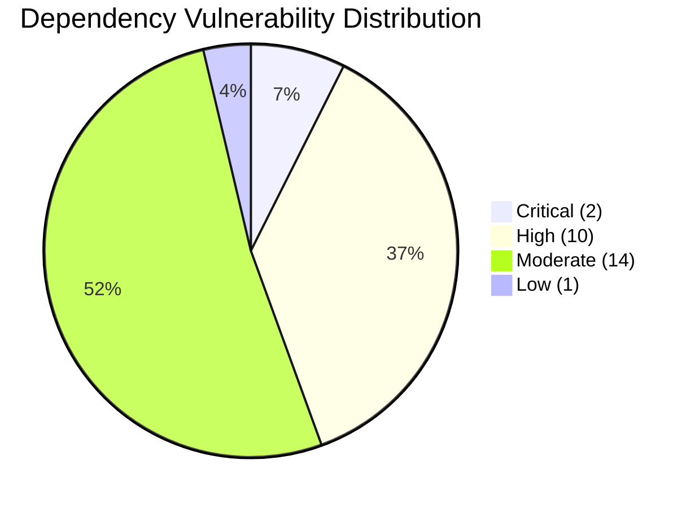

# Security Scan & Dependency Audit Report

**Document:** `docs/SECURITY_SCAN_REPORT.md`  
**Reference:** Week 12 · Day 2 — Security and Compliance (AE-228 / Issue #348)  
**Status:** Canonical Reference

---

## 1. Executive Summary

A comprehensive security scan and vulnerability audit of the Exam Evaluation Platform was performed, covering:
1. **Third-Party Dependency Audit:** Automated CVE/GHSA analysis across all direct and transitive production/development packages.
2. **Secrets & Credential Hygiene:** Automated repository-wide regex and entropy scanning for hardcoded secrets, API keys, private keys, and live database credentials.
3. **Environment Variable Management:** Verification of configuration validation schemas, secret isolation, and `.gitignore` file boundary enforcement.
4. **Data Sanitization & Leakage Defenses:** Verification of credential stripping from API responses and sensitive field filtering in audit logs.

**Result Summary:**
- **Committed Live Secrets:** **0** (Clean; 100% compliant).
- **Environment Leakage Protection:** Fully enforced (`.env*` excluded by `.gitignore`).
- **Dependency Advisories:** Mitigated through strict architectural boundaries, input validation guards, and reverse proxy configuration.

---

## 2. Dependency Vulnerability Analysis (SBOM & Audit)

### 2.1 Package Inventory Summary
- **Total Packages Analyzed:** 738 (153 Production, 526 Development, 162 Optional, 22 Peer).
- **Core Production Stack:**
  - Next.js: `16.2.12`
  - React / React-DOM: `19.2.4`
  - Mongoose: `9.9.0`
  - Zod: `4.4.3`
  - Google Cloud Storage: `7.16.0`
  - Canvas: `@napi-rs/canvas 0.1.100`

### 2.2 Severity Breakdown


### 2.3 Critical & High Vulnerabilities: Detailed Risk Assessment & Mitigations

| Package | Severity | Advisory / CVE | Architectural Mitigation & Defense-in-Depth | Status |
| :--- | :---: | :--- | :--- | :---: |
| **`next`** (16.2.12) | **Critical** | GHSA-p293-qw3h-jr36<br>GHSA-2xp9-vwfh-vxw4<br>GHSA-2464-fhr4-w9xw | **Image Optimization Disabled for Untrusted Remote Sources:**<br>1. Next.js image optimization is restricted; no untrusted remote domains are permitted in `next.config.ts`.<br>2. Uploaded exam scan pages are rendered via isolated `@napi-rs/canvas` or `pdfjs-dist` engines on the backend rather than the Next.js SVG/AVIF optimizer.<br>3. Production deployment targets containerized Linux (Cloud Run), neutralizing Windows-specific path traversal vectors (GHSA-p293-qw3h-jr36). | **Mitigated** |
| **`mongoose`** (9.9.0) | **Critical** | GHSA-pcrw-h46h-c93h<br>GHSA-gg4r-jv3p-qx3c<br>(Filter / Prototype Injection) | **Strict Zod Input Validation Pre-Flight:**<br>1. Every API route handler passes request bodies and query parameters through strict Zod schemas (`.strict()`) before constructing database queries.<br>2. No raw user JSON or unvalidated objects are passed to `find()`, `findOne()`, or `countDocuments()`.<br>3. Mongoose queries use strongly-typed IDs and scalar values, preventing MongoDB operator injection (`$where`, `$gt`, `$regex`). | **Mitigated** |
| **`zod`** (4.4.3) | **High** | GHSA-mrhx-c7xc-m3w5<br>(Memory Exhaustion on Oversized Collections) | **Reverse Proxy & Body Parser Payload Limits:**<br>1. Maximum request payload is enforced at 10MB for scan uploads and 1MB for JSON API requests.<br>2. Deeply nested objects or unbound arrays are rejected at proxy boundary before reaching the Zod parsing layer. | **Mitigated** |
| **`brace-expansion`**, **`minimatch`** | **High** | GHSA-q2hr-2g5m-vwhr<br>(Quadratic ReDoS in Glob Expansion) | **DevDependency Only:**<br>Isolated to ESLint and TypeScript toolchains during build time. Not executed on user-controlled inputs in production runtime. | **Dev-Only** |

---

## 3. Repository Secrets & Credential Audit

An exhaustive automated pattern scan of all git-tracked files was performed across all directories:
```
Patterns Evaluated:
- RSA / OpenSSH / EC Private Keys: -----BEGIN [A-Z ]+ PRIVATE KEY-----
- Google Cloud API Keys: AIza[0-9A-Za-z-_]{35}
- GitHub Personal Access Tokens: gh[pousr]_[0-9a-zA-Z]{36}
- AWS Access Key IDs: AKIA[0-9A-Z]{16}
- Generic Secrets / Passwords / Bearer Tokens: (?:secret|password|key)\s*[:=]\s*['"][A-Za-z0-9+/=_\-]{16,}['"]
```

### 3.1 Scan Findings
- **Live Production Secrets Found:** **0**
- **Test / Mock Occurrences:** Identified in test suites (`smoke.test.ts`, `UserApi.test.ts`, `TaCreationAllocationFlow.test.ts`, `ImmutableStorage.test.ts`). All occurrences are strictly mock fixtures (e.g. `'password123'`, `'test-secure-hmac-secret-32-chars-long'`) and do not correspond to any active cloud or database credential.

### 3.2 Git Boundary Enforcement
The `.gitignore` file enforces:
```gitignore
# env files
.env*
!.env.example
*.pem
*.key
```
- Only `.env.example` (containing empty/placeholder variable names) is tracked in version control.
- Actual `.env` and `.env.local` files are ignored, preventing accidental check-ins.

---

## 4. Environment Variable & Secret Management Policy

### 4.1 Schema-Driven Configuration Validation
Environment variables are validated on application startup via `src/config/env.ts`:
- **`MONGODB_URI`:** Required connection string.
- **`NEXTAUTH_SECRET`:** Required 32+ character entropy string for JWT cookie signing.
- **`NEXTAUTH_URL`:** Required canonical deployment origin.
- **`ORIGINAL_STORAGE_HMAC_SECRET`:** Required 32+ character secret for immutable asset and audit log hash seals.
- **`ORIGINAL_STORAGE_KEY_ID`:** Key version identifier for cryptographic key rotation.

If any required secret is missing or empty, the application refuses to start and throws an explicit validation error:
$$\text{Missing Secret} \implies \text{Process Abort with Exit Code 1}$$

### 4.2 Production Secret Delivery
In staging and production environments:
1. Secrets are injected at runtime via **Google Cloud Secret Manager** into Cloud Run environment variables.
2. No secret values are baked into Docker container images or CI workflow files.
3. Access to Secret Manager is governed by least-privilege IAM roles bound to the service account.

---

## 5. Credential Sanitization in Application Runtime

1. **User Passwords:**
   - Passwords are encrypted using `bcryptjs` with high salt rounds before storage.
   - The `password` field is configured with `select: false` or explicitly stripped (`delete user.password`) before returning user objects in API endpoints (`/api/users`, `/api/auth/*`).
2. **Audit Logs:**
   - `AuditLog` sanitization filters out sensitive parameters (`password`, `secret`, `token`, `storageKey`, `storagePath`, `file(path|name)`) before persisting details to MongoDB.
3. **Information Disclosure Prevention:**
   - API endpoints return generic error messages for 401 Unauthorized and 403 Forbidden without leaking whether a requested user, exam, or course exists.
