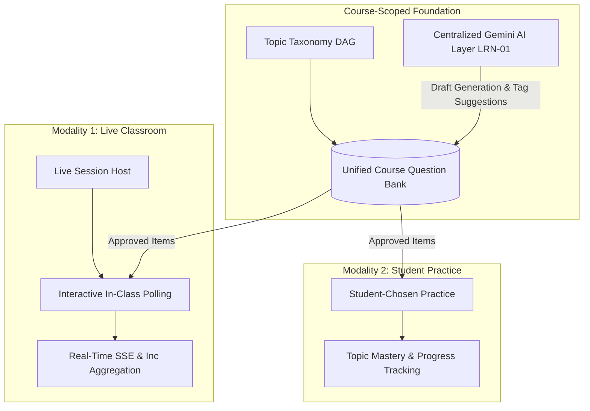
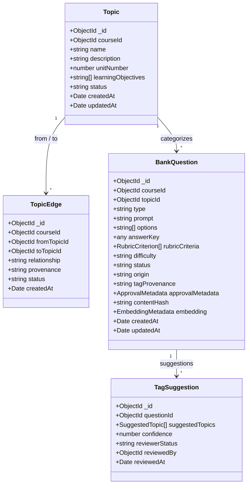
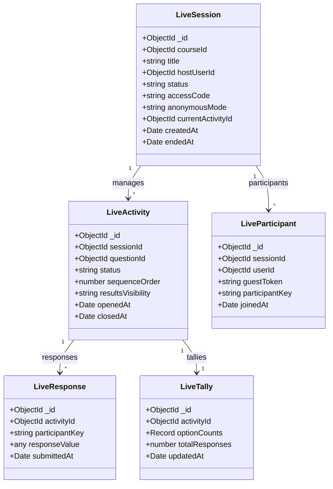
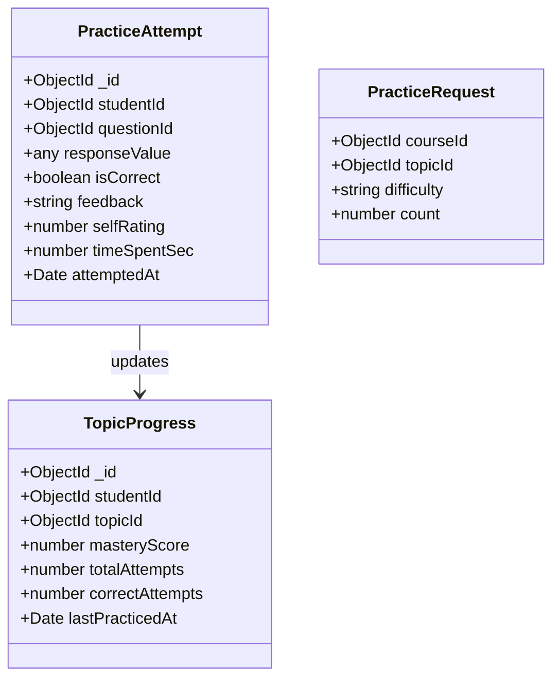
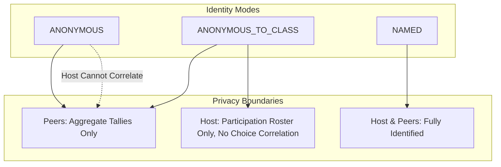
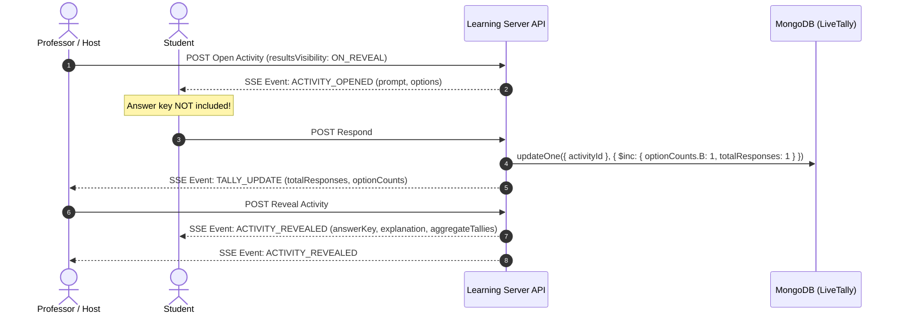
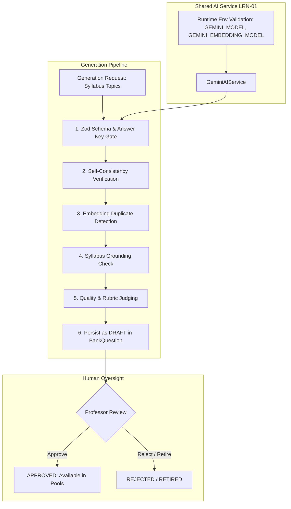
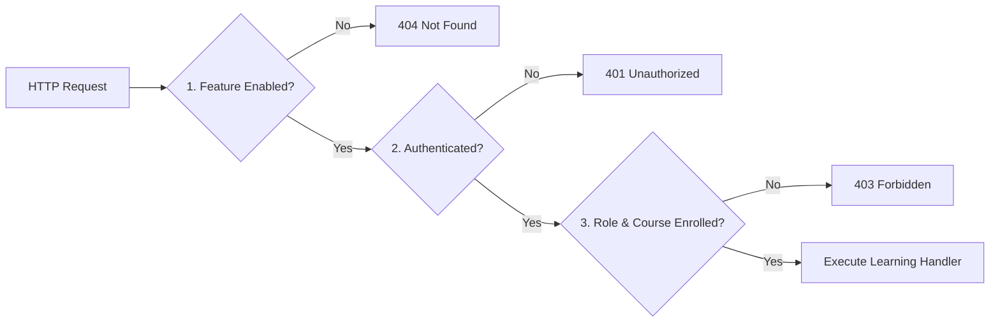

# Learning Module Architecture & Unified Design Note (LRN-03)

**Author:** Antigravity AI Engineering (Pair Programming with IIIT Hyderabad Team)
**Research Advisor:** Prof. C. V. Jawahar
**Parent Implementation Plan:** [GitHub Issue #244](https://github.com/Aarathi1535/assignment_evaluation-IIIT-Hyd/issues/244)
**Ticket:** [LRN-03 — Issue #262](https://github.com/Aarathi1535/assignment_evaluation-IIIT-Hyd/issues/262)
**Target Integration Branch:** `research/learning`
**Feature Gate:** `LEARNING_MODULE` (Disabled by default)
**Status:** Canonical Target Architecture Note (Documentation Specification — Application features pending phase rollout)

---

## A. Purpose and Scope

The Learning Module unifies two previously separate research streams into a single cohesive, course-scoped learning platform within the IIIT Hyderabad Assignment Evaluation platform:
1. **Interactive Classroom Assessment** (formerly Research Direction 1, developed on `research/jawahar-1-classroom-assessment`): Live, in-class polling, formative checkpoints, and real-time response aggregation.
2. **Personalized Practice & Progression** (formerly Research Direction 2, developed on `research/jawahar-2-personalized-assessment`): Student-chosen self-study practice, mastery progression, and curriculum-aligned question generation.

Rather than maintaining duplicate schemas, diverging Gemini client wrappers, and separate question pools, the unified module consolidates both modalities around three shared pillars:
* **One Course-Scoped Question Bank:** A unified repository of human-authored and AI-generated, professor-approved questions.
* **One Knowledge Taxonomy:** A syllabus-grounded Directed Acyclic Graph (DAG) of topics and prerequisite edges.
* **One Centralized AI Layer:** A single, robust `GeminiAIService` (specified in [LRN-01 #258](https://github.com/Aarathi1535/assignment_evaluation-IIIT-Hyd/issues/258)) governing structured generation, validation, embeddings, duplicate detection, and quality gates.



### Architectural Distinction: Design Plan vs. Current Implementation
This document specifies the **canonical target architecture** for the learning module. It serves as the authoritative blueprint for subsequent implementation tickets.
* **Current State:** The learning module is protected behind the `LEARNING_MODULE` feature flag ([LRN-02 #260](https://github.com/Aarathi1535/assignment_evaluation-IIIT-Hyd/issues/260)), disabled by default on both server (`FEATURE_LEARNING_MODULE=false`) and client (`NEXT_PUBLIC_FEATURE_LEARNING_MODULE=false`). The shared AI layer configuration is standardized under [LRN-01 #258](https://github.com/Aarathi1535/assignment_evaluation-IIIT-Hyd/issues/258).
* **Target State:** The database schemas, REST endpoints, SSE streams, and UI views defined below represent target models to be implemented across Phases 2 through 5. They must not be assumed to be operational until their respective PRs merge to `research/learning`.

---

## B. Agreed Defaults and Status

Based on preliminary research results and the parent plan in [Issue #244](https://github.com/Aarathi1535/assignment_evaluation-IIIT-Hyd/issues/244), the following operational defaults are established for the initial implementation:

| Architectural Area | Agreed Default Specification | Status / Boundaries |
|---|---|---|
| **Live Session Grading** | **Participation-only, not graded.** Live classroom activities track student engagement and presence, not evaluative marks or letter grades. | Default baseline; any future grading integration requires supervisor approval. |
| **Result Visibility** | **Aggregate results revealed after activity closes (`ON_REVEAL`).** Real-time individual submissions are hidden from peers. The professor explicitly triggers `REVEALED` state. | Agreed default for initial pilot; other visibility modes (`LIVE`, `AFTER_CLOSE`, `NEVER`) remain supported in schema. |
| **AI Tagging Behavior** | **Advisory suggestions only.** AI tags populate `TagSuggestion` models and are never silently written over human-curated topic fields. | Invariant; human professor or TA must accept or reject suggestions. |
| **AI Question Status** | **Default `DRAFT`.** AI-generated questions can never enter active question pools without explicit professor review and approval. | Invariant; prevents unverified AI content from reaching students. |
| **Topic Prerequisites** | **Advisory guidance pending professor confirmation.** Suggested prerequisite edges require human review before locking topic graphs. | Invariant; approved edges must enforce a strict DAG. |
| **Live Poll Modalities** | **Structured items only.** The initial live-poll pilot supports structured types (MCQ, predict output, numerical, short answer, word cloud, rating). Handwritten photo evaluation and sandboxed code execution are deferred. | Explicitly excluded from first pilot; reduces network latency and device friction. |
| **Parked Research** | **Direction 3 (Answer segmentation) and Direction 4 (Handwriting consistency) remain parked.** | Inactive; team focus is strictly on Directions 1 and 2 unification. |

> [!IMPORTANT]
> These defaults reflect consensus for Phase 1 and Phase 2 implementation. Unresolved decisions are explicitly documented as open questions in [Section H](#h-open-questions-for-prof-jawahar) and await final supervisor confirmation from Prof. C. V. Jawahar.

---

## C. Target Data Models (Proposed Target Architecture)

The data architecture is divided into three logical domains: Question Bank & Taxonomy, Live Classroom, and Practice. All models are scoped to a specific `courseId` to enforce strict multi-course isolation. All models documented in this section represent the **proposed target architecture** to be implemented under subsequent tickets.

### 1. Question Bank & Taxonomy Models



#### Proposed Schema Specifications: Question Bank

| Model Name | Field | Type | Description / Invariants |
|---|---|---|---|
| **`Topic`** | `_id` | `ObjectId` | Unique topic identifier. |
| | `courseId` | `ObjectId` | Foreign key to `Course`. Indexed. |
| | `name` | `string` | Topic title (e.g., "Convolutional Layers & Kernels"). |
| | `description` | `string` | Pedagogical description and scope. |
| | `unitNumber` | `number` | Syllabus unit or module number. |
| | `learningObjectives`| `string[]` | Specific Bloom's-aligned learning objectives. |
| | `status` | `string` | Enum: `'DRAFT'` \| `'APPROVED'`. Defaults to `'DRAFT'`. |
| **`TopicEdge`** | `_id` | `ObjectId` | Unique edge identifier. |
| | `courseId` | `ObjectId` | Foreign key to `Course`. Indexed. |
| | `fromTopicId` | `ObjectId` | Prerequisite topic ID. |
| | `toTopicId` | `ObjectId` | Dependent topic ID. |
| | `relationship` | `string` | Enum: `'PREREQUISITE'`. |
| | `provenance` | `string` | Enum: `'HUMAN'` \| `'AI_SUGGESTED'`. Tracks whether the edge was human-curated or AI-suggested. |
| | `status` | `string` | Enum: `'SUGGESTED'` \| `'APPROVED'`. Defaults to `'SUGGESTED'`. |
| | *Invariant* | *Rule* | **Approved prerequisite edges must form a Directed Acyclic Graph (DAG).** Cycles reject on edge creation or approval. |
| **`BankQuestion`**| `_id` | `ObjectId` | Unique bank question identifier. |
| | `courseId` | `ObjectId` | Foreign key to `Course`. Indexed. |
| | `topicId` | `ObjectId` | Foreign key to `Topic`. Indexed. |
| | `type` | `string` | Question type enum (see supported list below). |
| | `prompt` | `string` | The markdown-rendered question text. |
| | `options` | `string[]` | Array of choices (required for `MCQ`). |
| | `answerKey` | `any` | Authoritative answer key (value, option index, or range). |
| | `rubricCriteria` | `RubricCriterion[]`| Structured scoring criteria for subjective or open-ended assessment. |
| | `difficulty` | `string` | Enum: `'EASY'` \| `'MEDIUM'` \| `'HARD'`. |
| | `status` | `string` | Enum: `'DRAFT'` \| `'IN_REVIEW'` \| `'APPROVED'` \| `'RETIRED'`. Defaults to `'DRAFT'`. |
| | `origin` | `string` | Enum: `'HUMAN'` \| `'AI_GENERATED'` \| `'AI_VARIANT'`. |
| | `tagProvenance` | `string` | Enum: `'HUMAN'` \| `'AI_SUGGESTED'`. Indicates whether active topic tags were human-assigned or AI-derived. |
| | `approvalMetadata`| `object` | `{ approvedBy: ObjectId, approvedAt: Date, notes?: string }`. |
| | `contentHash` | `string` | SHA-256 hash of normalized prompt + options for quick collision check. |
| | `embedding` | `object` | `{ vector: number[], model: string, generatedAt: Date }`. |
| | *Invariant* | *Rule* | **An approved bank question strictly requires an authoritative answer key.** Rubrics supplement grading criteria for open questions but do not substitute for a required answer key. |
| **`TagSuggestion`**| `_id` | `ObjectId` | Unique suggestion identifier. |
| | `questionId` | `ObjectId` | Foreign key to `BankQuestion`. Indexed. |
| | `suggestedTopics` | `object[]` | Array of `{ topicId: ObjectId, score: number }`. |
| | `confidence` | `number` | Float [0.0 - 1.0] indicating AI confidence. |
| | `reviewerStatus` | `string` | Enum: `'PENDING'` \| `'ACCEPTED'` \| `'REJECTED'`. Defaults to `'PENDING'`. |

#### Supported Question Types
The unified bank supports eleven question types across practice and live classroom modalities:
* **Standard & Practice Types:**
  1. `MCQ`: Single or multiple-choice questions with defined options and single correct answer key.
  2. `NUMERICAL`: Mathematical or calculated answers with tolerance interval (e.g., $10.5 \pm 0.1$).
  3. `PREDICT_OUTPUT`: Code snippet provided; student submits exact stdout/evaluation result.
  4. `FIX_THE_CODE`: Code snippet containing a bug; student specifies corrected lines.
  5. `DEBUGGING`: Identification of root-cause logic, algorithmic, or syntactic defect.
  6. `COUNTEREXAMPLE`: Student submits an edge case or counterexample disproving a premise.
  7. `SHORT_ANSWER`: 1–2 sentence conceptual response evaluated against semantic criteria.
  8. `THEORY`: Conceptual proof or essay response graded against structured rubric criteria.
* **Live-Only Survey & Poll Types:**
  9. `WORD_CLOUD`: Open single-token or phrase responses aggregated into frequency distributions.
  10. `RATING`: 1-to-5 Likert scale for subjective comprehension checks or pacing sentiment.
  11. `OPEN_TEXT`: Freeform short feedback displayed anonymously on the host screen.

---

### 2. Live Classroom Models



#### Proposed Schema Specifications: Live Classroom

| Model Name | Field | Type | Description / Invariants |
|---|---|---|---|
| **`LiveSession`** | `_id` | `ObjectId` | Unique live session identifier. |
| | `courseId` | `ObjectId` | Foreign key to `Course`. Indexed. |
| | `title` | `string` | Session title (e.g., "Lecture 14: Attention Mechanisms"). |
| | `hostUserId` | `ObjectId` | Professor or TA hosting the session. |
| | `status` | `string` | Enum: `'DRAFT'` \| `'ACTIVE'` \| `'CONCLUDED'`. Indexed. |
| | `accessCode` | `string` | 6-character alphanumeric code for students to join. Unique while active. |
| | `anonymousMode` | `string` | Enum: `'ANONYMOUS'` \| `'ANONYMOUS_TO_CLASS'` \| `'NAMED'`. |
| | `currentActivityId`| `ObjectId` | Reference to currently running `LiveActivity`. Nullable. |
| **`LiveActivity`** | `_id` | `ObjectId` | Unique activity identifier. |
| | `sessionId` | `ObjectId` | Foreign key to `LiveSession`. Indexed. |
| | `questionId` | `ObjectId` | Foreign key to `BankQuestion`. |
| | `status` | `string` | Enum: `'PENDING'` \| `'ACTIVE'` \| `'REVEALED'` \| `'CLOSED'`. |
| | `sequenceOrder` | `number` | Order of activity within session (1, 2, 3...). |
| | `resultsVisibility`| `string` | Enum: `'LIVE'` \| `'AFTER_CLOSE'` \| `'ON_REVEAL'` \| `'NEVER'`. Defaults to `'ON_REVEAL'`. Controls when aggregate tallies are broadcast to students. |
| **`LiveParticipant`**| `_id` | `ObjectId` | Participant join record. |
| | `sessionId` | `ObjectId` | Foreign key to `LiveSession`. Indexed. |
| | `userId` | `ObjectId` | Optional link to authenticated `User`. Nullable for unauthenticated guests. |
| | `guestToken` | `string` | Ephemeral guest token for unauthenticated participants. Nullable for authenticated users. |
| | `participantKey` | `string` | Pseudonymous HMAC token: `HMAC(secret, sessionId + (userId \| guestToken))`. Unique per `[sessionId, participantKey]`. |
| | `joinedAt` | `Date` | Timestamp of joining. |
| **`LiveResponse`** | `_id` | `ObjectId` | Response document. |
| | `activityId` | `ObjectId` | Foreign key to `LiveActivity`. Indexed. |
| | `participantKey` | `string` | Pseudonymous identifier of respondent. |
| | `responseValue` | `any` | Selected option, numerical value, or text. |
| | `submittedAt` | `Date` | Submission timestamp. |
| | *Invariant* | *Rule* | **Compound Unique Index on `[activityId, participantKey]`. Exactly one response per activity per participant.** |
| **`LiveTally`** | `_id` | `ObjectId` | Cached real-time tally document. |
| | `activityId` | `ObjectId` | Foreign key to `LiveActivity`. Unique 1-to-1. |
| | `optionCounts` | `Map<string, number>`| Map of choice keys to submission count. Updated atomically via `$inc`. |
| | `totalResponses` | `number` | Total responses received. Updated atomically via `$inc`. |

---

### 3. Practice & Progression Models

The practice subsystem replaces the legacy deterministic fixed-rotation model from Research Direction 2 with an on-demand, student-chosen practice architecture.

> [!NOTE]
> The old deterministic fixed-rotation approach from Research Direction 2 is being formally retired. A clean question migration and deprecation path is tracked separately under **LRN-20**.



#### Proposed Schema Specifications: Practice

| Model Name | Field | Type | Description / Invariants |
|---|---|---|---|
| **`PracticeAttempt`**| `_id` | `ObjectId` | Record of student practice submission. |
| | `studentId` | `ObjectId` | Foreign key to authenticated `User`. Indexed. |
| | `questionId` | `ObjectId` | Foreign key to `BankQuestion`. Indexed. |
| | `responseValue` | `any` | Answer provided by the student. |
| | `isCorrect` | `boolean` | Evaluated correctness for objective types; null/true for self-rated. |
| | `feedback` | `string` | Immediate explanation or AI-assisted feedback. |
| | `selfRating` | `number` | Optional 1-5 student comprehension rating. |
| | `timeSpentSec` | `number` | Active seconds spent on the question. |
| | `attemptedAt` | `Date` | Timestamp of practice attempt. |
| **`PracticeRequest`**| `courseId` | `ObjectId` | Course context for practice session. |
| (DTO/Query) | `topicId` | `ObjectId` | Target topic selected by student. |
| | `difficulty` | `string` | Optional filter: `'EASY'` \| `'MEDIUM'` \| `'HARD'`. |
| | `count` | `number` | Requested number of questions (e.g., 5). |
| **`TopicProgress`** | `_id` | `ObjectId` | Rollup progress document. |
| | `studentId` | `ObjectId` | Foreign key to authenticated `User`. Indexed. |
| | `topicId` | `ObjectId` | Foreign key to `Topic`. Indexed. Compound index `[studentId, topicId]`. |
| | `masteryScore` | `number` | Normalized mastery float [0.0 - 100.0] derived from recent attempts. |
| | `totalAttempts` | `number` | Cumulative questions attempted for this topic. |
| | `correctAttempts`| `number` | Cumulative questions correctly answered. |
| | `lastPracticedAt`| `Date` | Most recent activity timestamp. |

---

## D. Identity and Privacy Rules

Protecting student identity in classroom settings is essential for encouraging honest engagement without fear of peer judgment or grading penalties. The learning module enforces three distinct privacy modes:



### 1. Specification of Identity Modes

1. **`ANONYMOUS` (Full Anonymity):**
   * **Peer Visibility:** Students see only aggregate tallies and distributions.
   * **Host Visibility:** The professor/host sees the total response count and aggregate tallies. The professor **cannot** correlate any individual response or option choice with a specific student name, roll number, or identity.
   * **Use Case:** High-stakes conceptual questions, sensitive polls, or anonymous student feedback.
2. **`ANONYMOUS_TO_CLASS` (Pseudonymous to Peers):**
   * **Peer Visibility:** Classmates see only aggregated tallies. No student names or individual choices are broadcast.
   * **Host Visibility:** The professor/host has an administrative view confirming who joined and who participated (e.g., for attendance or participation credit), but aggregate question results remain decoupled from names on the primary presentation display.
   * **Use Case:** Standard lecture interactive quizzes where participation credit is tracked by the instructor but peer exposure is prevented.
3. **`NAMED` (Identified Mode):**
   * **Peer & Host Visibility:** Student identities and names are directly associated with submissions and can be displayed on leaderboards or cohort summary lists if enabled.
   * **Use Case:** Small graduate seminars, active discussion groups, or team presentations.

### 2. Pseudonymous `participantKey` Derivation
To decouple student identity from responses while supporting both authenticated users and unauthenticated guests:
* The `participantKey` is derived using HMAC:
  $$\text{participantKey} = \text{HMAC}(\text{secret}, \text{sessionId} + (\text{userId} \mid \text{guestToken}))$$
* This construction preserves anonymity across responses while permitting one-response-per-activity enforcement via the unique compound constraint on `[activityId, participantKey]`.
* In `ANONYMOUS` mode, individual responses in `LiveResponse` store only `activityId`, `participantKey`, and `responseValue`, preventing direct correlation with student profiles.
* In `ANONYMOUS_TO_CLASS` mode, `LiveParticipant` records presence/participation for administrative review by the instructor, but aggregate responses displayed to peers remain anonymous.

### 3. Payload and AI Privacy Guards
* **SSE Payload Sanitization:** Student-facing Server-Sent Events (SSE) payloads must **never** contain student names, roll numbers, user IDs, email addresses, or unhashed participant keys.
* **AI Prompt Privacy Invariant:** Student identity metadata (names, IDs, emails) must **never** be injected into AI prompts. All AI generation, tag classification, and feedback evaluation calls are completely decoupled from student personal data.

---

## E. Real-Time Events and Role-Specific DTOs

The live classroom subsystem utilizes Server-Sent Events (SSE) over HTTP with streaming JSON lines for unidirectional push events, coupled with atomic REST endpoints for student submissions.



### 1. Incremental Tally Architecture
To prevent high-concurrency database locks during live classroom spikes (e.g., 200 students responding simultaneously within a 30-second window):
* Responses are written to `LiveResponse` with a compound unique index constraint on `[activityId, participantKey]`.
* Aggregated tallies are maintained incrementally using MongoDB's atomic `$inc` operator:
  ```typescript
  // Target incremental tally update
  await LiveTally.updateOne(
    { activityId },
    {
      $inc: {
        [`optionCounts.${sanitizedChoice}`]: 1,
        totalResponses: 1
      },
      $set: { updatedAt: new Date() }
    },
    { upsert: true }
  );
  ```
* Tallies are **never** recalculated by executing a full table aggregation scan across all `LiveResponse` rows during an active poll.

### 2. Result Visibility Modes & Reveal Policy
The target architecture supports four visibility modes configured on `LiveActivity.resultsVisibility`:
* `LIVE`: Aggregate tallies update continuously on student screens during polling.
* `AFTER_CLOSE`: Aggregate tallies become visible to students only after the activity status transitions to `CLOSED`.
* `ON_REVEAL`: Aggregate tallies and answer keys become visible only when the host explicitly transitions the activity status to `REVEALED`. This is the **agreed default** for the initial pilot to prevent peer anchoring bias during polling.
* `NEVER`: Aggregate tallies are never broadcast to students (used for formal evaluative checkpoints or research baselines).

Regardless of the visibility mode, **answer keys are never released until the activity status reaches `REVEALED`**.

### 3. Planned Degraded-Mode Polling Fallback
In environments where unstable classroom Wi-Fi or proxy middleboxes disrupt SSE connections:
* The client architecture plans for degraded-mode HTTP short polling as a fallback mechanism if SSE streams disconnect and fail to reconnect within an established heartbeat window.
* When the degraded mode is active, the client polls the server for current activity state until SSE streaming can be cleanly re-established.
* Exact endpoint paths, heartbeat thresholds, and polling backoff intervals will be defined as part of the live classroom implementation ticket (LRN-08/LRN-09).

### 4. Role-Specific Data Transfer Objects (Target Contracts)

#### Student DTO: `ActivityStateEvent` (Pre-Reveal)
When an activity is `ACTIVE`, the student receives only the question prompt and choices. The `answerKey` and `tallies` are strictly omitted.
```json
{
  "event": "ACTIVITY_STATE",
  "data": {
    "activityId": "670f1a2b3c4d5e6f7a8b9c0d",
    "status": "ACTIVE",
    "question": {
      "type": "MCQ",
      "prompt": "What is the primary role of the stride parameter in a 2D convolution?",
      "options": [
        "A) Controls kernel padding depth",
        "B) Determines the step size when traversing the input feature map",
        "C) Sets the learning rate of the convolutional filter",
        "D) Normalizes activation values across channels"
      ]
    },
    "hasSubmitted": false
  }
}
```

#### Student DTO: `ActivityStateEvent` (Post-Reveal)
Once the host toggles the activity to `REVEALED`, the answer key, explanation, and anonymous aggregate tallies are broadcast.
```json
{
  "event": "ACTIVITY_STATE",
  "data": {
    "activityId": "670f1a2b3c4d5e6f7a8b9c0d",
    "status": "REVEALED",
    "answerKey": "B",
    "explanation": "Stride defines the step size with which the sliding window kernel traverses the spatial dimensions.",
    "tallies": {
      "totalResponses": 84,
      "optionCounts": { "A": 4, "B": 72, "C": 2, "D": 6 }
    }
  }
}
```

#### Professor / Host DTO: `HostActivityMonitorEvent`
The host receives live, unmasked participation metrics and incremental tallies while polling is active.
```json
{
  "event": "HOST_MONITOR_UPDATE",
  "data": {
    "activityId": "670f1a2b3c4d5e6f7a8b9c0d",
    "status": "ACTIVE",
    "totalEnrolled": 92,
    "totalConnected": 88,
    "totalResponses": 84,
    "tallies": {
      "A": 4,
      "B": 72,
      "C": 2,
      "D": 6
    }
  }
}
```

---

## F. AI Architecture and Gates

All generative AI capabilities across the learning module are centralized behind the shared `GeminiAIService` introduced in [LRN-01 #258](https://github.com/Aarathi1535/assignment_evaluation-IIIT-Hyd/issues/258). Direct, ad-hoc HTTP calls to Gemini endpoints or unmanaged model clients are strictly prohibited.



### 1. Unified Configuration & Model Resolution
* **Runtime Resolution:** The service requires `GEMINI_MODEL` (for structured generation and multimodal evaluation) and `GEMINI_EMBEDDING_MODEL` (for vector embeddings).
* **No Hard-Coded Fallback:** If either environment variable is missing, the service fails fast with HTTP 503 Service Unavailable, preventing silent degradation to incompatible or unvetted model versions.
* **Secret Safety:** API keys and credential tokens must never appear in client bundles, log outputs, or error payloads.

### 2. Multi-Stage Question Generation & Rejection Pipeline
AI-generated questions must pass six mandatory automated validation gates before being persisted:

1. **Schema & Answer Key Gate:**
   * Response must parse cleanly against strict Zod schemas.
   * `MCQ` questions must provide non-empty options and a valid answer key matching one of the options.
   * Numerical questions must specify numeric answer keys and tolerance bounds.
   * Open and theory questions must generate structured `rubricCriteria` alongside reference answer keys.
   * Failure causes immediate rejection and retry.
2. **Self-Consistency Gate:**
   * The generated prompt is sent to a separate generation call without the answer key to verify whether the model solves its own question identically.
   * Inconsistencies or ambiguous answer paths trigger rejection.
3. **Embedding-Based Duplicate Detection:**
   * An embedding vector is computed using `GEMINI_EMBEDDING_MODEL`.
   * Cosine similarity is calculated against all existing approved questions in the course bank.
   * **Similarity $\ge 0.92$:** Automatic rejection (classified as duplicate).
   * **$0.85 \le \text{Similarity} < 0.92$:** Question is flagged with a duplicate warning for human reviewer inspection.
4. **Syllabus Grounding Verification:**
   * The question's extracted concepts are compared against the course's active `Topic` learning objectives.
   * Questions introducing out-of-scope concepts or irrelevant topics are rejected.
5. **Quality & Clarity Judging:**
   * Evaluates prompt clarity, presence of concrete artifacts (code blocks, equations, figures), Bloom's taxonomy alignment, and absence of trick questions or hallucinated citations.
6. **Human Approval Gate:**
   * Passed questions are saved with `status = 'DRAFT'` and `origin = 'AI_GENERATED'`.
   * AI-generated questions **never** enter active live or practice pools until a professor or authorized instructor marks them `APPROVED`.

### 3. Operational Gates, Billed Keys, and Data Privacy
* **Advisory AI Tags:** AI-generated topic tags populate `TagSuggestion` models with confidence scores. They are never written directly over human-assigned topic metadata.
* **Advisory AI Prerequisites:** AI-proposed prerequisite edges between topics remain `SUGGESTED` until confirmed by an instructor.
* **Background Job Budgets:** Generation tasks run as queued background jobs with per-course rate limits and progress reporting.
* **Paid-Tier Verification & `isRealStudentData` Gate:**
  * When executing AI calls involving real student content (such as student-submitted answers or handwritten notes), the application must supply `isRealStudentData: true`.
  * The system **strictly requires supervisor confirmation that the intended Gemini key is actually billed** (`GEMINI_PAID_TIER=true`) before real student data is sent to the model.
  * Under Google AI Studio's free tier, user prompts may be logged for model training. Real student submissions must **never** be transmitted over the free tier.
  * If `isRealStudentData === true` and `GEMINI_PAID_TIER !== 'true'`, the service immediately halts execution with HTTP 403 Forbidden.
  * *Status Note:* Billing setup and financial budgets are currently unapproved open decisions awaiting supervisor confirmation (see Questions 11 & 12).

---

## G. Authorization and Rollout

### 1. Feature Flag Protection
* The entire learning module is gated by the `LEARNING_MODULE` feature flag ([LRN-02 #260](https://github.com/Aarathi1535/assignment_evaluation-IIIT-Hyd/issues/260)).
* When `FEATURE_LEARNING_MODULE=false`:
  * API endpoints return HTTP 404 Not Found without disclosing feature existence.
  * Navigation links, dashboard widgets, and student practice portals are completely hidden in the UI.
* Enabling the flag activates the routes but **does not bypass** standard role-based access control (RBAC).

### 2. Multi-Layer Security Architecture
When the feature flag is enabled, every API route must execute full defense-in-depth authorization:
1. **Feature Guard:** Verify `requireFeature('LEARNING_MODULE')`.
2. **Session Authentication:** Verify valid JWT session via `requireAuth(req)`.
3. **Role & Permission Check:** Enforce RBAC via `requireRole(['PROFESSOR', 'ADMIN'])` for administrative and bank authoring endpoints.
4. **Course Enrollment Isolation:** Verify that the authenticated student is actively enrolled in the `courseId` specified in the request.



### 3. Prerequisites for Student-Facing Rollout
Before exposing student-facing learning functionality (live participation or practice) in production, the following security prerequisites must be met:
* **Verified Identity Linking:** Unauthenticated or self-registered student accounts without institutional email verification must not access course practice pools.
* **Role Tampering Protection:** Session claims must be cryptographically validated on every state-changing route.
* **Safety Affirmation:** The student-facing rollout is currently **disabled** and will remain disabled until pilot authorization is granted by the faculty supervisor.

---

## H. Open Questions for Prof. Jawahar

The following 14 questions are carried forward from Section B5 of the parent plan ([Issue #244](https://github.com/Aarathi1535/assignment_evaluation-IIIT-Hyd/issues/244)). Every question represents an unresolved pedagogical or architectural decision and is recorded as **OPEN — awaiting supervisor confirmation**.

### 1. Course, Content, and Question Bank Ownership
1. **Question 1 (Course Scope & Question Sharing):**
   *Status:* `OPEN — awaiting supervisor confirmation`
   *Description:* Is the question bank strictly isolated per course (e.g., each course code owns its independent taxonomy and questions), or should approved questions and topics be shareable across multiple courses or professors within the institute (e.g., shared across CS101 and CS102)?
2. **Question 2 (Initial Seeding):**
   *Status:* `OPEN — awaiting supervisor confirmation`
   *Description:* Will Prof. Jawahar and the course instructors provide an initial seed bank of professor-authored questions and course syllabus outlines for the first pilot course (e.g., Computer Vision, SMAI, or Intro to Programming), or should the AI generation pipeline synthesize the initial candidate pool from textbook chapters and lecture notes?
3. **Question 3 (Human Review Authority & TA Roles):**
   *Status:* `OPEN — awaiting supervisor confirmation`
   *Description:* Should graduate Teaching Assistants (TAs) have the authorization to review, edit, and approve AI-generated draft questions and prerequisite edges, or is approval strictly restricted to the primary course professor?

### 2. Result Visibility, Moderation, Identity, and Joining
4. **Question 4 (Live Joining & Authentication Friction):**
   *Status:* `OPEN — awaiting supervisor confirmation`
   *Description:* For live classroom polling, should students be required to log in with their institutional student accounts, or should they be permitted to join rapidly on mobile browsers via a 6-character session PIN/QR code without authenticating?
5. **Question 5 (Real-Time Result Reveal Policy):**
   *Status:* `OPEN — awaiting supervisor confirmation`
   *Description:* Should real-time submission distributions and tallies remain strictly hidden until the instructor explicitly clicks "Reveal", or would the instructor prefer a live-updating bar chart on the podium display during polling?

### 3. Grading Policy, Handwritten Submissions, and Code Execution
6. **Question 6 (Formative vs. Evaluative Grading):**
   *Status:* `OPEN — awaiting supervisor confirmation`
   *Description:* Should live classroom participation and student practice remain strictly formative (ungraded engagement tracking), or should verified participation scores and practice streaks contribute a weighted percentage to the student's final semester grade?
7. **Question 7 (Handwritten-Photo Pilot Inclusion):**
   *Status:* `OPEN — awaiting supervisor confirmation`
   *Description:* Does Prof. Jawahar want the multimodal handwritten photo capture and Gemini VLM evaluation (developed in Research Direction 1) included in the first live classroom pilot, or should the pilot strictly use rapid structured types (MCQ, predict output, numerical) to minimize classroom latency?
8. **Question 8 (Interactive Code Sandbox Execution):**
   *Status:* `OPEN — awaiting supervisor confirmation`
   *Description:* For programming questions (`FIX_THE_CODE`, `PREDICT_OUTPUT`), should the platform incorporate a real-time sandboxed execution engine (e.g., isolated Docker/WebAssembly runner) to run student code, or should evaluation rely on static text/AST analysis and AI judging?

### 4. Practice Adaptation and TA Escalation
9. **Question 9 (Adaptive Difficulty vs. Student Choice):**
   *Status:* `OPEN — awaiting supervisor confirmation`
   *Description:* When a student demonstrates consistent mastery in practice, should the system automatically advance them to harder questions via an adaptive algorithm (e.g., Elo or Item Response Theory), or should students retain complete manual control over topic and difficulty selection?
10. **Question 10 (TA Escalation & Doubt Clearing):**
    *Status:* `OPEN — awaiting supervisor confirmation`
    *Description:* When a student repeatedly struggles with a concept in practice (e.g., 3 consecutive failed attempts) or flags an AI explanation as confusing, should an automated alert be dispatched to the course TA dashboard for intervention?

### 5. Paid Gemini Tier, Budget, and Student Data Privacy
11. **Question 11 (Institutional Paid API Billing Account):**
    *Status:* `OPEN — awaiting supervisor confirmation`
    *Description:* Given that Google AI Studio's free tier permits prompt data logging (violating student data privacy requirements for production student submissions), what institutional Google Cloud billing account or Vertex AI enterprise project will be provisioned for paid Gemini API calls?
12. **Question 12 (Monthly AI Cost & Quota Budgets):**
    *Status:* `OPEN — awaiting supervisor confirmation`
    *Description:* What is the monthly financial and token quota budget allocated per course for AI question generation, embedding duplicate detection, and automated student feedback?

### 6. Prerequisite Enforcement, Scale, and Pilot Timeline
13. **Question 13 (Strict vs. Advisory Prerequisite Locking):**
    *Status:* `OPEN — awaiting supervisor confirmation`
    *Description:* Should prerequisite edges in the topic DAG strictly lock dependent practice topics until the student demonstrates proficiency in prerequisites, or should edges serve purely as advisory learning path recommendations?
14. **Question 14 (Target Course, Scale, and Pilot Milestone):**
    *Status:* `OPEN — awaiting supervisor confirmation`
    *Description:* What specific course, expected class cohort size (e.g., 60 vs. 250 students), and target calendar week in the upcoming academic term are designated for the first in-classroom live trial?

---

## I. Implementation Roadmap

The unification plan outlined in [Issue #244](https://github.com/Aarathi1535/assignment_evaluation-IIIT-Hyd/issues/244) is structured into sequential phases. Each ticket is executed on an isolated branch and merged into `research/learning` via pull request.

```mermaid
gantt
    title Learning Module Implementation Sequence
    dateFormat  X
    axisFormat %s

    section Phase 1: Foundations
    LRN-01 Shared AI Layer (#258)       :done, p1, 0, 1
    LRN-02 Feature Flag Guard (#260)     :done, p2, 1, 2
    LRN-03 Canonical Architecture (#262):active, p3, 2, 3

    section Phase 2: Bank & Taxonomy
    LRN-04 Topic & DAG Schemas          :p4, 3, 5
    LRN-05 Bank Question & Zod Models   :p5, 4, 6
    LRN-06 AI Question Gen Pipeline     :p6, 5, 8
    LRN-07 Deduplication & Embeddings   :p7, 6, 8

    section Phase 3: Live Classroom
    LRN-08 Live Session & Activity API  :p8, 8, 10
    LRN-09 Real-time SSE & Tally Inc    :p9, 9, 11
    LRN-10 Live Host & Student Views    :p10, 10, 12

    section Phase 4: Practice
    LRN-11 Practice Attempt & Progress  :p11, 11, 13
    LRN-20 Question Bank Migration      :p12, 12, 14

    section Phase 5: Verification & Pilot
    LRN-15 End-to-End Test Matrix       :p13, 14, 16
    LRN-16 Pilot Readiness Review       :p14, 15, 17
```



### Dependency Graph & PR Workflow
* **Foundation Phase (Current):**
  * **LRN-01 ([#258](https://github.com/Aarathi1535/assignment_evaluation-IIIT-Hyd/issues/258)):** Standardizes `GeminiAIService` with strict `GEMINI_MODEL` and `GEMINI_EMBEDDING_MODEL` validation.
  * **LRN-02 ([#260](https://github.com/Aarathi1535/assignment_evaluation-IIIT-Hyd/issues/260)):** Implements the `LEARNING_MODULE` feature flag and route guards.
  * **LRN-03 ([#262](https://github.com/Aarathi1535/assignment_evaluation-IIIT-Hyd/issues/262)):** Establishes this canonical design document.
* **Subsequent Phases:**
  * **Phase 2 (Taxonomy & Bank):** Implements `Topic`, `TopicEdge` (DAG invariant), `BankQuestion`, and generation pipelines.
  * **Phase 3 (Live Classroom):** Implements live session controllers, atomic `$inc` tally engine, and SSE distribution.
  * **Phase 4 (Student Practice):** Implements self-study progression and executes **LRN-20** to retire the legacy fixed-rotation approach and migrate questions.
  * **Phase 5 (Rollout & Validation):** Executes comprehensive load tests and reviews pilot readiness with Prof. Jawahar.

> [!IMPORTANT]
> This roadmap defines the intended schedule. No subsequent ticket should be assumed to be implemented until its corresponding pull request has been reviewed and merged into `research/learning`.

---

## J. References and Status

### 1. Specification References
* **Parent Plan:** [GitHub Issue #244: Unification Plan — Interactive Classroom + Personalized Practice](https://github.com/Aarathi1535/assignment_evaluation-IIIT-Hyd/issues/244)
* **AI Service Standardization:** [LRN-01: GitHub Issue #258](https://github.com/Aarathi1535/assignment_evaluation-IIIT-Hyd/issues/258)
* **Feature Flag Guard:** [LRN-02: GitHub Issue #260](https://github.com/Aarathi1535/assignment_evaluation-IIIT-Hyd/issues/260)
* **Architecture Design Note:** [LRN-03: GitHub Issue #262](https://github.com/Aarathi1535/assignment_evaluation-IIIT-Hyd/issues/262)

### 2. Legacy Research Documents & Source Branches
* **Classroom Assessment (Direction 1):**
  * Historical Document: [docs/research-classroom-assessment.md](./research-classroom-assessment.md)
  * Source Branch: `research/jawahar-1-classroom-assessment`
* **Personalized Assessment (Direction 2):**
  * Historical Document: [docs/research-personalized-assessment.md](./research-personalized-assessment.md)
  * Source Branch: `research/jawahar-2-personalized-assessment`
