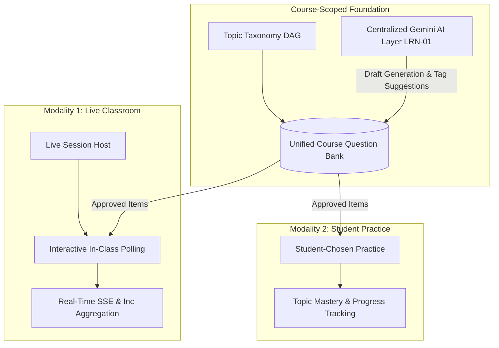
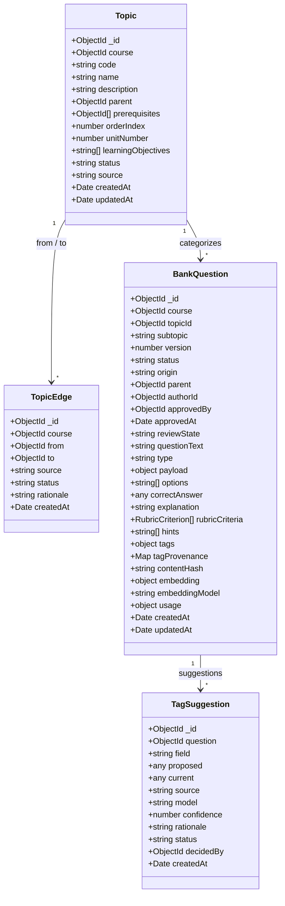
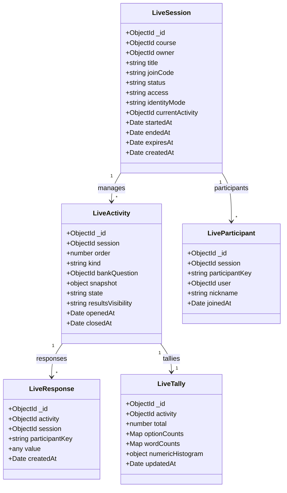
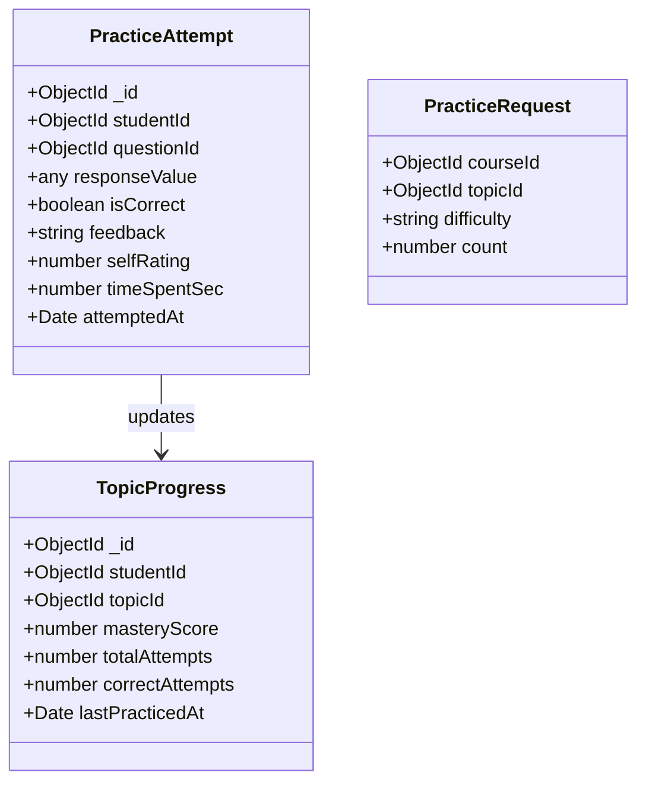
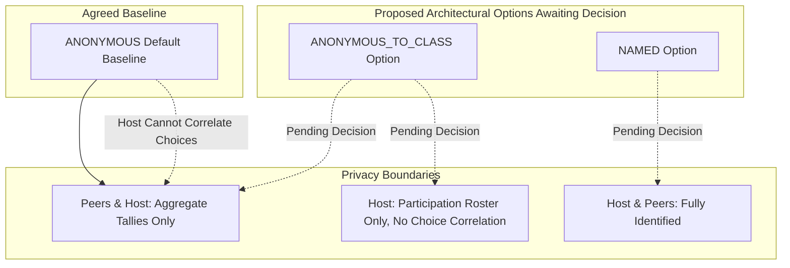
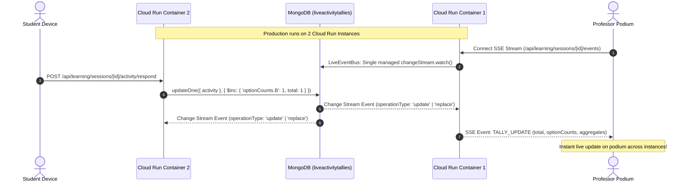
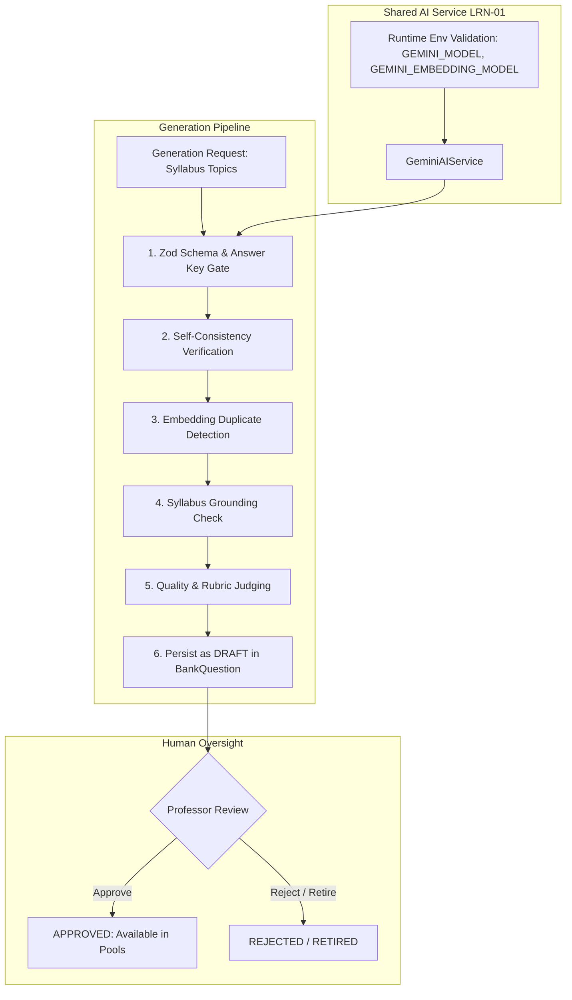
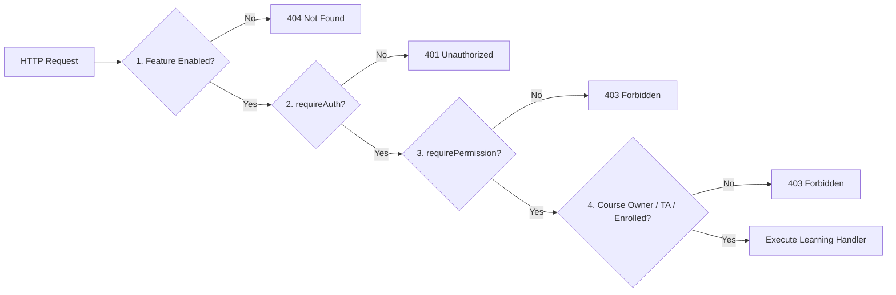

# Learning Module Architecture & Unified Design Note (LRN-03)

**Author:** Aarathi Sree (IIIT Hyderabad)
**Research Advisor:** Prof. C. V. Jawahar
**Parent Implementation Plan:** [GitHub Issue #244](https://github.com/Aarathi1535/assignment_evaluation-IIIT-Hyd/issues/244)
**Ticket:** [LRN-03 — Issue #262](https://github.com/Aarathi1535/assignment_evaluation-IIIT-Hyd/issues/262)
**Target Integration Branch:** `research/learning`
**Feature Gate:** `FEATURE_LEARNING_MODULE` (Disabled by default)
**Status:** Canonical Target Architecture Note (Documentation Specification — Application features pending phase rollout)
**PR Metadata Preparation:** Title: `docs(learning): design note for the learning module (LRN-03)` | Issue Ref: `Refs #262` (not `Closes #262` due to pending supervisor decisions) | Labels: `type:docs`, `area:docs`

---

## A. Purpose and Scope

The Learning Module unifies two previously separate research streams into a single cohesive, course-scoped learning platform within the IIIT Hyderabad Assignment Evaluation platform:
1. **Interactive Classroom Assessment** (formerly Research Direction 1, developed on legacy research branch `research/jawahar-1-classroom-assessment`): Live, in-class polling, formative checkpoints, and real-time response aggregation.
2. **Personalized Practice & Progression** (formerly Research Direction 2, developed on legacy research branch `research/jawahar-2-personalized-assessment`): Student-chosen self-study practice, mastery progression, and curriculum-aligned question generation.

Rather than maintaining duplicate schemas, diverging Gemini client wrappers, and separate question pools, the unified module consolidates both modalities around three shared pillars:
* **One Course-Scoped Question Bank:** A unified repository of human-authored and AI-generated, professor-approved questions.
* **One Knowledge Taxonomy:** A syllabus-grounded Directed Acyclic Graph (DAG) of topics and prerequisite edges.
* **One Centralized AI Layer:** A single, robust `GeminiAIService` (specified in [LRN-01 #258](https://github.com/Aarathi1535/assignment_evaluation-IIIT-Hyd/issues/258), merged into `research/learning`) governing structured generation, validation, embeddings, duplicate detection, and quality gates.



### Architectural Distinction: Design Plan vs. Current Implementation
This document specifies the **canonical target architecture** for the learning module. It serves as the authoritative blueprint for subsequent implementation tickets.
* **Current State:** The learning module is protected behind the `LEARNING_MODULE` feature flag ([LRN-02 #260](https://github.com/Aarathi1535/assignment_evaluation-IIIT-Hyd/issues/260), merged to `research/learning`), disabled by default on both server (`FEATURE_LEARNING_MODULE=false`) and client (`NEXT_PUBLIC_FEATURE_LEARNING_MODULE=false`). The shared AI layer configuration is standardized under [LRN-01 #258](https://github.com/Aarathi1535/assignment_evaluation-IIIT-Hyd/issues/258), also merged to `research/learning`.
* **Target State:** The database schemas, REST endpoints, SSE streams, and UI views defined below represent target models to be implemented across Phases 1 through 5. They must not be assumed to be operational until their respective PRs merge to `research/learning`.

---

## B. Agreed Defaults and Status

Based on preliminary research results and the parent plan in [Issue #244](https://github.com/Aarathi1535/assignment_evaluation-IIIT-Hyd/issues/244), the following operational defaults are established for the initial implementation:

| Architectural Area | Agreed Default Specification | Status / Boundaries |
|---|---|---|
| **Live Session Grading** | **Participation-only, not graded.** Live classroom activities track student engagement and presence, not evaluative marks or letter grades. | Default baseline; any future grading integration requires supervisor approval. |
| **Identity & Privacy Baseline** | **`ANONYMOUS` is the baseline default.** Full anonymity for students. `ANONYMOUS_TO_CLASS` and `NAMED` are presented as architectural options awaiting Prof. Jawahar's decision, not approved design decisions. | Default baseline; see [Section D](#d-identity-and-privacy-rules) & [Question 4](#4-anonymity). |
| **Result Visibility** | **Aggregate results revealed after activity closes (`ON_REVEAL`).** Real-time individual submissions are hidden from peers. The professor explicitly triggers `REVEALED` state. | Agreed default for initial pilot; other visibility modes (`LIVE`, `AFTER_CLOSE`, `NEVER`) remain supported in schema. |
| **AI Tagging Behavior** | **Advisory suggestions only.** AI tags populate `TagSuggestion` models and are never silently written over human-curated topic fields. | Invariant; human professor or TA must accept or reject suggestions. |
| **AI Question Status** | **Default `DRAFT`.** AI-generated questions can never enter active question pools without explicit professor review and approval. | Invariant; prevents unverified AI content from reaching students. |
| **Topic Prerequisites** | **Advisory guidance pending professor confirmation.** Suggested prerequisite edges (`status = 'PROPOSED'`) require human review before locking topic graphs. | Invariant; approved edges must enforce a strict DAG. |
| **Live Poll Modalities** | **Structured items only.** The initial live-poll pilot supports structured types (MCQ, predict output, numerical, short answer, word cloud, rating). Handwritten photo evaluation and sandboxed code execution are deferred. | Explicitly excluded from first pilot; reduces network latency and device friction. |
| **Production Rollout Gate** | **`FEATURE_LEARNING_MODULE` stays `false` in production until Issue #257 is closed.** Student-facing endpoints and UI remain disabled in production until institutional email verification, admin approval, and account linking safeguards are completed. | Mandatory security gate; see [Section G](#g-authorization-and-rollout). |
| **Parked Research** | **Direction 3 (Answer segmentation) and Direction 4 (Handwriting consistency) remain parked.** | Inactive; team focus is strictly on Directions 1 and 2 unification. |

> [!IMPORTANT]
> These defaults reflect consensus for Phase 0 and Phase 1 implementation. Unresolved decisions are explicitly documented as open questions in [Section H](#h-open-questions-for-prof-jawahar) and await final supervisor confirmation from Prof. C. V. Jawahar.

---

## C. Target Data Models (Proposed Target Architecture)

The data architecture is divided into three logical domains: Question Bank & Taxonomy, Live Classroom, and Practice. All models are scoped to a specific `course` to enforce strict multi-course isolation. All models documented in this section represent the **proposed target architecture** to be implemented under subsequent tickets.

### 1. Question Bank & Taxonomy Models



#### Proposed Schema Specifications: Question Bank (Issue #244 B1)

| Model Name | Field | Type | Description / Invariants |
|---|---|---|---|
| **`Topic`** | `_id` | `ObjectId` | Unique topic identifier. |
| | `course` | `ObjectId` | Foreign key to `Course`. Indexed. |
| | `code` | `string` | Pedagogical topic code (e.g., `"UNIT-1.2"`, `"CS101-T04"`). |
| | `name` | `string` | Topic title (e.g., "Convolutional Layers & Kernels"). |
| | `description` | `string` | Pedagogical description and scope. |
| | `parent` | `ObjectId` | Reference to parent `Topic` for hierarchical subtopics. Nullable. |
| | `prerequisites` | `ObjectId[]` | Array of prerequisite `Topic` identifiers. |
| | `orderIndex` | `number` | Sequencing order within the course syllabus. |
| | `unitNumber` | `number` | Syllabus unit or module number. |
| | `learningObjectives`| `string[]` | Specific Bloom's-aligned learning objectives. |
| | `status` | `string` | Enum: `'PROPOSED'` \| `'APPROVED'`. **Defaults to `'PROPOSED'`** for AI-suggested topics awaiting instructor review and approval. |
| | `source` | `string` | Enum: `'HUMAN'` \| `'AI'`. Preserves provenance of topic creation. |
| **`TopicEdge`** | `_id` | `ObjectId` | Unique edge identifier. |
| | `course` | `ObjectId` | Foreign key to `Course`. Indexed. |
| | `from` | `ObjectId` | Prerequisite `Topic` identifier. |
| | `to` | `ObjectId` | Dependent `Topic` identifier. |
| | `source` | `string` | Enum: `'HUMAN'` \| `'AI'`. Preserves whether the edge was human-curated or AI-suggested. |
| | `rationale` | `string` | Optional text explaining why this prerequisite relationship exists (especially for AI suggestions). |
| | `status` | `string` | Enum: `'PROPOSED'` \| `'APPROVED'` \| `'REJECTED'`. Defaults to `'PROPOSED'`. |
| | *Invariant* | *Rule* | **Approved prerequisite edges (`status === 'APPROVED'`) must form a Directed Acyclic Graph (DAG).** Cycles reject on edge creation or approval via DFS cycle-detection check. |
| **`BankQuestion`**| `_id` | `ObjectId` | Unique bank question identifier. |
| | `course` | `ObjectId` | Foreign key to `Course`. Indexed. |
| | `topicId` | `ObjectId` | Foreign key to `Topic`. Indexed. |
| | `subtopic` | `string` | Optional granular subtopic tag or label. |
| | `version` | `number` | Incremental integer version tracking revisions (starts at 1). |
| | `status` | `string` | Enum: `'DRAFT'` \| `'IN_REVIEW'` \| `'APPROVED'` \| `'RETIRED'`. Defaults to `'DRAFT'`. |
| | `origin` | `string` | Enum: `'HUMAN'` \| `'AI_GENERATED'` \| `'AI_VARIANT'`. Preserves question author provenance. |
| | `parent` | `ObjectId` | Nullable reference to ancestor `BankQuestion` for AI variants or cloned items. |
| | `authorId` / `authoredBy` | `ObjectId` | Foreign key to `User` who created or triggered generation. |
| | `approvedBy` | `ObjectId` | Foreign key to `User` (professor/instructor) who approved the question. Nullable. |
| | `approvedAt` | `Date` | Timestamp of approval. Nullable. |
| | `reviewState` | `string` | Enum: `'PENDING'` \| `'ACCEPTED'` \| `'REJECTED'`. |
| | `questionText` / `stem` | `string` | The markdown-rendered question text / problem stem. |
| | `type` / `questionType` | `string` | Question type enum: `MCQ`, `NUMERICAL`, `PREDICT_OUTPUT`, `FIX_THE_CODE`, `DEBUGGING`, `COUNTEREXAMPLE`, `SHORT_ANSWER`, `THEORY`, `WORD_CLOUD`, `RATING`, `OPEN_TEXT`. |
| | `payload` | `object` | **Discriminated by `type`** and validated by type-specific Zod schema (contains code snippets, test cases, regex criteria, numerical tolerance intervals, etc.). |
| | `options` | `string[]` | Array of choices (required for `MCQ`). |
| | `correctAnswer` / `answerKey` | `any` | Authoritative answer key (value, option index, or numeric range). **Strictly mandatory for approval (`status === 'APPROVED'`).** |
| | `explanation` | `string` | Pedagogical reference explanation revealed after activity closes or practice concludes. |
| | `rubricCriteria` | `RubricCriterion[]`| Structured scoring criteria for subjective or open-ended assessment. |
| | `hints` | `string[]` | Progressive hint sequence for self-study practice. |
| | `tags` | `object` | Explicit structured tags object containing: `{ topic: string, subtopic: string, difficulty: number, category: string, skills: string[] }`, where **`difficulty` is an integer on a 1–5 scale** and `category` is `'CODING'` \| `'ANALYTICAL'` \| `'NUMERICAL'` \| `'THEORY'` \| `'DEBUGGING'`. |
| | `tagProvenance` | `Map<string, object>`| Per-field metadata map tracking tag derivation. Contains `{ source: 'HUMAN' \| 'AI' \| 'HEURISTIC', confidence?: number, model?: string, reviewedBy?: ObjectId, reviewedAt?: Date }`. |
| | `contentHash` | `string` | SHA-256 hash of normalized prompt + options for quick duplicate / collision check. |
| | `embedding` | `object` | Vector embedding: `{ vector: number[], model: string, generatedAt: Date }`. |
| | `embeddingModel` | `string` | Embedding model identifier (`GEMINI_EMBEDDING_MODEL`). |
| | `usage` | `object` | Explicit question audit & usage tracking: `{ liveCount: number, practiceAttempts: number, pCorrect: number, lastUsedAt?: Date }`. |
| | *Invariant* | *Rule* | **An approved bank question (`status === 'APPROVED'`) strictly requires an authoritative answer key.** Rubrics supplement grading criteria for open questions but do not substitute for a required answer key. |
| **`TagSuggestion`**| `_id` | `ObjectId` | Unique suggestion identifier. |
| | `question` | `ObjectId` | Foreign key to `BankQuestion`. Indexed. |
| | `field` | `string` | Field name for tag suggestion (e.g., `'topics'`, `'difficulty'`, `'skills'`). |
| | `proposed` | `any` | Proposed tag value or array of suggested topic references. |
| | `current` | `any` | Current value of the field prior to suggestion. |
| | `source` | `string` | Enum: `'AI'` \| `'HEURISTIC'`. Indicates origin of suggestion. |
| | `model` | `string` | Optional AI model ID generating the suggestion. |
| | `confidence` | `number` | Float [0.0 - 1.0] indicating classification confidence. Required. |
| | `rationale` | `string` | Explanatory reasoning for the tag suggestion. Required. |
| | `status` | `string` | Enum: `'PENDING'` \| `'ACCEPTED'` \| `'EDITED'` \| `'REJECTED'`. Defaults to `'PENDING'`. |
| | `decidedBy` | `ObjectId` | Optional reviewer identifier who accepted, edited, or rejected the suggestion. |

#### Supported Question Types
The unified bank supports eleven question types across practice and live classroom modalities:
* **Standard & Practice Types:**
  1. `MCQ`: Single or multiple-choice questions with defined options and single correct answer key.
  2. `NUMERICAL`: Mathematical or calculated answers with tolerance interval (e.g., $10.5 \pm 0.1$).
  3. `PREDICT_OUTPUT`: Code snippet provided; student submits exact stdout/evaluation result.
  4. `FIX_THE_CODE`: Code snippet containing a bug; student specifies corrected lines.
  5. `DEBUGGING`: Identification of root-cause logic, algorithmic, or syntactic defect.
  6. `COUNTEREXAMPLE`: Student submits an edge case or counterexample disproving a premise.
  7. `SHORT_ANSWER`: 1–2 sentence conceptual response evaluated against semantic criteria.
  8. `THEORY`: Conceptual proof or essay response graded against structured rubric criteria.
* **Live-Only Survey & Poll Types:**
  9. `WORD_CLOUD`: Open single-token or phrase responses aggregated into frequency distributions.
  10. `RATING`: 1-to-5 Likert scale for subjective comprehension checks or pacing sentiment.
  11. `OPEN_TEXT`: Freeform short feedback displayed anonymously on the host screen.

---

### 2. Live Classroom Models



#### Proposed Schema Specifications: Live Classroom (Issue #244 B1)

| Model Name | Field | Type | Description / Invariants |
|---|---|---|---|
| **`LiveSession`** | `_id` | `ObjectId` | Unique live session identifier. |
| | `course` | `ObjectId` | Foreign key to `Course`. Indexed. |
| | `owner` | `ObjectId` | Foreign key to `User` (course instructor or assigned TA hosting session). |
| | `title` | `string` | Session title (e.g., "Lecture 14: Attention Mechanisms"). |
| | `joinCode` | `string` | **Six-character Crockford base32 code** (digits `0-9` and uppercase letters excluding ambiguous `I`, `L`, `O`, `U`). Case-insensitive. Unique among non-`ENDED` sessions. Generated with automatic collision retry loop. |
| | `status` | `string` | Exact session state enum: **`'LOBBY'` \| `'LIVE'` \| `'ENDED'`**. Indexed. |
| | `access` | `string` | Access mode enum: **`'ENROLLED_LOGIN'` \| `'GUEST_CODE'`**. Controls whether session join requires authenticated enrolled student login or guest code entry. |
| | `identityMode` | `string` | Enum: `'ANONYMOUS'` \| `'ANONYMOUS_TO_CLASS'` \| `'NAMED'`. **`ANONYMOUS` is the baseline default.** `ANONYMOUS_TO_CLASS` and `NAMED` are architectural options awaiting Prof. Jawahar's decision. |
| | `currentActivity` | `ObjectId` | Reference to currently running `LiveActivity`. Nullable. |
| | `startedAt` | `Date` | Timestamp session transitioned to `LIVE`. Nullable. |
| | `endedAt` | `Date` | Timestamp session transitioned to `ENDED`. Nullable. |
| | `expiresAt` | `Date` | **Session expiry timestamp with MongoDB TTL index** for automatic garbage collection of ephemeral session resources. |
| **`LiveActivity`** | `_id` | `ObjectId` | Unique activity identifier. |
| | `session` | `ObjectId` | Foreign key to `LiveSession`. Indexed. |
| | `order` | `number` | 1-based sequence order of activity within session (1, 2, 3...). |
| | `kind` | `string` | Activity kind enum: `'MCQ'` \| `'POLL'` \| `'SHORT_ANSWER'` \| `'NUMERIC'` \| `'WORD_CLOUD'` \| `'OPEN_TEXT'` \| `'RATING'` \| `'BANK_QUESTION'`. |
| | `bankQuestion` | `ObjectId` | Foreign key to `BankQuestion` if launched from bank. Nullable for ad-hoc polls. |
| | `snapshot` | `object` | **Frozen question snapshot** `{ prompt: string, options?: string[], params?: Record<string, any>, rubricCriteria?: any[], answerKey?: any, explanation?: string }` captured at launch. Ensures subsequent question bank revisions or deletions never mutate active or historical live activities. |
| | `state` | `string` | Exact activity state enum: **`'READY'` \| `'OPEN'` \| `'CLOSED'` \| `'REVEALED'`**. Indexed. |
| | `resultsVisibility`| `string` | Enum: `'LIVE'` \| `'AFTER_CLOSE'` \| `'ON_REVEAL'` \| `'NEVER'`. Defaults to `'ON_REVEAL'`. Controls when aggregate tallies are broadcast to students. |
| | `openedAt` | `Date` | Timestamp activity opened for responses. Nullable. |
| | `closedAt` | `Date` | Timestamp activity closed to responses. Nullable. |
| **`LiveParticipant`**| `_id` | `ObjectId` | Participant join record. |
| | `session` | `ObjectId` | Foreign key to `LiveSession`. Indexed. |
| | `participantKey` | `string` | Pseudonymous HMAC token: `HMAC(secret, sessionId + (userId \| guestToken))`. Unique per `[session, participantKey]`. |
| | `user` | `ObjectId` | Optional link to authenticated `User`. **Stored ONLY if `identityMode !== 'ANONYMOUS'`.** Nullable. |
| | `nickname` | `string` | Optional student/guest display name for podium roster. |
| | `joinedAt` | `Date` | Timestamp of joining. |
| **`LiveResponse`** | `_id` | `ObjectId` | Response document. |
| | `activity` | `ObjectId` | Foreign key to `LiveActivity`. Indexed. |
| | `session` | `ObjectId` | Foreign key to `LiveSession`. Indexed. |
| | `participantKey` | `string` | Pseudonymous identifier of respondent. |
| | `value` | `any` | Selected option, numerical value, or text response. |
| | `createdAt` | `Date` | Submission timestamp. |
| | *Invariant* | *Rule* | **Compound Unique Index on `(activity, participantKey)`. Exactly one response per activity per participant.** TTL index applied per retention policy. Student user ID is **never** stored. |
| **`LiveTally`** | `_id` | `ObjectId` | Cached real-time tally document. |
| | `activity` | `ObjectId` | Foreign key to `LiveActivity`. Unique 1-to-1 index. |
| | `total` | `number` | Total responses received. Updated atomically via `$inc`. |
| | `optionCounts` | `Map<string, number>`| Map of choice keys to submission count (for MCQ/poll). Updated atomically via `$inc`. |
| | `wordCounts` | `Map<string, number>`| Explicit frequency map `{ [normalizedWord: string]: number }` for open-text/word-cloud activities. Words are case-folded, punctuation-stripped, and stop-word filtered. Capped at top-100 terms. Updated atomically. |
| | `numericHistogram` | `object` | Explicit numeric question aggregates: `{ min: number, max: number, mean: number, median: number, count: number, histogramBuckets: Array<{ binStart: number, binEnd: number, count: number }> }`. Recomputed efficiently on submission. |
| | `updatedAt` | `Date` | Timestamp of last tally update. |

*Implementation Normalization Note:* In Mongoose document definitions, reference fields may be modeled as `activity`/`session`/`course` or with explicit `Id` suffixes (`activityId`, `sessionId`, `courseId`) without altering the canonical relationship architecture.

---

### 3. Practice & Progression Models

The practice subsystem replaces the legacy deterministic fixed-rotation model from Research Direction 2 with an on-demand, student-chosen practice architecture.

> [!NOTE]
> The old deterministic fixed-rotation approach from Research Direction 2 is being formally retired. A clean question migration and deprecation path is tracked separately under **LRN-20**.



#### Proposed Schema Specifications: Practice

| Model Name | Field | Type | Description / Invariants |
|---|---|---|---|
| **`PracticeAttempt`**| `_id` | `ObjectId` | Record of student practice submission. |
| | `studentId` | `ObjectId` | Foreign key to authenticated `User`. Indexed. |
| | `questionId` | `ObjectId` | Foreign key to `BankQuestion`. Indexed. |
| | `responseValue` | `any` | Answer provided by the student. |
| | `isCorrect` | `boolean` | Evaluated correctness for objective types; null/true for self-rated. |
| | `feedback` | `string` | Immediate explanation or AI-assisted feedback. |
| | `selfRating` | `number` | Optional 1-5 student comprehension rating. |
| | `timeSpentSec` | `number` | Active seconds spent on the question. |
| | `attemptedAt` | `Date` | Timestamp of practice attempt. |
| **`PracticeRequest`**| `courseId` | `ObjectId` | Course context for practice session. |
| (DTO/Query) | `topicId` | `ObjectId` | Target topic selected by student. |
| | `difficulty` | `string` | Optional filter: `'EASY'` \| `'MEDIUM'` \| `'HARD'`. |
| | `count` | `number` | Requested number of questions (e.g., 5). |
| **`TopicProgress`** | `_id` | `ObjectId` | Rollup progress document. |
| | `studentId` | `ObjectId` | Foreign key to authenticated `User`. Indexed. |
| | `topicId` | `ObjectId` | Foreign key to `Topic`. Indexed. Compound index `[studentId, topicId]`. |
| | `masteryScore` | `number` | Normalized mastery float [0.0 - 100.0] derived from recent attempts. |
| | `totalAttempts` | `number` | Cumulative questions attempted for this topic. |
| | `correctAttempts`| `number` | Cumulative questions correctly answered. |
| | `lastPracticedAt`| `Date` | Most recent activity timestamp. |

---

## D. Identity and Privacy Rules

Protecting student identity in classroom settings is essential for encouraging honest engagement without fear of peer judgment or grading penalties.

> [!IMPORTANT]
> **Identity Mode Decision Status:**
> * **`ANONYMOUS` is the agreed baseline default** for all initial live sessions.
> * **`ANONYMOUS_TO_CLASS` and `NAMED` are candidate architectural options awaiting Prof. C. V. Jawahar's decision** (see [Section H, Question 4](#4-anonymity)), **not approved design decisions**.
> * The data models support these modes to avoid schema migrations once a decision is made, but the platform defaults strictly to `ANONYMOUS`.



### 1. Specification of Identity Modes

1. **`ANONYMOUS` (Agreed Baseline Default — Full Anonymity):**
   * **Peer Visibility:** Students see only aggregate tallies and distributions.
   * **Host Visibility:** The professor/host sees the total response count and aggregate tallies. The professor **cannot** correlate any individual response or option choice with a specific student name, roll number, or identity.
   * **Implementation Guarantee:** No student identifiers or user IDs are stored in `LiveResponse` or `LiveParticipant`. Only pseudonymous `participantKey` is recorded.
   * **Use Case:** Formative conceptual checks, sensitive polls, and classroom feedback.
2. **`ANONYMOUS_TO_CLASS` (Architectural Option Awaiting Prof. Jawahar's Decision):**
   * **Status:** *Pending supervisor decision (Question 4).*
   * **Peer Visibility:** Classmates see only aggregated tallies. No student names or individual choices are broadcast.
   * **Host Visibility:** The professor/host has an administrative view confirming who joined and who participated (e.g., for attendance or participation credit), but aggregate question results remain decoupled from names on the primary presentation display.
   * **Use Case:** Standard lecture interactive quizzes where participation credit is tracked by the instructor but peer exposure is prevented.
3. **`NAMED` (Architectural Option Awaiting Prof. Jawahar's Decision):**
   * **Status:** *Pending supervisor decision (Question 4).*
   * **Peer & Host Visibility:** Student identities and names are directly associated with submissions and can be displayed on leaderboards or cohort summary lists if enabled.
   * **Use Case:** Small graduate seminars, active discussion groups, or team presentations.

### 2. Pseudonymous `participantKey` Derivation
To decouple student identity from responses while supporting both authenticated users and unauthenticated guests:
* The `participantKey` is derived using HMAC:
  $$\text{participantKey} = \text{HMAC}(\text{secret}, \text{sessionId} + (\text{userId} \mid \text{guestToken}))$$
* This construction preserves anonymity across responses while permitting one-response-per-activity enforcement via the unique compound constraint on `(activity, participantKey)`.
* In `ANONYMOUS` mode, individual responses in `LiveResponse` store only `activity`, `session`, `participantKey`, and `value`, preventing direct correlation with student profiles.
* In `ANONYMOUS_TO_CLASS` mode, `LiveParticipant` records presence/participation for administrative review by the instructor, but aggregate responses displayed to peers remain anonymous.

### 3. Payload and AI Privacy Guards
* **SSE Payload Sanitization:** Student-facing Server-Sent Events (SSE) payloads must **never** contain student names, roll numbers, user IDs, email addresses, or unhashed participant keys.
* **AI Prompt Privacy Invariant:** Student identity metadata (names, IDs, emails) must **never** be injected into AI prompts. All AI generation, tag classification, and feedback evaluation calls are completely decoupled from student personal data.

---

## E. Real-Time Events, Cross-Instance SSE, and Role-Specific DTOs

The live classroom subsystem provides real-time state synchronization and live tally updates to the podium presentation screen and student devices.

### 1. Cross-Instance Event Bus Architecture (`LiveEventBus`)

In production, the application is deployed on **Google Cloud Run across two container instances** (concurrency up to 80 requests per instance). Because in-memory Node `EventEmitter` subscribers are strictly local to an individual process memory space, an in-memory event bus cannot synchronize state across containers: if a student posts a response routed to Instance 2, an instructor or peer connected via SSE to Instance 1 would never receive the tally update.

To solve cross-instance distribution without introducing external Redis infrastructure, the learning module introduces **`LiveEventBus`**, generalized directly from the production-proven [`ProgressEventService`](../src/services/ProgressEventService.ts):



#### Key Architecture Principles of `LiveEventBus`:
1. **MongoDB Change Streams as Shared Distributed Bus:**
   `LiveEventBus` watches the `liveactivitytallies` collection using MongoDB Change Streams (`LiveTally.watch(pipeline, { fullDocument: 'updateLookup' })`). Whenever an atomic `$inc` updates a tally document, MongoDB pushes the change to all registered container processes.
2. **Single Managed Change Stream per Container Process:**
   To avoid exhausting database cursor limits and connection pools under high student concurrency, each Cloud Run container maintains exactly **one shared change stream cursor**. The stream is lazily initialized upon the first active session SSE subscription.
3. **Local Dispatch to Connected SSE Subscribers:**
   When the change stream emits an update, `LiveEventBus` extracts the updated fields from `fullDocument` and dispatches them locally to all active SSE client connections matching the `activityId` or `sessionId`.
4. **Transparent Fallback to Local Dispatch in Tests:**
   In single-instance development environments or CI runners without MongoDB replica sets (where change streams are unavailable), `LiveEventBus` transparently falls back to direct in-memory `EventEmitter` dispatch.

### 2. Degraded-Mode Polling Fallback

In real classroom environments, unstable Wi-Fi, aggressive campus firewalls, or proxy middleboxes may disrupt persistent HTTP SSE connections. To guarantee fault tolerance:
* **Heartbeat Monitoring:** The server transmits an SSE heartbeat ping comment (`: ping\n\n`) every 15 seconds. If a client fails to receive a heartbeat within 45 seconds (3 missed heartbeats), it assumes the SSE connection is broken.
* **Degraded-Mode Transition:** Upon SSE disconnection or when `LiveEventBus` signals that change streams are temporarily degraded, the client UI transitions automatically to **degraded-mode polling**.
* **Dedicated Polling Endpoint:**
  `GET /api/learning/sessions/[id]/activity/tally`
  Clients poll this endpoint with short intervals (2–3 seconds) with randomized jitter ($\pm 500\text{ms}$) to prevent synchronized traffic spikes.
* **Seamless Reconnection:** The client attempts background SSE reconnection in parallel. Once the persistent SSE stream re-establishes, polling ceases immediately.

### 3. Incremental Tally Architecture
To prevent high-concurrency database locks during live classroom spikes (e.g., 200 students responding simultaneously within a 30-second window):
* Responses are written to `LiveResponse` with a compound unique index constraint on `(activity, participantKey)`.
* Aggregated tallies are maintained incrementally using MongoDB's atomic `$inc` operator:
  ```typescript
  // Target incremental tally update for MCQ / Poll
  await LiveTally.updateOne(
    { activity: activityId },
    {
      $inc: {
        [`optionCounts.${sanitizedChoice}`]: 1,
        total: 1
      },
      $set: { updatedAt: new Date() }
    },
    { upsert: true }
  );
  ```
* **Word Cloud Aggregation:** For open text and word cloud activities, submitted responses are case-folded, stripped of punctuation, and filtered against an English stop-word list before atomic `$inc` on `wordCounts.[normalizedTerm]`. The tally maintains a rolling top-100 terms.
* **Numeric Aggregation:** For numeric activities, atomic increments track count and sum, while running min, max, median, and histogram bucket distributions are recomputed efficiently into `numericHistogram`.
* Tallies are **never** recalculated by executing a full table aggregation scan across all `LiveResponse` rows during an active poll.

### 4. Result Visibility Modes & Reveal Policy
The target architecture supports four visibility modes configured on `LiveActivity.resultsVisibility`:
* `LIVE`: Aggregate tallies update continuously on student screens during polling.
* `AFTER_CLOSE`: Aggregate tallies become visible to students only after the activity status transitions to `CLOSED`.
* `ON_REVEAL`: Aggregate tallies and answer keys become visible only when the host explicitly transitions the activity status to `REVEALED`. This is the **agreed default** for the initial pilot to prevent peer anchoring bias during polling.
* `NEVER`: Aggregate tallies are never broadcast to students (used for formal evaluative checkpoints or research baselines).

Regardless of the visibility mode, **answer keys are never released until the activity status reaches `REVEALED`**.

### 5. Role-Specific Data Transfer Objects (Target Contracts)

#### Student DTO: `ActivityStateEvent` (Pre-Reveal)
When an activity is `OPEN`, the student receives only the question prompt and choices. The `answerKey` and `tallies` are strictly omitted.
```json
{
  "event": "ACTIVITY_STATE",
  "data": {
    "activityId": "670f1a2b3c4d5e6f7a8b9c0d",
    "state": "OPEN",
    "kind": "MCQ",
    "question": {
      "type": "MCQ",
      "prompt": "What is the primary role of the stride parameter in a 2D convolution?",
      "options": [
        "A) Controls kernel padding depth",
        "B) Determines the step size when traversing the input feature map",
        "C) Sets the learning rate of the convolutional filter",
        "D) Normalizes activation values across channels"
      ]
    },
    "hasSubmitted": false
  }
}
```

#### Student DTO: `ActivityStateEvent` (Post-Reveal)
Once the host toggles the activity to `REVEALED`, the answer key, explanation, and anonymous aggregate tallies are broadcast.
```json
{
  "event": "ACTIVITY_STATE",
  "data": {
    "activityId": "670f1a2b3c4d5e6f7a8b9c0d",
    "state": "REVEALED",
    "kind": "MCQ",
    "answerKey": "B",
    "explanation": "Stride defines the step size with which the sliding window kernel traverses the spatial dimensions.",
    "tallies": {
      "total": 84,
      "optionCounts": { "A": 4, "B": 72, "C": 2, "D": 6 }
    }
  }
}
```

#### Professor / Host DTO: `HostActivityMonitorEvent`
The host receives live, unmasked participation metrics and incremental tallies while polling is active.
```json
{
  "event": "HOST_MONITOR_UPDATE",
  "data": {
    "activityId": "670f1a2b3c4d5e6f7a8b9c0d",
    "state": "OPEN",
    "kind": "MCQ",
    "totalEnrolled": 92,
    "totalConnected": 88,
    "total": 84,
    "tallies": {
      "optionCounts": { "A": 4, "B": 72, "C": 2, "D": 6 }
    }
  }
}
```

---

## F. AI Architecture and Gates

All generative AI capabilities across the learning module are centralized behind the shared `GeminiAIService` introduced in [LRN-01 #258](https://github.com/Aarathi1535/assignment_evaluation-IIIT-Hyd/issues/258). Direct, ad-hoc HTTP calls to Gemini endpoints or unmanaged model clients are strictly prohibited.



### 1. Unified Configuration & Model Resolution
* **Runtime Resolution:** The service requires `GEMINI_MODEL` (for structured generation and multimodal evaluation) and `GEMINI_EMBEDDING_MODEL` (for vector embeddings).
* **No Hard-Coded Fallback:** If either environment variable is missing, the service fails fast with HTTP 503 Service Unavailable, preventing silent degradation to incompatible or unvetted model versions.
* **Secret Safety:** API keys and credential tokens must never appear in client bundles, log outputs, or error payloads.

### 2. Multi-Stage Question Generation & Rejection Pipeline
AI-generated questions must pass six mandatory automated validation gates before being persisted:

1. **Schema & Answer Key Gate:**
   * Response must parse cleanly against strict Zod schemas.
   * `MCQ` questions must provide non-empty options and a valid answer key matching one of the options.
   * Numerical questions must specify numeric answer keys and tolerance bounds.
   * Open and theory questions must generate structured `rubricCriteria` alongside reference answer keys.
   * Failure causes immediate rejection and retry.
2. **Self-Consistency Gate:**
   * The generated prompt is sent to a separate generation call without the answer key to verify whether the model solves its own question identically.
   * Inconsistencies or ambiguous answer paths trigger rejection.
3. **Embedding-Based Duplicate Detection:**
   * An embedding vector is computed using `GEMINI_EMBEDDING_MODEL`.
   * Cosine similarity is calculated against all existing approved questions in the course bank.
   * **Similarity $\ge 0.92$:** Automatic rejection (classified as duplicate).
   * **$0.85 \le \text{Similarity} < 0.92$:** Question is flagged with a duplicate warning for human reviewer inspection.
4. **Syllabus Grounding Verification:**
   * The question's extracted concepts are compared against the course's active `Topic` learning objectives.
   * Questions introducing out-of-scope concepts or irrelevant topics are rejected.
5. **Quality & Clarity Judging:**
   * Evaluates prompt clarity, presence of concrete artifacts (code blocks, equations, figures), Bloom's taxonomy alignment, and absence of trick questions or hallucinated citations.
6. **Human Approval Gate:**
   * Passed questions are saved with `status = 'DRAFT'` and `origin = 'AI_GENERATED'`.
   * AI-generated questions **never** enter active live or practice pools until a professor or authorized instructor marks them `APPROVED`.

### 3. Operational Gates, Billed Keys, and Data Privacy
* **Advisory AI Tags:** AI-generated topic tags populate `TagSuggestion` models with confidence scores. They are never written directly over human-assigned topic metadata.
* **Advisory AI Prerequisites:** AI-proposed prerequisite edges between topics remain `status = 'PROPOSED'` until confirmed and approved by an instructor.
* **Background Job Budgets:** Generation tasks run as queued background jobs with per-course rate limits and progress reporting.
* **Paid-Tier Verification & `isRealStudentData` Gate:**
  * When executing AI calls involving real student content (such as student-submitted answers or handwritten notes), the application must supply `isRealStudentData: true`.
  * The system **strictly requires supervisor confirmation that the intended Gemini key is actually billed** (`GEMINI_PAID_TIER=true`) before real student data is sent to the model.
  * Under Google AI Studio's free tier, user prompts may be logged for model training. Real student submissions must **never** be transmitted over the free tier.
  * If `isRealStudentData === true` and `GEMINI_PAID_TIER !== 'true'`, the service immediately halts execution with HTTP 403 Forbidden.
  * *Status Note:* Billing setup and financial budgets are currently unapproved open decisions awaiting supervisor confirmation (see Question 10).

---

## G. Authorization, Security Blockers, and Rollout Gate

### 1. Feature Flag Protection & Production Rollout Gate
* The entire learning module is gated by the `LEARNING_MODULE` feature flag ([LRN-02 #260](https://github.com/Aarathi1535/assignment_evaluation-IIIT-Hyd/issues/260), merged into `research/learning`).
* When `FEATURE_LEARNING_MODULE=false`:
  * API endpoints (`/api/learning/*`) return HTTP 404 Not Found without disclosing feature existence.
  * Navigation links, dashboard widgets, and student practice portals are completely hidden in the UI.
* **Production Rollout Gate (Issue #257):**
  > [!CAUTION]
  > **Mandatory Rollout Gate:** `FEATURE_LEARNING_MODULE` must remain strictly **`false` in production** until **[GitHub Issue #257](https://github.com/Aarathi1535/assignment_evaluation-IIIT-Hyd/issues/257)** (institutional email verification, admin role approval, and SSO account binding) is fully closed. Enabling the learning module in production prior to the resolution of Issue #257 creates unacceptable risk of unverified user registration and unauthorized classroom access.

### 2. Multi-Layer Authorization Architecture
When the feature flag is enabled, every API route executes defense-in-depth authorization using the repository's real authorization utilities from [`src/lib/apiAuth.ts`](../src/lib/apiAuth.ts) and [`src/constants/permissions.ts`](../src/constants/permissions.ts):

1. **Feature Guard:** Verify `isFeatureEnabled('LEARNING_MODULE')` via middleware/proxy.
2. **Session Authentication:** Verify valid session JWT via `await requireAuth()`.
3. **Permission Check:** Verify granular permissions via `await requirePermission(permission)` (e.g., `Permission.CREATE_COURSE`, `Permission.VIEW_COURSES`).
4. **Course-Owner & Teaching Assistant Check:**
   * Crucial: General role or permission checks alone are insufficient for course mutating operations.
   * For any session creation, activity launch, question approval, or result reveal, the handler **must verify course ownership**:
     ```typescript
     const isOwner = course.professor.toString() === auth.user.id ||
                     course.teachingAssistants.some((ta: ObjectId) => ta.toString() === auth.user.id);
     if (!isOwner) {
       return NextResponse.json({ success: false, message: 'Forbidden: You are not an instructor for this course' }, { status: 403 });
     }
     ```
5. **Student Course Enrollment Isolation:**
   * For student participation or practice endpoints, verify that the authenticated student is actively enrolled in `course.students`.



### 3. Security Blocker Mapping & Preventive Tests
The prototype developed in `research/jawahar-1-classroom-assessment` surfaced several critical security vulnerabilities (P1–P4, item 6, and item 7). The canonical architecture maps each blocker directly to a design rule and a preventive automated test:

| Blocker ID | Prototype Defect | Canonical Design Rule | Preventive Automated Test |
|---|---|---|---|
| **P1** | **Premature Answer Key / Rubric Leak in SSE:** Pre-reveal `ACTIVITY_STATE` broadcasted answer keys and explanations to student connections while voting was still active. | Pre-reveal student payloads strictly omit `answerKey`, `correctAnswer`, `rubricCriteria`, and `explanation`. These fields are included in student payloads **only after status reaches `REVEALED`**. | Student SSE connection test asserting `answerKey` is absent from payload when activity `status === 'OPEN'`, and present only after transition to `'REVEALED'`. |
| **P2** | **Unsanitized REST Information Disclosure:** `GET /questions/[id]` and `GET /submissions` returned raw documents with reference solutions and peer participant identities. | Student-facing REST endpoints use strict Zod DTO serialization. Solutions and explanations are stripped. Response collections are decoupled from student IDs. | Integration test verifying student role calling `GET /questions/[id]` receives 200 with sanitized DTO devoid of `answerKey`, or 403 for administrative routes. |
| **P3** | **Missing Course-Owner Check:** Mutating endpoints (`PATCH`, `DELETE`, open activity, reveal results) checked only role existence, allowing arbitrary instructors to mutate sessions of unrelated courses. | Mutating routes must verify that caller is the designated course owner (`course.professor === user.id`) or an assigned TA (`course.teachingAssistants.includes(user.id)`). | Multi-tenant test: Professor A attempts to open/close an activity or reveal results in Professor B's course session, asserting HTTP 403 Forbidden. |
| **P4** | **Cross-Tenant Active Question Collision in `setActiveQuestion`:** Deactivating/activating questions was not scoped to the session and course, allowing concurrent sessions to overwrite each other's active questions. | Activity lookups and updates are compound-scoped: `{ _id: activityId, session: sessionId }`, with session verified as `{ _id: sessionId, course: courseId }`. | Concurrency test: Two parallel live sessions in distinct courses launch activities simultaneously; verify zero cross-talk or state collision. |
| **Item 6** | **Insecure Image Endpoint (`api/classroom/image`):** Prototype introduced an unauthenticated local image serving route susceptible to path traversal. | Endpoint completely prohibited and deleted. Any student or question imagery must use authenticated object storage with short-lived pre-signed URLs requiring session validation. | Route guard assertion confirming `/api/classroom/image` does not exist (returns 404) and no unauthenticated static image streaming routes exist. |
| **Item 7 / #257** | **Unrestricted Registration & Account Linking Risk:** Open self-registration without email verification or admin approval allowed unauthorized accounts to join courses. | Mandatory rollout gate: `FEATURE_LEARNING_MODULE` remains `false` in production until Issue #257 is closed and institutional SSO / email verification is enforced. | Feature flag guard tests confirming that in default production configuration (`FEATURE_LEARNING_MODULE=false`), all learning routes return 404. |

---

## H. Open Questions for Prof. Jawahar

The following 14 questions are carried forward directly from Section B5 of the parent plan ([Issue #244](https://github.com/Aarathi1535/assignment_evaluation-IIIT-Hyd/issues/244)). Every question represents an unresolved pedagogical or architectural decision and is recorded as **OPEN — awaiting supervisor confirmation**.

### 1. Course and Pilot Context
1. **Question 1 (Course and Pilot Context):**
   *Status:* `OPEN — awaiting supervisor confirmation`
   *Description:* Which specific course needs the ~50 questions? Which programming language(s) (e.g., Python, C, C++), when does the course run in the academic calendar, and which upcoming lecture is designated for the first in-classroom live pilot?

### 2. Question Authorship and Preparation
2. **Question 2 (Question Authorship and Preparation):**
   *Status:* `OPEN — awaiting supervisor confirmation`
   *Description:* Will the professor, Teaching Assistants (TAs), or Aarathi author the initial question bank? Will they include answer keys and rubrics? By when are they needed? *(Note: A CSV bulk-upload template is planned under ticket LRN-22 to support human question seeding).*

### 3. Live-Poll Visibility and Moderation
3. **Question 3 (Live-Poll Visibility and Moderation):**
   *Status:* `OPEN — awaiting supervisor confirmation`
   *Description:* Can students see individual answers or only aggregate results, and at what point in time (e.g., live during voting vs. only after reveal)? Should open-ended submissions (free text and word cloud) be filtered or moderated before appearing on the podium screen to prevent inappropriate content?

### 4. Anonymity
4. **Question 4 (Anonymity Modes):**
   *Status:* `OPEN — awaiting supervisor confirmation`
   *Description:* Should student participation be fully anonymous (`ANONYMOUS`), anonymous to classmates but visible to the professor (`ANONYMOUS_TO_CLASS`), or fully named (`NAMED`)? Does the anonymity setting differ between quick comprehension check-in polls and formal quiz-style questions?

### 5. Login and Joining
5. **Question 5 (Login and Joining):**
   *Status:* `OPEN — awaiting supervisor confirmation`
   *Description:* Is guest joining via a 6-character session PIN/QR code on mobile browsers acceptable without logging in, or must students authenticate with registered student accounts? Is IIIT institutional SSO an option for integration, or should the platform rely on the current email-and-password authentication system?

### 6. Grading Policy
6. **Question 6 (Grading Policy):**
   *Status:* `OPEN — awaiting supervisor confirmation`
   *Description:* Are live classroom sessions and practice sessions strictly formative participation tracking, or do they contribute to student semester grades? If anything counts toward formal grades, academic integrity controls are mandatory and unreviewed AI scoring cannot be accepted.

### 7. Handwritten-Photo Answers
7. **Question 7 (Handwritten-Photo Answers):**
   *Status:* `OPEN — awaiting supervisor confirmation`
   *Description:* Should multimodal handwritten photo capture and Gemini VLM evaluation (developed in Research Direction 1) be dropped from live sessions to prevent classroom latency, kept for student self-study practice only, or retained for both modalities?

### 8. Interactive Question Types
8. **Question 8 (Interactive Question Types):**
   *Status:* `OPEN — awaiting supervisor confirmation`
   *Description:* Which programming languages should be supported for interactive `FIX_THE_CODE` and `DEBUGGING` questions? Is client-side code execution (e.g., in-browser WebAssembly/Pyodide) acceptable for student practice only, or is a trusted server-side sandboxed execution runner required?

### 9. Harder-Question Chat and TA Escalation
9. **Question 9 (Harder-Question Chat and TA Escalation):**
   *Status:* `OPEN — awaiting supervisor confirmation`
   *Description:* When a student masters a concept and requests harder questions or deeper chat explanations, may they see AI-generated question variants before professor review if explicitly labeled as unreviewed, or must practice questions originate exclusively from the approved human-written bank? Should struggling students be routed to a TA escalation queue for chat intervention, or should the system assign a recommended remedial question?

### 10. AI on Real Student Data
10. **Question 10 (AI on Real Student Data):**
    *Status:* `OPEN — awaiting supervisor confirmation`
    *Description:* Is sending real student content (written code, text answers, or uploaded photos) to Google's Gemini API acceptable, or must student content remain strictly outside AI processing? Confirmation is required for an active institutional billing account and monthly cost budget for `GEMINI_PAID_TIER=true` before real student data can be submitted.

### 11. Prerequisites
11. **Question 11 (Prerequisites):**
    *Status:* `OPEN — awaiting supervisor confirmation`
    *Description:* Should prerequisites be modeled at the high-level topic level or per-question? Should prerequisite topic edges strictly block student access until mastery is achieved, or should they serve as advisory learning path recommendations?

### 12. Scale
12. **Question 12 (Scale):**
    *Status:* `OPEN — awaiting supervisor confirmation`
    *Description:* What is the expected class size, concurrent connected device count, and Cloud Run compute/memory capacity assumptions for the live lecture pilot?

### 13. Research Outputs
13. **Question 13 (Research Outputs):**
    *Status:* `OPEN — awaiting supervisor confirmation`
    *Description:* Is there an academic paper or report target for this project, and which pedagogical metrics matter most (e.g., student engagement, concept retention, latency)? Are Research Directions 3 (answer segmentation) and 4 (handwriting consistency) formally parked?

### 14. Timeline
14. **Question 14 (Timeline):**
    *Status:* `OPEN — awaiting supervisor confirmation`
    *Description:* Will the project and student engagement continue beyond Week 12 of the academic semester? This decision directly affects whether subsequent implementation phases (Phases 2 through 5) will be delivered.

---

## I. Implementation Roadmap

The unification plan outlined in [Issue #244](https://github.com/Aarathi1535/assignment_evaluation-IIIT-Hyd/issues/244) is structured into sequential phases. Each ticket is executed on an isolated feature branch and merged into `research/learning` via pull request.

```mermaid
gantt
    title Learning Module Implementation Sequence (Issue #244)
    dateFormat  X
    axisFormat %s

    section Phase 0: Foundations
    LRN-01 Shared AI Layer (#258)             :done, p0_1, 0, 2
    LRN-02 Feature Flag Guard (#260)           :done, p0_2, 1, 3
    LRN-03 Canonical Design Note (#262)        :active, p0_3, 2, 4
    LRN-04 Test Harness & Seed Fixtures        :p0_4, 3, 5

    section Phase 1: Live Classroom
    LRN-10 Live Session & Activity Models      :p1_1, 4, 6
    LRN-11 Crockford Base32 Join Code & API    :p1_2, 5, 7
    LRN-12 Pseudonymous Participant Identity   :p1_3, 6, 8
    LRN-13 Atomic Incremental Tally Engine     :p1_4, 7, 9
    LRN-14 Cross-Instance SSE (LiveEventBus)   :p1_5, 8, 10
    LRN-15 Degraded-Mode Polling Fallback      :p1_6, 9, 11
    LRN-16 Professor Podium Dashboard View     :p1_7, 10, 12
    LRN-17 Student Live Mobile View            :p1_8, 11, 13
    LRN-18 Live Modality Integration & Load    :p1_9, 12, 14

    section Phase 2: Bank & Taxonomy
    LRN-20 Topic & DAG Edge Schemas            :p2_1, 13, 15
    LRN-21 BankQuestion Model & Zod Types      :p2_2, 14, 16
    LRN-22 Question Bank Authoring & CSV Seed  :p2_3, 15, 17
    LRN-23 TagSuggestion Advisory Pipeline     :p2_4, 16, 18
    LRN-24 Question Review & Approval Flow     :p2_5, 17, 19
    LRN-25 Question Bank Management UI         :p2_6, 18, 20
    LRN-26 Legacy Model Deprecation Migration  :p2_7, 19, 21

    section Phase 3: Practice & Mastery
    LRN-30 PracticeAttempt & Progress Models   :p3_1, 20, 22
    LRN-31 Practice Session Retrieval API      :p3_2, 21, 23
    LRN-32 Practice Evaluation & Scoring       :p3_3, 22, 24
    LRN-33 Student Self-Study Practice UI      :p3_4, 23, 25
    LRN-34 Student Progress Dashboard          :p3_5, 24, 26
    LRN-35 Interactive Question Runners        :p3_6, 25, 27
    LRN-36 Client WebAssembly/Pyodide Pilot    :p3_7, 26, 28
    LRN-37 Practice Modality Integration Test  :p3_8, 27, 29

    section Phase 4: AI Quality Pipeline
    LRN-40 Syllabus-Grounded Question Gen      :p4_1, 28, 30
    LRN-41 Multi-Stage Validation Gates        :p4_2, 29, 31
    LRN-42 Embedding Cosine Deduplication      :p4_3, 30, 32
    LRN-43 Paid-Tier Check (isRealStudentData) :p4_4, 31, 33
    LRN-44 AI Generation Review Queue UI       :p4_5, 32, 34

    section Phase 5: Verification & Pilot
    LRN-50 System Integration & Security Audit :p5_1, 33, 35
    LRN-51 Classroom Pilot Review with Jawahar :p5_2, 34, 36
    LRN-52 Production Rollout (Post-Issue #257):p5_3, 35, 37
```



### Detailed Ticket Breakdown by Phase

#### Phase 0: Foundations & Architecture
* **LRN-01 ([#258](https://github.com/Aarathi1535/assignment_evaluation-IIIT-Hyd/issues/258)):** Centralized `GeminiAIService` with strict `GEMINI_MODEL` and `GEMINI_EMBEDDING_MODEL` validation. **Status: MERGED into `research/learning`.**
* **LRN-02 ([#260](https://github.com/Aarathi1535/assignment_evaluation-IIIT-Hyd/issues/260)):** Implemented `FEATURE_LEARNING_MODULE` server and client feature flags with proxy route guard. **Status: MERGED into `research/learning`.**
* **LRN-03 ([#262](https://github.com/Aarathi1535/assignment_evaluation-IIIT-Hyd/issues/262)):** Canonical architecture design note (this document). **Status: ACTIVE.**
* **LRN-04:** Test harness, mock providers, and seed fixtures for the unified learning module.

#### Phase 1: Live Classroom Modality (LRN-10 through LRN-18)
* **LRN-10:** `LiveSession` and `LiveActivity` data models, exact states (`READY`, `OPEN`, `CLOSED`, `REVEALED`), `LiveActivity.kind`, and frozen `snapshot`.
* **LRN-11:** Six-character Crockford base32 `joinCode` generation with collision-retry loop, exact status `LOBBY | LIVE | ENDED`, and session lifecycle REST endpoints.
* **LRN-12:** `LiveParticipant` pseudonymous `participantKey` derivation via HMAC and access control modes (`ENROLLED_LOGIN`, `GUEST_CODE`).
* **LRN-13:** Atomic incremental tally engine (`$inc`) on `LiveTally`, with support for MCQ counts, `wordCounts` frequency map, and `numericHistogram` aggregates.
* **LRN-14:** `LiveEventBus` cross-instance SSE distribution backed by MongoDB change streams watching `liveactivitytallies` for production's two Cloud Run instances.
* **LRN-15:** Degraded-mode polling fallback API (`GET /api/learning/sessions/[id]/activity/tally`) for unreliable client networks.
* **LRN-16:** Professor podium presentation screen and session control dashboard.
* **LRN-17:** Student live participation mobile web view (PIN entry, response submission, post-reveal review).
* **LRN-18:** Live classroom load testing and end-to-end integration test suite.

#### Phase 2: Course Question Bank & Taxonomy (LRN-20 through LRN-26)
* **LRN-20:** `Topic` and `TopicEdge` Mongoose models, with DFS cycle-detection ensuring approved prerequisite edges form a strict DAG.
* **LRN-21:** `BankQuestion` Mongoose schema, supporting 11 question types with type-discriminated Zod validation and mandatory answer keys.
* **LRN-22:** Question bank authoring REST API and CSV bulk-import template for initial question seeding.
* **LRN-23:** `TagSuggestion` model and advisory tagging pipeline (preserving human-curated tags).
* **LRN-24:** Question review, approval, and retirement workflow with version increments.
* **LRN-25:** Professor question bank management UI (search, filter, edit, approve).
* **LRN-26:** Migration script for legacy research prototype questions and clean model deprecation.

#### Phase 3: Student Practice & Progression (LRN-30 through LRN-37)
* **LRN-30:** `PracticeAttempt` and `TopicProgress` models for student-driven mastery tracking.
* **LRN-31:** Practice question generation and retrieval API based on student topic selection and difficulty.
* **LRN-32:** Practice submission evaluation, instant feedback delivery, and rolling mastery score updates.
* **LRN-33:** Student self-study practice interface with progressive hints and self-rating.
* **LRN-34:** Student topic mastery and learning progression visualization dashboard.
* **LRN-35:** Interactive question runners for `PREDICT_OUTPUT`, `FIX_THE_CODE`, and `DEBUGGING`.
* **LRN-36:** Client-side sandboxed code execution pilot using WebAssembly / Pyodide.
* **LRN-37:** End-to-end integration tests for student practice modality.

#### Phase 4: AI Generation & Quality Pipeline (LRN-40 through LRN-44)
* **LRN-40:** Syllabus-grounded question generation service utilizing centralized `GeminiAIService`.
* **LRN-41:** Multi-stage validation gates: Zod schema parsing, self-consistency solving, syllabus grounding, and rubric judging.
* **LRN-42:** Vector embedding generation and cosine similarity duplicate detection ($\ge 0.92$ reject, $\ge 0.85$ warning).
* **LRN-43:** Paid-tier verification guard (`isRealStudentData` requires `GEMINI_PAID_TIER=true`) and per-course generation quotas.
* **LRN-44:** Professor AI generation review queue and one-click acceptance/editing UI.

#### Phase 5: Verification, Pilot & Production Readiness (LRN-50 through LRN-52)
* **LRN-50:** End-to-end multi-tenant isolation, authorization, and security audit.
* **LRN-51:** Pilot readiness review and parameter confirmation with Prof. C. V. Jawahar.
* **LRN-52:** Production rollout and feature flag activation (contingent upon closing Issue #257).

> [!IMPORTANT]
> This roadmap defines the intended implementation sequence. No subsequent ticket should be assumed to be operational until its corresponding pull request has been reviewed, tested, and merged into `research/learning`.

---

## J. References, Legacy Source Files, and PR Metadata

### 1. Specification References
* **Parent Plan:** [GitHub Issue #244: Unification Plan — Interactive Classroom + Personalized Practice](https://github.com/Aarathi1535/assignment_evaluation-IIIT-Hyd/issues/244)
* **AI Service Standardization:** [LRN-01: GitHub Issue #258](https://github.com/Aarathi1535/assignment_evaluation-IIIT-Hyd/issues/258) (Merged)
* **Feature Flag Guard:** [LRN-02: GitHub Issue #260](https://github.com/Aarathi1535/assignment_evaluation-IIIT-Hyd/issues/260) (Merged)
* **Architecture Design Note:** [LRN-03: GitHub Issue #262](https://github.com/Aarathi1535/assignment_evaluation-IIIT-Hyd/issues/262) (Active)
* **Security & Account Verification Gate:** [GitHub Issue #257](https://github.com/Aarathi1535/assignment_evaluation-IIIT-Hyd/issues/257) (Rollout prerequisite)

### 2. Legacy Research Documents & Source Branches
> [!WARNING]
> **Source Files on Legacy Branches Only:**
> The prototype implementation files listed below exist **only** on their respective legacy research branches. They are **not** present on `main` or `research/learning`. They serve as historical reference prototypes and will be systematically migrated or superseded across Phases 1 through 4.

* **Classroom Assessment (Direction 1):**
  * Historical Document: [docs/research-classroom-assessment.md](./research-classroom-assessment.md)
  * Legacy Research Branch: `research/jawahar-1-classroom-assessment`
  * Prototype Files (on legacy branch only):
    * `src/services/ClassroomEvaluationService.ts`
    * `src/services/ClassroomAssessmentService.ts`
    * `src/repositories/ClassroomAssessmentRepository.ts`
    * `src/models/ClassroomQuestion.ts`
    * `src/models/ClassroomSubmission.ts`
    * `src/app/api/classroom/*`
    * `src/__tests__/ClassroomAssessment.test.ts`
* **Personalized Assessment (Direction 2):**
  * Historical Document: [docs/research-personalized-assessment.md](./research-personalized-assessment.md)
  * Legacy Research Branch: `research/jawahar-2-personalized-assessment`
  * Prototype Files (on legacy branch only):
    * `src/models/CourseSyllabus.ts`
    * `src/models/PersonalizedQuestion.ts`
    * `src/models/PersonalizedAssessmentSchedule.ts`
    * `src/models/PersonalizedStudentAssignment.ts`
    * `src/services/PersonalizationService.ts`
    * `src/services/PersonalizedAssessmentService.ts`
    * `src/services/PersonalizedQuestionGenerationService.ts`
    * `src/services/SyllabusProcessingService.ts`
    * `src/app/api/personalized/*`
    * `src/__tests__/PersonalizedAssessment.test.ts`

### 3. PR Metadata Preparation
When preparing the pull request for LRN-03:
* **PR Title:** `docs(learning): design note for the learning module (LRN-03)`
* **Issue Link:** Use `Refs #262`, **NOT** `Closes #262`, because supervisor answers to the 14 open questions are still outstanding.
* **Required GitHub Labels:** `type:docs`, `area:docs`.
* **Merge Target:** `research/learning` (which now incorporates merged LRN-01 and LRN-02).
